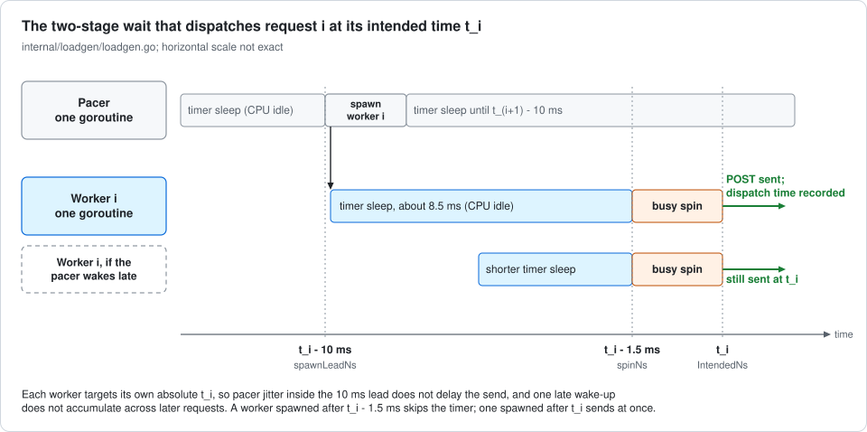
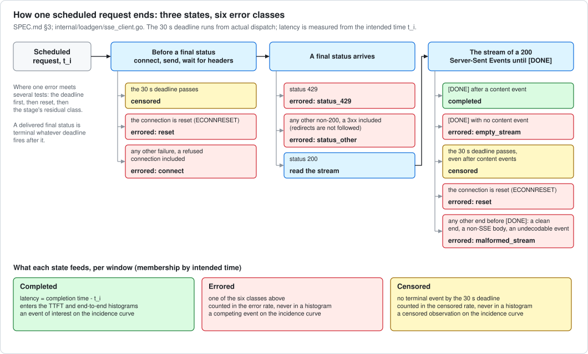
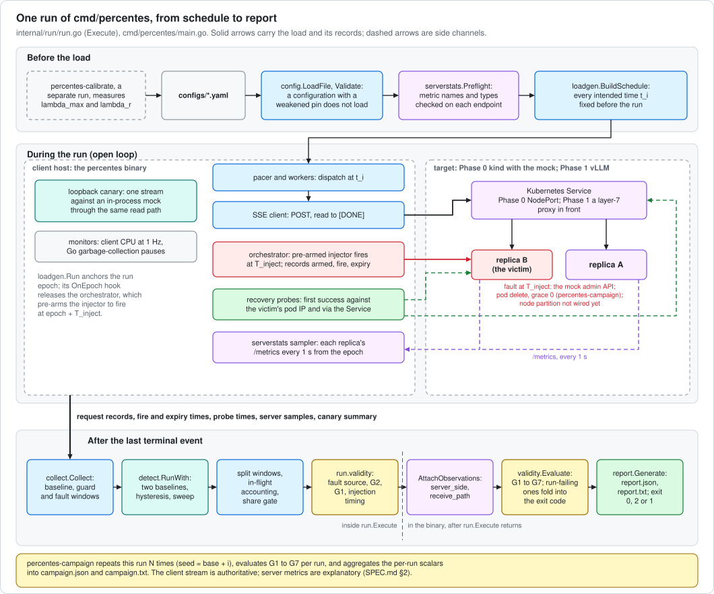
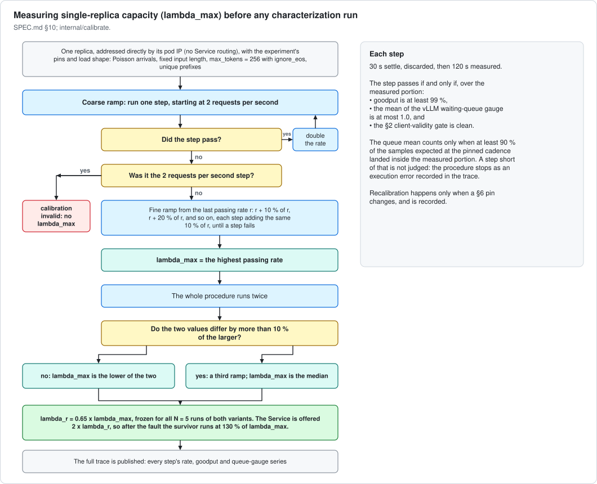
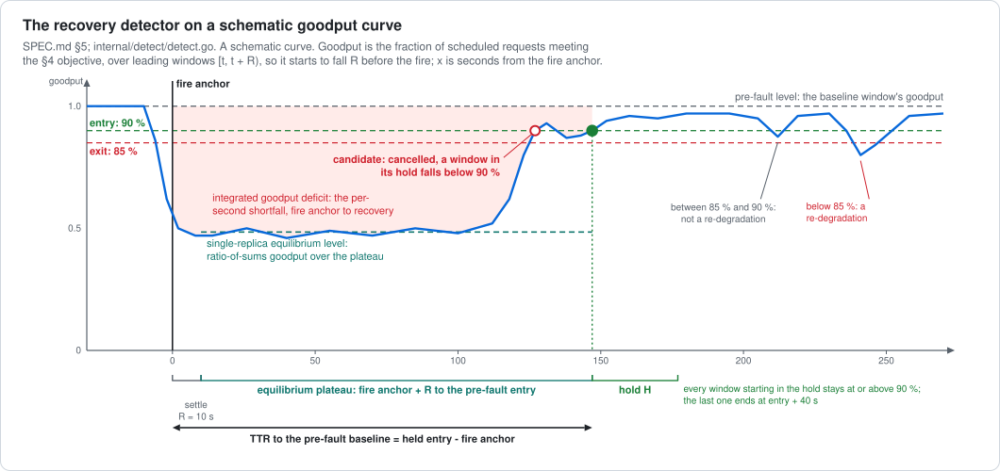
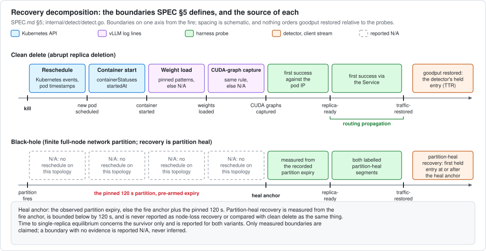

# Percentes architecture

Percentes drives open-loop load (each request sent at its scheduled time whether or not earlier ones have answered) at large language model (LLM) inference services and records what the client observes. It runs the replica-loss experiment of [SPEC.md](../SPEC.md), which is authoritative, and the managed-endpoint protocol of [SPEC-HOSTED.md](../SPEC-HOSTED.md), which is subordinate to it. A § number refers to SPEC.md unless it is prefixed SPEC-HOSTED.

Phase 0 runs against the mock and needs no GPU (graphics processing unit); Phase 1 runs against vLLM, the open-source inference server whose version §6 pins, and SPEC.md's status line records which Phase 1 runs are done. Under SPEC-HOSTED, a route is one provider, model identifier, endpoint, account tier and request shape, and a cell is one run of the route's ladder, the stepped series of request rates of SPEC-HOSTED §3.

- [Binaries](#binaries)
- [A run on the clock](#a-run-on-the-clock)
- [One request](#one-request)
- [Anatomy of a run](#anatomy-of-a-run)
- [Recovery detection](#recovery-detection)
- [Package map](#package-map)
- [Gates and where each bites](#gates-and-where-each-bites)
- [Server-side sampling and the receive path](#server-side-sampling-and-the-receive-path)
- [Fault modes](#fault-modes)
- [Hosted runs and the evidence files](#hosted-runs-and-the-evidence-files)
- [The release runner](#the-release-runner)
- [Tracing a published number back to raw records](#tracing-a-published-number-back-to-raw-records)
- [Changing things safely](#changing-things-safely)
- [Glossary](#glossary)

## Binaries

Packages are each binary's `internal/` imports from `go list`, less `internal/config`.

| Binary | What it does | Packages it drives | Exit codes |
|---|---|---|---|
| `cmd/percentes` | One self-hosted run: `report.json`, `report.txt`, `attempts.jsonl`. Refuses a hosted target, and through `run.CheckConfig` a pilot configuration or a literal `target.body`. `--replay DIR` re-renders the report pair of the release cell whose directory is DIR; `--check-release DIR` runs the completeness check on that directory | `run`, `loadgen`, `serverstats`, `validity`, `evidence`, `report`, `releasekey` | 0 run valid, replay identical or check passed; 2 a run-failing gate; 1 error, a refused target, a replay that differs or a refused check |
| `cmd/percentes-campaign` | N runs (`run.repetitions`) of one fault variant, gates per run, §7 aggregation into `campaign.json` and `campaign.txt`; `--dry-kill` makes one process kill with no load | `campaign`, `run`, `orchestrator`, `collect`, `detect`, `vllmlog`, `serverstats`, `validity`, `loadgen`, `redact`, `report` | 0 every run valid; 2 an invalid run or a halt (`--halt-after-invalid-run`, on by default for process kill); 1 error |
| `cmd/percentes-calibrate` | The §10 capacity calibration and the §5 reference step, rewriting `calibration.json` and `calibration.txt` after every step; `--check` validates a configuration and lists its placeholders | `calibrate`, `serverstats`, `redact`, `report` | 0 valid; 2 completed with no lambda_max (the measured single-replica capacity); 1 error |
| `cmd/percentes-pilot` | The descriptive pilot of hosted amendment 2 (HA2, a draft amendment in `SPEC-HOSTED-AMENDMENT-DRAFT.md`): `ledger` (`create`, `price`, `hosting`, `show`), `probe`, `dev`, `session`, `check-cpu` | `admission`, `probe`, `pilot`, `score`, `evidence`, `loadgen`, `collect`, `run`, `validity` | 0 done; 2 a client-invalid window or one that did not start, a probe blocked, the second window late, the development gate failed, or `check-cpu` found host CPU (central processing unit) unmeasured; 1 error |
| `cmd/percentes-release` | One release route per process, and the commands before and after its window ([The release runner](#the-release-runner)) | `admission`, `schedule`, `probe`, `pilot`, `evidence`, `report`, `releasekey`, `loadgen`, `mock`, `redact` | per subcommand, in [its table](#the-release-runner) |
| `cmd/mockserver` | The Phase 0 mock inference server from a run configuration's `mock` section; `--addr-file` writes the bound address | `mock` | 0 stopped by SIGINT or SIGTERM (the interrupt and termination signals); 1 error |
| `cmd/naivesweep` | A closed-loop sweep (each of a fixed number of workers sends its next request once its last one has answered) of an OpenAI-compatible endpoint, configured by `SWEEP_ENDPOINT`, `SWEEP_API_KEY` and `SWEEP_MODEL`; outside the instrument, with no client-validity gate and no ledger admission | `sse`, `redact` | 0 every request has a verdict; 1 configuration missing or invalid |

## A run on the clock

A self-hosted run has four phases, and every report window is cut from
them by intended dispatch time. You need this section to read any
`windows.*` field of a run report. A release cell replaces these phases
with the ladder's steps ([The ladder](#the-ladder)).

A run has four phases, whose ends `internal/loadgen/loadgen.go` sets from
the pinned durations: warm-up 60 s (discarded), baseline 300 s, the fault
phase, which is §1's degradation-and-recovery window with its 600 s
timeout, and cooldown 60 s. The load is identical throughout.

- **T_inject** is the configured fault instant, measured from the run
  epoch: the end of warm-up plus `fault.t_inject_offset_s`. The experiment
  profile sets the offset to 300 s, the end of the baseline phase, so
  T_inject is 360 s from the run epoch.
- **The fire anchor** is the earlier of T_inject and the recorded actual
  fire time (`collect.FireAnchorNs`). AC3 lets the fault fire up to 500 ms
  either side of T_inject. Times to recovery are measured from the fire
  anchor.

`run.Execute` builds the report windows. Every request belongs to the
window of its intended dispatch time, and each window is half-open,
[start, end).

| Window (report key) | Bounds | SPEC term |
|---|---|---|
| `baseline` | [warm-up end, fire anchor − 30 s) | baseline window (pre-fault) |
| `guard` | [fire anchor − 30 s, T_inject) | guard window |
| `fault` | [T_inject, end of the fault phase), which is T_inject + 600 s on the experiment profile | fault window |
| `fault_degraded` | [T_inject, recovery point), when the detector's recovery point falls inside the fault window | no separate term |
| `fault_recovered` | [recovery point, end of the fault phase), under the same condition | no separate term |
| `fault_survivor` | the fault window, restricted to requests served by the survivor replica, when baseline attribution names exactly one replica besides the victim | survivor cohort (§3) |

The recovery point is the pre-fault recovery, or partition-heal recovery
under the black-hole variant. No window covers the cooldown; the
detector's 1 s buckets still run to the end of the run. The guard window
exists because a request intended in the 30 s before the fire can still be
in flight when the fault fires, and counting it in the baseline would
charge a fault loss to the baseline.

The diagram's detector row is explained in [Recovery
detection](#recovery-detection).

## One request

Every request's send time is fixed before the run, a pacer and a worker
keep the send on time, and its ending is classed by the stage at which
it fails. You need this section to read any latency or outcome figure.

`loadgen.BuildSchedule` fixes every t_i before the run. The pacer spawns a
worker 10 ms before t_i, and the worker dispatches at t_i. The
server-sent events (SSE) client (`internal/loadgen/sse_client.go`, with the
framing in `internal/sse`) posts to the target's complete `endpoint_url`,
or to `base_url` plus `/v1/chat/completions` when no `endpoint_url` is
set, and reads the stream. The client timeout, the pinned 30 s or the
release profile's 90 s hard timeout, runs from the actual dispatch.

### Pacer timing

If one loop did the precise wait and the dispatch itself, a hiccup while
handling request i (a garbage-collection pause, a scheduler delay) would
delay request i and push every later request back with it. The generator
splits the work in two (`internal/loadgen/loadgen.go`):

1. **The pacer**, a loop in one goroutine (Go's lightweight thread), sleeps
   until t_i − 10 ms (`spawnLeadNs`), spawns the worker for request i, and
   moves straight on to request i + 1. It never does the precise wait.
2. **The worker** sleeps on its own timer (`gen.sleep`) until
   t_i − 1.5 ms (`spinNs`), then spins on the clock until it reaches t_i and
   dispatches. The timer keeps the spin short; the spin covers timer
   wake-up latency.

Each worker aims at its own absolute t_i, so pacer jitter inside the 10 ms
lead does not delay the send, and one late wake-up does not accumulate
across later requests. A worker spawned after t_i − 1.5 ms skips the timer,
and one spawned after t_i dispatches at once, its lateness recorded as send
skew, which the §2 client-validity gate bounds.

### From dispatch to outcome

The client stamps four moments:

- **dispatch:** send skew is dispatch time minus t_i;
- **the first content event:** time to first token (TTFT) is its time
  minus t_i;
- **each later content event:** the gap from the previous one;
- **the terminal event:** end-to-end (e2e) latency is the completion time
  minus t_i.

A content event is an SSE event whose decoded delta carries non-empty
content at the key `target.response_shape.content` names (`content` by
default). Keys the shape lists as reasoning are recorded apart and never
count as content. A target whose `adapter` is `messages` is read by the
Messages adapter instead of the response shape: `text_delta` text is
content, `thinking_delta` text is reasoning, `message_start` carries the
model and the first usage object, `message_delta` the stop reason and the
cumulative usage, an `error` event the in-band error object, and
`message_stop` ends the stream. Gaps between content events are inter-chunk latencies. On a
self-hosted or mock target the report calls them inter-token latency (ITL)
where the §10 check passes. A hosted target's gaps stay inter-chunk, and a
mock run without usage is labelled one token per content event by
construction ([token counts](#token-counts-and-the-itl-label)). A chunk carrying a usage object
supplies the completion token count.

The client classifies how each request ends into one of the three §3
states and, for an error, one of six classes, by the stage at which the
failure occurs. A stream is also classed `malformed_stream` when an event
or a line exceeds the 1 MiB bound the client reads with.

`collect.Collect` then, per window:

- assigns each request to the window of its intended time;
- records completed TTFT and e2e latencies into the pinned HdrHistogram
  (high-dynamic-range histogram) configuration through `RecordValue` only;
- adds every scheduled request to the window's incidence curve;
- counts error classes, error and censored rates, throughput, and goodput,
  the fraction of scheduled requests that complete within the §4
  service-level objective (SLO);
- runs the §4 threshold sweep and computes the content-event and
  usage-count distributions and the §7 tail confidence intervals (CIs).

`detect.BuildSeries` buckets the same records at 1 s for the detector.
Every latency, rate and detector figure is computed from these records.

## Anatomy of a run

`cmd/percentes` runs one experiment from setup to report in the order
below, and campaigns and calibration repeat that run. You need this
section to find where a step of a run happens.

The diagram follows one run of `cmd/percentes` from its setup to its report;
the sections below expand each part.

`run.Execute`, in code order:

1. `loadgen.Run` anchors the run epoch on the monotonic clock and fires the
   `OnEpoch` hook before it starts the pacer.
2. The hook releases the orchestrator, which pre-arms the injector to fire
   at epoch + T_inject with automatic expiry and records the armed, fire and
   expiry times. §1 requires pre-arming because a black-hole partition
   makes the victim unreachable the moment it fires. Each §5 recovery probe
   runs when `cmd/percentes` is given its uniform resource locator (URL):
   `--probe-direct` for replica-ready, `--probe-service` for
   traffic-restored. A probe starts at the planned fire and polls every
   500 ms until its first counted success or the end of the fault phase; a
   success counts only after the fault was visible on that path.
   `percentes-campaign` takes `--probe-direct`, required under the
   process-kill variant, and passes it to every run; it passes no service
   probe URL, so traffic-restored and routing propagation are N/A in its
   runs.
3. The load runs open loop through warm-up, baseline, the fault phase and
   cooldown. Monitors sample client central processing unit (CPU) use at
   1 Hz and the Go garbage-collection (GC) pause histogram for the §2 gate.
4. After the last terminal event:
   1. the phase windows are collected (baseline, guard, fault);
   2. the detector runs (`detect.RunWith`): two baselines, hysteresis, the
      27-row sensitivity sweep, integrated deficits, per-component recovery;
   3. the split windows are collected: `fault_survivor`, and
      `fault_degraded` and `fault_recovered` at the recovery point;
   4. in-flight-at-fire requests are classified by outcome and replica
      (`collect.AccountInFlight`), the share gate is computed from
      per-request replica attribution (`run.shareGate`), and the §4
      threshold analysis runs;
   5. the probe times fill the decomposition, and for a mock fault the
      scheduled fires are read back from `/admin/faults`;
   6. `run.validity` decides validity from the fault source, the
      client-validity gate (G2), the share gate (G1) and the injection
      timing.
5. `run.Execute` returns. The binary attaches the server samples and the
   canary streams (`AttachObservations` fills the top-level `server_side`
   and `receive_path` maps, keyed by window), evaluates G1 to G7
   (`validity.Evaluate`), renders the report pair (`report.Generate`), and
   exits 0, 2 or 1.

**Campaigns.** `percentes-campaign` runs N repetitions of one variant with
seed base + i. For a clean delete it resolves each run's victim and arms a
fresh injector that deletes the pod through kubectl on a named context:
with `--victim` it waits for that pod to be Ready, and with
`--victim-selector` for every replica to be Ready before it picks one. It
evaluates G1 to G7 per run and aggregates the per-run scalars under §7
(`campaign.Run`, `stats.Summarize`): all values, median, mean and a
t-interval whose degrees of freedom follow the contributing runs, with
heavy-tailed scalars led by the median and range. Each endpoint reports
how many runs were dropped and why. The black-hole variant is refused until
the node-partition injector is wired. The process-kill runner is described
under [Fault modes](#fault-modes).

**Calibration.** `percentes-calibrate` runs the §10 procedure against one
replica addressed directly: coarse and fine ramps, the two-ramp agreement
rule, lambda_r frozen at 0.65 lambda_max, and the §5 reference run at
2 × lambda_r. Every step is a §3 collection over its measured window, with
the queue-gauge series, the kept families' reductions and the §2
receive-path report; the trace is rewritten after every step. The binary
writes `calibration.json` and `calibration.txt`, and the values are then
entered in the configuration's `calibration` block.

## Recovery detection

The detector turns the goodput series into a time to recovery through
an entry threshold, a hold and an exit threshold. You need this section
to read the `detector` and `decomposition` fields of a self-hosted
report; hosted runs carry neither.

The detector (`internal/detect`) works on goodput over R = 10 s windows of
1 s buckets, keyed by intended dispatch time. The window at time t covers
[t, t + R), a leading window, so an entry time is the start of the good
service it describes, and the curve starts to fall R before the fire.

- **Entry and hold.** A candidate entry is a window at or above 90 % of the
  applicable baseline. It becomes recovery only if every window starting in
  the following H = 30 s also stays at or above 90 %; any window below 90 %
  cancels it (`canceled_entries`). The time to recovery (TTR) is the held
  entry's start minus the fire anchor.
- **Exit.** After recovery, a window below 85 % starts a re-degradation
  episode, which ends when a window is back at 90 % (`re_degradations`);
  the TTR stands.
- **Two baselines.** The pre-fault level is the baseline window's goodput
  from the collector. The single-replica equilibrium level is the
  ratio-of-sums goodput over the plateau, from fire anchor + R to the
  earlier of the pre-fault entry or the 600 s timeout, estimable only when
  that span is at least R and its goodput is above zero. Each baseline has
  its own TTR.
- **Unobserved.** A candidate whose hold runs past the end of the series is
  reported unobserved (`hold_unobserved`), which differs from not
  recovered, where no held entry starts before the timeout. A cut entry
  window counts as unobserved only when its missing seconds, each at the
  observed mean load and all of it good, could still lift it to 90 %.
- **Partition heal.** Under the black-hole variant the labelled recovery is
  the first held entry at or after the heal anchor: the observed partition
  expiry, else fire anchor + 120 s. The raw threshold crossing is reported
  beside it.
- **Sweep and deficit.** The sensitivity sweep runs entry 85, 90 and 95 %,
  R 5, 10 and 20 s, and H 15, 30 and 60 s, with exit fixed at 85 %: 27 rows.
  The integrated goodput deficit sums each second's shortfall below the
  baseline level, from the fire anchor to recovery, or to the timeout when
  there is none.
- **Components.** `ttft_slo`, `e2e_slo` and `error_rate` each get their own
  detection against their own pre-fault level. Backlog drain is reported
  unmeasured in every run; no code path measures it yet.

The decomposition (`detect.NewDecomposition`, filled in
`run.Execute`) reports each §5 boundary with its source. The probes supply
replica-ready and traffic-restored when they run, and the detector
supplies goodput restored. When `--victim` names the victim replica, the
traffic-restored probe counts only a success whose `X-Percentes-Replica`
header names that replica, a header only the mock sends; without
`--victim` it counts any success. Routing propagation is traffic-restored
minus replica-ready. No code path measures the Kubernetes API and log
boundaries yet (reschedule, container start, weight load, and the graph
capture of CUDA, NVIDIA's Compute Unified Device Architecture), so the
clean-delete and black-hole variants report them N/A. Under the
process-kill variant, container start comes from the container's
`StartedAt` in `docker inspect`, the vLLM startup boundaries and the
figures vLLM prints come from the server log (`internal/vllmlog`, patterns
pinned to vLLM 0.29.0), and reschedule, traffic-restored and routing
propagation are N/A. The code measures the probe segments from the fire in every variant; §5
measures the black-hole ones from the partition expiry, which lands with
the node-partition injector.

The figure shows the §5 boundaries of the two Kubernetes variants. Of
those, the code measures the probe and detector ones.

## Package map

Each Go package serves named SPEC clauses through the entry points the
table lists. You need this section to find the code behind a figure.

The diagram predates the hosted packages, which the table lists.

| Group | Package | Role | SPEC | Entry points | Tests |
|---|---|---|---|---|---|
| Configuration | `internal/config` | schema in YAML (YAML Ain't Markup Language), strict decode of a file holding one YAML document and only whitespace after its end marker, with no directive and no tag beyond the core types, the pins of each profile (`experiment`, `ac`, `pilot`, `release`) checked at load; the literal request body and its case slot; the release target's limits, unpublished-limit rulings, retained headers, not-applied parameters, naming record, documented statuses, errors and billing refusals, balance ruling and retention of model output, the other hosts of its model and the identifier its responses carry; each limit's marking, the retained headers and limits body a confidential limit requires, and the configuration as published with each confidential value withheld, and the forms of a value searched for in a text; the stand-in for a withheld in-band error object; the request-identifier header names a confidential route may publish; the body with its ceiling key set to another ceiling | §1 to §6, §8, §10; SPEC-HOSTED HA2 and HA3 | `LoadFile`, `Parse`, `Decode`, `Config.Validate`, `Config.Published`, `ValueForms`, `Carries`, `RetainedError`, `RequestIDHeader`, `Target.ExpectedModel`, `ReleaseBodyAt`, `CheckBaseURL`, `CheckLiteralBody`, `LiteralBody` | a mutation case per pin; refusal rows per profile |
| Load | `internal/loadgen` | schedule, pacer, SSE client with the Hypertext Transfer Protocol (HTTP) version 1.1 pin, outcome classification, per-request status, header, peer and protocol records, the credential header and literal body per target, the Messages stream adapter, retained header values kept apart from the record, the pilot and release tripwires, the release ladder with its drains and per-step verdicts, the dispatch and completion hooks, client gate, loopback canary | §2, §3; SPEC-HOSTED §3, §5, §9; HA3 points 2, 5, 15 and 16 | `BuildSchedule`, `BuildLadder`, `Run`, `NewTransport`, `StartCanary`, `SummarizeCanary`, `CPUMeasured` | request-body, stream-hardening, capture, ladder, hook and gate units; canary oracle; AC1 to AC2d |
| | `internal/sse` | SSE framing for the client, the recovery probes and naivesweep | §3 | `SplitLines`, `Events` | a unit per grammar case |
| | `internal/histo` | the pinned HdrHistogram wrapper; `RecordValue` only, and a test fails the suite if a correction API appears | §3 | `New`, `H.Record`, `H.Summarize` | the correction-API ban; AC1 oracles |
| | `internal/mock`, `cmd/mockserver` | OpenAI-compatible SSE mock: five scriptable fault modes and a slow-reload startup setting; the shaped hosted-provider form ([the mock's shaped form](#the-mocks-shaped-form)) | §2; SPEC-HOSTED §2, §5 | `New`, `NewShaped`, `Server.Start`, `/admin/faults` | a behaviour test per mode, including a raw Transmission Control Protocol (TCP) silent-hang test; a test per shape mode |
| Fault | `internal/orchestrator` | pre-armed fault execution with armed, fire and expiry records; mock-admin, clean-delete and process-kill injectors; container commands over SSH (Secure Shell) | §1, §2, AC3 | `Execute`, `NewMockInjector`, `NewCleanDeleteInjector`, `NewProcessKillInjector`, `SSHContainerOps` | AC3; fake-ops tests; a fake `ssh` on PATH |
| Server side | `internal/serverstats` | Prometheus sampler, per-window reductions, G7 baseline means | §2, §6, §10 | `ForRun`, `Sampler.Start`, `Sampler.Stop`, `Preflight`, `BaselineMeans`, `ReduceWindow` | test servers; window, reset and per-label-set oracles |
| Analysis | `internal/collect` | windows, incidence curves, in-flight accounting, threshold analysis, tail CIs, receive-path report | §3, §4, §7 | `Collect`, `EstimateIncidence`, `AccountInFlight`, `SplitAtFire`, `AnalyzeThresholds` | hand-computed incidence oracles; AC4, AC4b |
| | `internal/detect` | recovery detector, decomposition, recovery probes, /health calibration | §5 | `BuildSeries`, `RunWith`, `ProbeRecovery`, `CalibrateHealth`, `NewDecomposition` | synthetic-series units; AC5 |
| | `internal/vllmlog` | vLLM startup-log boundaries and printed figures, patterns pinned to vLLM 0.29.0, applied to the process-kill decomposition | §5 | `Parse`, `Apply`, `VLLM0290`, `Mock` | the 16 September 2026 vLLM start log as a byte-exact fixture |
| | `internal/validity` | the G1 to G7 run-validity gates | §10 | `Evaluate` | a unit per gate |
| | `internal/stats` | §7 statistics: values, median, mean, t-interval, coefficient of variation | §7 | `Summarize` | hand-computed oracles |
| Composition | `internal/run` | one run's artifacts; the profiles the single-run path refuses; a hosted run re-analysed from its records | §2; SPEC-HOSTED §9 | `Execute`, `CheckConfig`, `Replay` | the whole pipeline in process under the race detector |
| | `internal/campaign` | N runs, per-run scalars, endpoint summaries with drop counts, halt after an invalid run | §5, §7, §10 | `Run`, `RunWith` | fake-runner units |
| | `internal/calibrate` | the §10 ramps and the §5 reference | §10, §5 | `RunRamp`, `Calibrate`, `Reference`, `LoadRunner` | a capacity-model fake runner; one step against the mock |
| Output | `internal/report` | the report pairs for a run and a campaign; the hosted report without SLO fields; a hosted run's pair from its manifest and attempts file; the paired pilot report; the release cell report with G2 per step; the per-step tables with their intervals, finish-reason sub-lines, throughput, curves and quantile refusals, latency and token distributions, gap histograms and signals, the drift split of a frame, the window-close comparison, a route page's `model_mismatch` lines, and the index table | §2 to §5, §7; SPEC-HOSTED §4, §7 to §9, HA2 §8, HA3 points 8, 12, 13 and 16 | `Generate`, `GenerateCampaign`, `FromRun`, `WriteHostedPair`, `GeneratePilot`, `NewStepTables`, `NewIndex`, `DocsOf`, `CompareWindowClose` | renderer units; AC6 field assertions; byte-for-byte replay; hand-computed interval oracles; the forbidden-string test |
| | `internal/redact` | endpoint and error redaction for every published artifact and error string | §6 | `URL`, `ErrorText`, `Wrap` | leak tests across the packages that print |
| Hosted | `internal/probe` | the pre-run probe: Domain Name System (DNS) resolution, the Transport Layer Security (TLS) handshake, one request, the response shape, the start gate; the release ceiling check, a record's results re-derived from its requests, the ceiling choice across a model's hosts with a host left out on its records' reported-model fault, the values a probe record withholds, and the reported-model fault of a route's own records | SPEC-HOSTED §2, §5; HA3 points 7 and 15 | `Run`, `RunRelease`, `ReleaseRecord.Verify`, `ChooseCeiling`, `ModelFault`, `ReleaseRecord.Expected`, `LengthValue`, `Gate`, `Write`, `Retains`, `Exposed`, `ExposedByMarking`, `WriteRetained` | an httptest server per shape and failure |
| | `internal/admission` | the request and liability ledger, hash-chained, priced per token bound, bound to one open line once `Bind` is called; the release ceiling rule, and the check of a published verdict against the configuration's limits | SPEC-HOSTED HA2 §3; HA3 points 6 and 15 | `Create`, `Open`, `Ledger.Bind`, `Ledger.Admit`, `Ledger.AdmitAt`, `Ledger.Settle`, `CeilingRule`, `CheckPublished`, `State.Covers`, `State.ReservationUSD`, `State.PriceRevision` | chain, cap and settlement units |
| | `internal/evidence` | per-attempt records, the frame store, the clock, status, refresh and balance records with the balance check, the limits a refresh prints and the refresh record as published and as run, the window-close record, the operator file read again at each release cell's start, the manifest with the release cell record (the label, the aggregate dispatch series, the gap histograms, the per-step gates), the completeness check, the evidence pack, the release publication record and the publication page built from it | SPEC-HOSTED §4, §9; HA3 points 9, 13, 14, 15 and 16 | `Records`, `WriteRun`, `WriteRunFrames`, `ReadClock`, `ReadStatus`, `ReadBalance`, `CheckBalance`, `ReadRefreshedLimits`, `PublishedRefresh`, `ReadRetainedRefresh`, `ReadWindowClose`, `WindowClose.Verify`, `LoadOperator`, `Operator.Withhold`, `Operator.CheckConfidential`, `Operator.Refreshed`, `NewManifest`, `StepGaps`, `ReleaseG6`, `CheckRelease`, `BuildPack`, `ReadPack`, `PackCarries`, `LoadPublication`, `Publication.Check`, `Publication.Page` | round-trip, hash and refusal units |
| | `internal/pilot` | the synthetic ticket fixture, the pilot schedule, the Shape S tickets | SPEC-HOSTED HA2; HA3 point 7 | `Generate`, `NewSchedule`, `GenerateShapeS` | pinned hashes; determinism |
| | `internal/score` | the task scorer: the route contract and the ten outcome classes | SPEC-HOSTED HA2 §5 | `NewContract`, `NewScorer`, `Scorer.Score` | boundary, wrong-label and duplicate-key cases |
| | `internal/schedule` | a release's frame from one master seed: twelve cells per route, dates, attempt seeds, per-route offsets, the re-run bound, the committed file with each route's frozen configuration hashes (as published, and keyed as loaded) and host group, the ledger's open-line hash and its position (line count and the hash of its bytes) | SPEC-HOSTED §4; HA3 point 9 | `New`, `Load`, `Schedule.Runs`, `Schedule.Rerun`, `Schedule.Config` | a pinned derivation; window and refusal cases |
| | `internal/releasekey` | the release key ([The release key](#the-release-key)): 32 random bytes written once as lowercase hexadecimal to a new file readable by its owner only; the HMAC-SHA256 (a hash-based message authentication code built on SHA-256, the 256-bit Secure Hash Algorithm) under it of each configuration as loaded and, on a route with a confidential limit, of the withheld texts, the limit copies, the frame store, the operator file and its records; a key that prints as `[release key]` under every format verb and that `encoding/json` cannot write | SPEC-HOSTED §9; HA3 points 9 and 15 | `New`, `Create`, `Read`, `Key.Sum` | create and read refusals; formatting and JavaScript Object Notation (JSON) encoding expose no key bytes |
| Test support | `internal/hostqual` | the host qualification probe the timing-coupled tests run first | §2, §8 | `Measure`, `Observation.Qualify`, `Qualified`, `Allocation` | per-limit units |
| | `internal/ac` | the §8 acceptance suite; the mock runs as a separate process, so it never shares the generator's Go scheduler | §8 | | |

`detect.Run` wraps `RunWith` for a bare bucket series; the acceptance
suite calls it. `internal/stats` also implements the Holm step-down
correction for multiple comparisons, with tests; no campaign path calls it
yet.

| Path | Contents |
|---|---|
| `deploy/kind/` | the cluster configuration (one node, image pinned by digest, host port 18000 mapped to NodePort 30800); `smoke.sh`; `reproduce.sh`, the AC7 one-command run; `campaign-e2e.sh` |
| `deploy/mock/` | the two-replica mock Deployment and its NodePort Service; a readiness probe on `/health` and no liveness probe, so silent_hang can hold `/health` silent |
| `deploy/process-kill-e2e.sh` | the process-kill end-to-end: the mock in a Docker container under `--restart on-failure`, one dry kill and a two-run campaign that kill and restart it, and a check of the dry-kill record and the run files |
| `deploy/phase1/` | the vLLM topology manifest, which does not deploy until its PIN-AT-PHASE1 placeholders are filled; capture scripts for the host fingerprint, the GPU sample series and the server log |
| `configs/` | every runnable configuration; one file drives both the cluster ConfigMap and the host runner; `pilot.reference.yaml` and `release.reference.yaml` are the pilot and release profiles' reference files; `embed.go` builds `release.reference.yaml` into `percentes-release` for `rehearse` |

## Gates and where each bites

Every check that can refuse a configuration, end a run or label a cell
carries a pinned number and one enforcing function. You need this
section when a run exits 2 or a cell does not count.

| Check | Pinned numbers | When | Consequence | Enforced in |
|---|---|---|---|---|
| Configuration pins | SPEC numbers from §1 to §5, §8 and §10 as equalities or bounds; §6 environment values as required fields | configuration load | the configuration does not load | `config.Validate` |
| Metric preflight | the queue gauge, every kept family and the TTFT histogram's type, read on each endpoint | before the load | the binary exits before any dispatch | `serverstats.Preflight` |
| G2: send skew | 99th percentile (p99) ≤ 5 ms and max ≤ 50 ms, compared in nanoseconds | judged after the run | run invalid | `loadgen.evaluateGates`, `run.validity` |
| G2: undispatched | zero scheduled requests never dispatched | judged after the run | run invalid | same |
| G2: client CPU | ≤ 70 % over any 5 s window | judged after the run | run invalid; unmeasured counts as failed | same |
| G2: GC pause | p99 < 1 ms, on the upper edge of the runtime histogram bucket that holds it | judged after the run | run invalid; a p99 in the runtime's open last bucket fails | same |
| Fault source | an armed injector, or the mock's scheduled fires read back | after the run | run invalid | `run.validity` |
| Injection timing (AC3) | fire within 500 ms of T_inject | after the run | run invalid | `run.validity` |
| G1: share (§1) | 45 to 55 % per replica over the baseline window | after the run | run invalid under a per-request (layer-7) dataplane, descriptive under per-connection routing; a replica count other than the declared one, or no attributed baseline request, fails in either regime; not applicable to a one-replica target | `run.shareGate`, `config.BalancesPerRequest` |
| G3, G4 (black-hole only) | zero errored victim in-flight requests; staleness window ≥ 20 s with victim-bound traffic | per-run evaluation | a failed or unobserved gate strips the node-loss-representative label, and the run stays valid | `validity.Evaluate` |
| G5 | GPU clock and power fingerprints equal across replicas and runs | per-run evaluation | not applicable until the capture output is wired | `validity.Evaluate` |
| G6 | baseline goodput ≥ 0.99 | per-run evaluation | run invalid | `validity.Evaluate` |
| G7 | per-replica waiting-queue mean ≤ 1.0 over the baseline window, with ≥ 90 % of the expected samples | per-run evaluation | run invalid; not applicable without `target.metrics_urls` | `validity.Evaluate` |

`percentes` and `percentes-campaign` fold run-invalidating gate failures
into exit code 2; `run.Execute` has already recorded G1 and G2. An
applicable gate that goes unobserved fails. `make bins`, `reproduce.sh` and
`campaign-e2e.sh` build with `CGO_ENABLED=0` (cgo, Go's C interoperability,
disabled), and on macOS that leaves the client CPU gate unmeasured, so such
a run exits 2; Linux measures CPU from `/proc`. The fault-source and
injection-timing checks sit outside SPEC's G1 to G7 list and invalidate a
run in the code.

**Hosted targets.** Only G2 and G6 are evaluated. Hosted G6 is completion
within the 30 s timeout, computed over the baseline, guard and fault
windows and reported without invalidating the run; §10 defines G6 over the
baseline window. Under the release profile, hosted G6 is completion
within the 30 s deadline over each ladder step's scheduled requests, and
the cell's manifest carries it per attempted step beside G2 per step,
and G2 over the whole ladder where no stop interrupted it
(`evidence.ReleaseG6`, `validity.ReleaseG6`).
The cell's text report prints a G2 line and the hosted G6 lines per
attempted step, and a G2 failure is also named by the cell's label. The
request body the client generates omits `ignore_eos`
and asks for no usage object; a target with a literal `body` sends that
body instead ([Hosted runs](#hosted-runs-and-the-evidence-files)). The key
is read at run start from a file given with `--env`, as the value of the
variable `target.api_key_env` names, and sent in the one header
`target.auth_header` selects: `authorization_bearer` (the default) sends
`Authorization: Bearer` and the key, and `x-api-key` or `api-key` sends
the key alone in the `X-Api-Key` or `Api-Key` header. The key is
never recorded, and every recorded header, body and error string is
masked for it.

**Release cells.** A release route carries these checks beside G2 and
hosted-G6 ([The release runner](#the-release-runner)):

| Check | Pinned numbers | When | Consequence | Enforced in |
|---|---|---|---|---|
| Ceiling rule | each step's nominal demand at most half of every recorded rate, token, concurrency, daily and spend-window limit; the monthly cap and the route's ledger cap cover the twelve cells, re-runs and probes; the auto-reload threshold covers the costliest cell | route start | a step is excluded with its binding limit named; a route with no admitted step refuses to start | `admission.CeilingRule`, `newRoute` |
| Open-file limit | soft limit at least 65,536 | route start | refusal to start | `checkOpenFiles` |
| Balance command | one is given and parses | route start | refusal to start; a release manifest without its start balance record is refused | `ParseBalanceCommand`, `evidence.NewManifest` |
| Frozen inputs | the schedule froze this route's configuration as published and this ledger by their SHA-256 (256-bit Secure Hash Algorithm) hashes, the configuration as loaded by its HMAC-SHA256 under the release key `--release-key` names, the route's host group and the ledger's position; at route start the ledger still holds the frozen lines up to that position, and at each cell it still has the frozen open line, its first | route start; each cell's ledger reads | refusal to start; at a cell, the cell is labelled interrupted and `run` exits 1 | `checkFrozen`, `checkLedger`, `frozenEntries`, `Ledger.Bind`, `ledgerEntries` |
| Ceiling records | one record per host of the route's model at 512, and at 1,024 when any host failed at 512, each bound to the request it checked and naming in `ledger_sha256` the ledger the schedule froze, with its results re-derived from its requests; another host's records are also judged against that host's configuration as the schedule froze it (`--host-config`); another host whose records carry a reported-model fault is left out of the choice, and its records are then neither required at a ceiling nor checked for the start gate or the input bound | route start | refusal to start | `hostTargets`, `readCeilingProbes`, `ReleaseRecord.Verify`, `probe.ChooseCeiling` |
| Reported model at the check | the route's own ceiling-check records expect the configuration's expected identifier and report no other, and some response reported a recorded `target.reported_model` | the ceiling check; route start | `ceiling-check` prints a `REFUSED` line and exits 2 where its record reports an identifier with such a fault; `run` refuses to start | `modelRefusal`, `readCeilingProbes`, `probe.ModelFault` |
| Ledger prices | the ledger's highest price at the cell bounds and at the ceiling-check bounds covers the ceiling rule's verdict | route start | refusal to start | `State.Covers` |
| Clock offset | at most 60 s | cell start | the route stops; the cell is retained and labelled | `runCell` |
| Refresh | the refresh command exits 0 within 30 s, the operator file loads, holds no confidential limit's value and covers the build, and every limits and eligibility record's file was rewritten after the command started | cell start | the cell is blocked before admission: no ledger line, no request | `cellOperator`, `Operator.CheckConfidential`, `Operator.Refreshed` |
| Limits read | the refresh command prints one entry per recorded limit, its value or why it is unavailable; the ceiling rule with those values, at the route's newest recorded price, still admits every step the route runs | cell start | output that does not parse blocks the cell as a refresh fault does; limits that no longer admit a step stop the route before admission | `evidence.ReadRefreshedLimits`, `limitsStop` |
| Balance check | the balance command prints `{"amount_usd": "<decimal>"}` at or above the cell's reservation, or `{"unavailable": "<reason>"}` under a `target.balance_unavailable` ruling | cell start | the cell is blocked before admission | `evidence.CheckBalance`, `BalanceCheck.Blocks` |
| Ledger admission | the route and global liability caps of the configuration, at the route's price revision in the cell's ledger read | cell start | a cap refusal stops the route; a later price line for the route repeats the limits and balance checks once, and a second blocks the cell | `Ledger.AdmitAt` |
| Probe gate | a 400, 401, 403 or 404, or an operator-set limit status | cell start | the cell is blocked before its ladder | `probe.Gate` |
| Credential or account fault | a probe 401 or 403 that the route's previous cell to send a probe also saw, on its probe or inside its ladder | cell start | the route stops; the cell is retained and labelled | `authFault` |
| Documented billing refusal | the status and body string `target.billing_refusals` records; at the probe of a route with a confidential limit, the string is looked for in the withheld body | the probe, or any request | the route stops | `billingRefusal`, `Hooks.OnDone` |
| G2 per step | the §2 numbers over the step's measured window | each drain's end | the ladder ends; the cell is client-invalid | `loadgen.runLadder`, `stepEnd` |
| Tripwires | a send beyond the step's scheduled count; requests in flight above 2 × the step's rate × the 90 s hard timeout | each drain's end | the ladder ends; the cell is client-invalid | same |
| Backoff rule | a status_429 fraction above 0.5 of the step's scheduled requests | each drain's end | the ladder ends; the cell counts | same |
| EMFILE | any request failing for want of a file descriptor | during the ladder | the ladder ends; the cell is client-invalid | `isEMFILE` |
| Reported model per response | every response that names a model names the expected one | the ladder | the cell is labelled `model_mismatch`, kept out of the frame, listed on the route's page and re-run | `cellOutcome` |

**Timing-coupled tests.** Before each timing-coupled acceptance test,
`internal/hostqual` probes the host against limits set in
`hostqual.Allocation` from the §2 budget: timer wake lateness p99 ≤ 1 ms,
plus 1 ms on Linux, where Go's poller waits in whole milliseconds, and
max ≤ 10 ms, and a GC pause p99 bucket edge of at most 1 ms. A test
skips only on a host that fails the probe, and re-probes after a failed
timing assertion before it fails. `make test-ac` fails on any skip unless
`PERCENTES_AC_ALLOW_SKIPS=1`.

## Server-side sampling and the receive path

The client samples the server's metrics endpoints every second and
checks its own receive path twice per window. You need this section
for the `server_side` and `receive_path` fields. A hosted target exposes
no metrics endpoint to the instrument, so only the loopback canary
applies to it.

### The sampler

`target.metrics_urls` names one Prometheus endpoint per replica (keyed r0,
r1 in order), each sampled every 1 s from the run epoch.
`target.queue_gauge` (`vllm:num_requests_waiting` on vLLM,
`percentes_mock_requests_waiting` on the mock) feeds G7: the per-replica
mean over the baseline window, with coverage of at least 90 % of the
expected samples. The kind campaign sets no `metrics_urls`, since each
pod's endpoint needs its own address behind the one NodePort Service.

`target.metrics_families` names the families kept on every sample. The
top-level `server_side` map reduces them per window and replica:

| Family type | Per-window value |
|---|---|
| gauge, untyped | the mean over the samples inside the window |
| counter | the increase, measured per label set from its last sample before the window (or its first inside) to its last inside, summed over label sets |
| histogram | the increase in count, sum and buckets by the same rule, the +Inf bucket left out |

A label set missing from a sample adds nothing there, and one first seen
inside the window adds its whole value. A label set that falls, or a
histogram whose bucket layout changes, is marked as a reset and
contributes its later value; after a layout change no buckets are
reported. A non-finite value, or a sum over label sets that overflows, is
an error counted in `family_errors`. The run report keeps the sample series
under `server_samples`.

### The receive-path checks

The two §2 checks are reported per window in the top-level `receive_path`
map, and neither fails a run:

- the client-side TTFT mean over completed requests, against the mean of
  the server's TTFT histogram (`target.ttft_histogram`) over the same
  window, pooled across replicas; the difference also holds the network
  round trip and any difference in where the server starts its clock;
- the loopback canary, one stream against an in-process mock with fixed
  timing through the same read path: its event lag p99 and max bound the
  host's read-loop lag, with the first-token and per-gap deviations beside
  them.

A window restricted to one replica carries no receive-path report.
`percentes-calibrate` takes the same settings as `--families` and
`--ttft-histogram`.

### Token counts and the ITL label

A self-hosted or mock request asks for the usage object
(`stream_options.include_usage`); the hosted body the client generates
does not, and a literal body carries whatever it says. The client
records the completion token count from a usage object at the path
`target.response_shape.usage` names (`usage` by default) that carries a
completion count, beside its own content-event count; a count the stream
does not carry is absent, and an explicit 0 is a count. Each window
reports both counts as distributions (`content_events`,
`completion_tokens`) and the §10 check over the completed requests that
carried a completion count (`token_check`: sampled and matched).

| Case | Pooled ITL label in `report.txt` |
|---|---|
| hosted target | inter-chunk, with the counts when the stream carried usage |
| usage sampled, every request matched | inter-token, with the counts |
| usage sampled, a mismatch | inter-chunk, with the counts |
| mock, no usage in the stream | one token per content event by construction |
| any other target with no usage | inter-chunk |

## Fault modes

| §2 name | Configuration | Mock behaviour | Expected signature |
|---|---|---|---|
| stall | `stall` | server-wide emission freeze, staggered flush on expiry | completions delayed into p99.9 and max (AC2, AC2b) |
| error | `error` | 500 on new requests; in-flight streams untouched | an error-rate step and a detector TTR |
| throttle | `throttle` | 429 on new requests | `status_429` in the fault window only |
| stream-abort | `stream_abort` | a TCP (Transmission Control Protocol) reset (RST) of in-flight streams, closing with `SO_LINGER=0` | in-flight requests errored as `reset` (AC4) |
| silent-hang | `silent_hang` | sends nothing more on hijacked connections and holds them open | censored at the timeout, on the curve (AC4b) |
| slow reload | `mock.slow_reload` | 503 for a set time after start | the `replica_ready` boundary |

The first five are scheduled in `mock.fault_schedule` or armed through `/admin/faults` (`internal/mock/faults.go`, `internal/mock/server.go`); slow reload is a start-up setting.

**Process kill** (`cmd/percentes-campaign/processkill.go`, `internal/orchestrator/processkill.go`):

1. Before each run:
   1. wait until the container runs, `/health` returns 200 and one streamed inference succeeds;
   2. read the container's process ID (PID), start time, restart policy and restart count with `docker inspect`;
   3. check the restart policy and container name against `pins.container` (`pinReasons`), and that the container did not restart since the last run;
   4. write the before fingerprint;
   5. measure the host clock's offset (`SSHContainerOps.ClockOffset`).
2. At T_inject, `ProcessKillInjector` checks the PID still belongs to the container and sends SIGKILL through `SSHContainerOps.KillInit`; the recorded fire is the midpoint of the host-clock bracket around the kill, converted by the offset (`observedFire`).
3. Docker's restart policy (`PinnedContainerRestartPolicy`, `on-failure`) starts the same container.
4. After the run, check the restart count advanced by exactly one, read the `die` and `start` events, the server log (`vllmlog.Parse`, `vllmlog.Apply`) and the after fingerprint; `collect.SplitAtFire` separates requests indeterminate at the fire, and the `outage` window is collected. Any failed check or read makes the run invalid.

Commands run over SSH on `--ssh-target`, or locally when it is empty; a local kill runs through `sudo` or, with `--kill-via docker-helper`, a privileged helper container (Docker on macOS). `deploy/process-kill-e2e.sh` (`make process-kill-e2e`) kills the mock container once with `--dry-kill` and again in a two-run campaign.

## Hosted runs and the evidence files

A hosted target (`target.hosted`) is a managed provider endpoint, driven by `cmd/percentes-pilot` and `cmd/percentes-release`; each request is admitted in the admission ledger before its send. The key is read from the file `--env` names (`NAME=value` lines, owner-readable only), as the variable `target.api_key_env` names, and is masked out of every recorded header, body and error string.

| File | Writer | Content | Published or retained |
|---|---|---|---|
| `attempts.jsonl` | `evidence.WriteRun` through `evidence.Records` | one record per scheduled request in index order: times, outcome, class, status, allowed headers, usage, `finish_reason`, `reported_model`, `stream_error`, and `err_text` in the form `redact.ErrorText` gives (table below). Under the release profile `shape`, `ceiling_tokens`, `step`, `warmup`, `in_time`, `late`, `wrote_request_ns`, `write_denied`, `billing_refusal`, `reasoning_tokens` and no answer text | published |
| `frames.jsonl` | `evidence.WriteRunFrames` | every read of a 200 body with its time, up to `frameLimit` (8 MiB) per request, and the first `errorBodyLimit` (4,096) bytes of a non-200 body. Retained header values. Only byte counts (`dropped_bytes`) where `target.retention.model_output` is `none`. The in-band error text and the error body's code and status that `attempts.jsonl` withholds where the route has a confidential limit | retained under `--frames` |
| `clock.json` | `evidence.ReadClock`, `evidence.WriteClock` | the clock-sync command (`sntp` or `chronyc tracking`), its output, the parsed offset and its flag | published |
| `status-start.json`, `status-end.json` | `evidence.ReadStatus`, `evidence.WriteStatus` | the operator's endpoint-status command, output verbatim | published |
| `refresh.json` | `evidence.PublishedRefresh`; as run, `evidence.WriteRetainedRefresh` | release cells: the run of the refresh command (`deploy/release/`) and the limits it printed, each confidential limit without its value. Where the route has a confidential limit (`config.Target.Confidential`), `[retained]` in place of standard output, standard error and each limit's `unavailable` reason | published; where the route has a confidential limit, the record as run is retained beside the cell's frames |
| `balance-start.json`, `balance-end.json` | `evidence.ReadBalance`, `evidence.CheckBalance`, `evidence.WriteStatus` | release cells: the balance command; the start record's `check` (`sufficient`, `insufficient`, `unavailable`, `check_failed`) | published |
| `probe.json` | `probe.Write` (pilot window); `probe.Encode` and `replaceFile` (release cell) | the probe exchange, response shape, findings, start decision and reported prompt and output counts | published |
| `probe-retained.json` | `probe.WriteRetained` | what a probe or ceiling-check record withholds: retained header values, a withheld limits body, and each non-200 body and in-band error where the route has a confidential limit | retained |
| `manifest.json` | `evidence.NewManifest` | build revision, configuration hash, endpoint as configured and observed, operator records, ledger hash, every artifact by `sha256` and `bytes` or by `hmac_sha256`, validity, gates, and the release cell record | published |
| `operator.json`, `records/` | `Operator.WriteCopies` | the operator file and records as read | retained beside the frames |
| `config.yaml` | `evidence.WriteConfigCopy` | release, route with a confidential limit: the configuration as loaded | retained, owner-readable |
| `operator-error.txt` | `evidence.WriteOperatorError` | route with a confidential limit: an operator or refresh error that can quote retained text | retained |
| `window-close.json` | `windowClose`, `evidence.NewWindowClose` | per release route after its last cell: the refresh record as published, the tier, and the operator file and records read after it | published; copies under `--frames` in `window-close/<route>/<UTC time>/`, where `<UTC time>` is the record's time in UTC (Coordinated Universal Time), written as the date YYYYMMDD, the letter T, the time HHMMSS to nine decimal places of a second, and the letter Z |

`redact.ErrorText` gives the text of a transport or stream error, in `attempts.jsonl` (`err_text`) and in the probe and ceiling-check records. The first row that matches applies, so a dial or read timeout carried by a `*net.OpError` prints that error's text.

| Error | Text |
|---|---|
| a network error (`*net.OpError`) | its text, without its own source address or that of a wrapped network error that names both ends |
| a certificate that does not verify | its text |
| a deadline or a network timeout | `timed out after <timeout>`, with `<timeout>` the timeout its caller gives |
| a cancellation | `cancelled` (`redact.Cancelled`) |
| an end of input | `connection closed` |
| any other error | its Go type and `, text withheld` |

**The operator file** (`--operator`, `evidence.LoadOperator`) names the provider, the account tier, the client host and one record of each required kind; `LoadOperator` hashes every record before the run. `evidence.CheckSource` refuses a build with no version-control revision, and a modified tree without a `source_diff` record.

On a release route with a confidential limit, `Operator.CheckConfidential` refuses an operator file whose path or text fields carry the value of a confidential limit, the configured one or the one the refresh command read (`Operator.Withhold`). The fields searched are the provider, client host, cell and roles, and each record's path, note and URL (Uniform Resource Locator). It searches each form `config.ValueForms` gives, skipping a form that lies within an identifier the provider fixes (`config.CarriesOutside` over `config.FixedIdentifiers`).

**The admission ledger** (`--ledger`, `internal/admission/ledger.go`) is one append-only JSON Lines (JSONL, one JavaScript Object Notation object per line) file. Each line carries its sequence number and the SHA-256 of every byte before it; `admission.Parse` checks the chain on every read and append, and a chain that does not check admits nothing. An admission reserves its requests at the route's highest recorded price for their token bounds, and is settled with the count sent.

The pilot's caps are `PilotCaps`: `PilotRouteRequestCap` (1,024), `PilotTotalRequestCap` (2,048) and `PilotLiabilityCapUSD` (US$40).

### A hosted run, in order

1. **Admission, status and clock.** A pilot window is admitted in the ledger, then `--status-cmd` and `--clock-sync` run; an offset above `PinnedClockOffsetMaxS` (60 s), or no reading, makes the window client-invalid. A release cell runs its clock, status, refresh and balance commands before its admission; there the offset stops the route and a missing reading blocks the cell ([A cell, in order](#a-cell-in-order)).
2. **Probe** (`probe.Run`, SPEC-HOSTED §5): DNS (Domain Name System) resolution, the TLS handshake and one request; a 400, 401, 403 or 404, or a status in `target.probe.account_limit_statuses`, blocks the start (`probe.Gate`).
3. **Load** through `loadgen.Run` with the canary; one case text per request through `Hooks.Cases`. A pilot window's tripwires (`newTripwire`) record a send beyond the schedule and a fifth request in flight (`PinnedPilotInFlightTripwire`, 4); a fired tripwire makes the window client-invalid without stopping it.
4. **After the last terminal event:** the end status, the frame store, `attempts.jsonl` and `manifest.json`. A release cell writes its report pair through `report.WriteHostedPair` before the manifest that names it.

### The pilot

`cmd/percentes-pilot` runs the pilot profile, whose constants are in `internal/config/config.go` and enforced in `internal/config/pilot.go`: two targets (`PinnedPilotTargets`), one request every 10 s (`PinnedPilotRateRPS`), a 60 s warm-up, a 1,200 s window, a 4,096-token ceiling and the 30 s timeout.

| Part | Code |
|---|---|
| Cases: 120 measured and 24 development synthetic tickets, labelled `billing`, `technical`, `account` or `escalation` | `pilot.Generate` (`internal/pilot/tickets.go`) |
| Scorer: one JSON object whose one key is `route`; ten task outcomes | `score.NewScorer`, `Scorer.Score` |
| `probe`, `dev` (the development gate), `session` | `cmd/percentes-pilot/probe.go`, `dev.go`, `session.go` |
| Session schedule from a master seed, re-derived and compared | `pilot.NewSchedule` |
| Paired pilot report | `report.GeneratePilot`; no command calls it |

### Replay and the completeness check

In the commands below, DIR is a cell's directory, FILE after `--config` the configuration as loaded, OUT an output directory other than DIR, whose report pair is overwritten, ROOT the `--frames` root and KEY the release key file.

| Command | Calls | Checks |
|---|---|---|
| `percentes --replay DIR --config FILE --out OUT` | `report.FromRun` | renders the pair from `manifest.json`, `attempts.jsonl` and the configuration, checks hashes, invalid reasons, G6, per-step G2 (`stepG2`), canary summaries (`stepCanary`) and the ceiling-rule verdict (`admission.CheckPublished`); exits 1 unless both files match the manifest byte for byte |
| `percentes --check-release DIR --config FILE --frames ROOT [--release-key KEY]` | `evidence.CheckRelease` | the cell's files and records against its manifest (list below), naming every problem it finds |

`evidence.CheckRelease` checks these:

- a build revision in the manifest, and a source diff named where the build's tree was modified;
- the recorded hash and size, or keyed hash (`readRef`), of each file the manifest names in DIR: `artifacts` and the clock, status and balance records, though not the ceiling-check record copies that the manifest's `release` record names in `probes`;
- for a release cell, the label against its gates, the ceiling-rule verdict (`admission.CheckPublished`), and each attempt's shape and ceiling, with its connection and write times in order after its dispatch (`recordProblems`);
- for a release cell, the dispatch series, gap histograms, canary, balance records, no answer text, and the expected and reported models;
- the same hashes of the files in the cell's frame directory under ROOT: the frame store, the operator file copy, the record copies and the source diff;
- where the configuration given differs from its published form, the retained `config.yaml` beside the frames, which must hold the configuration given byte for byte.

Both commands compare the manifest's configuration hash with that of `Config.Published` for the configuration given. Neither applies to a pilot window, whose manifest names no report pair.

### The mock's shaped form

`mock.NewShaped` serves a hosted provider's stream form for the hosted tests and the rehearsal; `cmd/mockserver` builds the Phase 0 form only. A `Shape` (`internal/mock/shape.go`) sets reasoning chunks, the answer in four-rune content chunks, the finish reason, the usage chunk, an in-band error, an unknown key, a cut body and the one credential header the key must arrive in. With `Messages` set it serves the Messages stream (`internal/mock/messages.go`).

## The release runner

`cmd/percentes-release` runs one route as one process (SPEC-HOSTED §1 to §9). A release's routes run concurrently on one client host at their own offsets, under one `--out` directory.

| Subcommand | What it does | Code | Exit codes |
|---|---|---|---|
| `key create`, `key sum` | write the release key; print each file's HMAC-SHA256 under it | `key.go`, `keyCmd` | 0; 1 |
| `ledger create`, `ledger price` | start the admission ledger with the routes' caps; record a route's prices for its cells and ceiling check | `ledger.go`, `ledgerCmd` | 0; 1 |
| `ceiling-check` | send a route's ceiling check and write its record; `--recover` settles unsettled checks, `--record FILE` installs a record printed on standard error | `ceiling.go`, `ceilingCheckCmd` | 0 the check and its input and output bounds passed and `run` accepts the reported model, or `--recover` settled or installed a record. 2 the check or a bound failed, its record's outcome is `refused` or `stopped`, its start gate blocked it, or it carries a model fault. 1 the command refused to start ([its table](#before-the-first-cell)), a record could not be written, or the ledger did not settle the admission |
| `schedule` | write the committed schedule of the given routes | `schedule.go`, `scheduleCmd` | 0; 1 |
| `public-config` | write a route's configuration as published | `public.go`, `publicConfigCmd` | 0; 1 |
| `run` | run one route's cells over the committed window | `route.go`, `runCmd` | 0 every cell counts; 4 a cell does not count; 3 the route stopped, or a stop is unacknowledged; 5 SIGTERM with no stop; 1 a refusal to start, or an execution error after it |
| `dispatch` | sum every cell's dispatch series under `--out` | `dispatch.go`, `dispatchCmd` | 0; 1 |
| `pages` | write the index page and each route's page; with `--cell-files`, each route page names each cell's archive | `pages.go`, `pagesCmd` | 0; 1 |
| `pack` | write a route's evidence pack, its pages built at the `--cell-files` address given | `pack.go`, `packCmd` | 0; 1 |
| `publish-check` | check the release publication record against the pages and packs it builds at the `--cell-files` address given; `--write-page` writes the publication page | `publish.go`, `publishCheckCmd` | 0 the record is complete and the publication page under `--pages` is the one it gives; 2 either is not; 1 |
| `rehearse` | run the five-step rehearsal against mock routes | `rehearse.go`, `rehearseCmd` | 0 green; 2 not; 1 |
| `check-cpu` | report whether this build measures host CPU | `main.go`, `checkCPUCmd` | 0 measured; 2 not |

Exit codes are the constants in `cmd/percentes-release/main.go` (`exitOK` to `exitTerminated`). Any command exits 2 on a Go panic or a fatal runtime error. SIGINT and SIGHUP (the hang-up signal) cancel the context of `ceiling-check`, `run` and `rehearse` with `loadgen.ErrOperatorAbort` (`operatorContext`); SIGTERM cancels it with `errTerminated` for `run` and as an operator abort for the other two. The other commands take no context, and the three signals do not stop them: each runs to completion.

Once started, `run` exits 1 on an execution error in `route.loop`. The next start does this:

| Execution error | Next start |
|---|---|
| an error inside a cell (`runCell`) | the cell is labelled `interrupted`, except a stopped cell, which keeps its label and makes `run` exit 3 (`cellEnded`), and a cell whose evidence was written (`retain`) and whose ledger settlement alone failed, which keeps its outcome; `route.state` resumes from the cell records |
| a failed label, wait or read of the cell records | `route.state` resumes from the cell records |
| a refresh fault at the window close (`windowClose`) | no window-close record was written, so the window close runs again |
| the ledger's open line changed (`readLedger`) | the cell is labelled `interrupted`; `checkLedger` refuses to start until the ledger the schedule froze is back |
| a cell record written under another schedule file (`scheduleOf`) | `sameSchedule` refuses to start |

### The release profile

`internal/config/release.go` refuses a release file outside these values:

| Field | Value | Constant or file |
|---|---|---|
| `release.ladder.step_fractions` | 0.25, 0.50, 0.75, 0.90 and 1.00 of the binding rate, the rate the binding-rate rule (`admission.Solve`) solves for the route | `PinnedReleaseStepFractions` |
| `release.ladder.warmup_s`, `step_s`, `drain_s` | 60 s, 240 s, 90 s; the drain follows each step's measured window, with nothing scheduled, while that step's requests end | `PinnedReleaseWarmupS`, `PinnedReleaseStepS`, `PinnedReleaseDrainS` |
| `release.shape` | Shape S: input bound 1,200, ceiling 512, fallback 1,024; Shape R: input bound 128, ceiling 16, fallback 256 where `fallback` is true; `deadline_s` 30 | `PinnedReleaseShapes`, `PinnedReleaseDeadlineS` |
| `client.http_timeout_s` | 90 s, the hard timeout | `PinnedReleaseHardTimeoutS` |
| `load` | `arrival_process` `deterministic`, `connections` 32 | `PinnedReleaseArrivalProcess`, `PinnedReleaseConnections` |
| `target.unpublished_limits` | each entry limits the route to 0.5 requests per second | `PinnedReleaseUnpublishedCapRPS` |
| `release.caps` | `route_usd` within `global_usd`, both positive decimals | `release.go` |
| `release.other_hosts`, `release.account_group` | the route's host group and account group, both defined in the [Glossary](#glossary) | `release.go` |

The literal body carries `stream` true, the case slot once and the ceiling key of the route's adapter (`target.adapter`, the streaming request form: chat completions or Messages), such as `max_tokens`, at `release.shape.ceiling_tokens`, with no sampling parameter. Each `target.limits` entry records a dimension, value, marking (`public` or `confidential`), source and hash, with `evaluation_windows_s`, `counting`, `output_at_generation` and `reset_zone` where they apply.

`percentes-release public-config` writes `Config.Published`: each confidential value replaced by `"[retained]"` and the rest of the file unchanged. It refuses a file carrying a confidential value elsewhere in a form `config.ValueForms` gives, outside the identifiers the provider fixes (`config.CarriesOutside`).

### The release key

`releasekey.Create` (`key create --key FILE`) writes `Size` (32) random bytes as lowercase hexadecimal to a new file with mode 0600. `releasekey.Read` refuses a file with any group or other permission bit, and one that is not 64 lowercase hex digits and a newline. A `releasekey.Key` prints as `[release key]` and `encoding/json` writes none of its bytes.

The schedule's `config_hmac_sha256` is keyed on every route; the other fields below are keyed only on a route with a confidential limit. Every other published hash is a plain SHA-256.

| Record | Keyed field |
|---|---|
| the schedule file (`--schedule`), every route | `config_hmac_sha256`, the configuration as loaded |
| configuration, ceiling-check records, `report.json`, route pages | `hmac_sha256` of a confidential limit's retained copy |
| `probe.json`, ceiling-check records | `hmac_sha256` of a withheld body; `error_hmac_sha256` |
| `attempts.jsonl` | `stream_error_hmac_sha256` |
| `manifest.json`, `window-close.json` | `hmac_sha256` of the frame store, operator file and each record, with no `bytes` |

`schedule` and `run` require `--release-key`; `ceiling-check`, `pages`, `pack`, `publish-check` and `percentes --check-release` require it where any route has a confidential limit; `rehearse` makes one in memory.

### The schedule

`schedule.New` derives the sampling frame from one master seed (SPEC-HOSTED §4); `schedule.Load` refuses a file whose bytes differ from what its own input derives.

| Rule | Value | Constant or function |
|---|---|---|
| Cells per route | 12: slots 00, 04, 08, 12, 16, 20 UTC for each day type, weekday and weekend; each cell's attempt 1 date is drawn from its day type's dates but the last, and the weekend cells' dates include a Saturday and a Sunday | `SlotHoursUTC`, `derive` |
| Window | at most 14 days | `MaxWindowDays` |
| Attempts per cell, re-runs per route | 2, 2 | `MaxAttempts`, `MaxReruns` |
| Offsets | a permutation of 0, 40, 80 ... minutes over the routes in name order, drawn from the seed | `OffsetStep` |
| Account-group separation | two routes sharing an account group have offsets no closer than 80 minutes, in either direction round the slot | `GroupSeparation` |
| Start tolerance | 15 minutes; a start or ladder epoch later than this labels the cell missed | `StartTolerance` |
| Cell length | 60 + 5 × (240 + 90) s, 28.5 minutes | `CellLength` |

`scheduleCmd` freezes per route (`configs`): `config_sha256` of the file as published (`frozenConfig`), `config_hmac_sha256`, `host_group`, `account_group`, and `binding_rps`, `binding_limit` and `binding_window_s` from `admission.Solve` (`freezeBinding`, `bindingSolution`); and for the ledger, `ledger_sha256` of its open line, `ledger_lines` and `ledger_head_sha256`. It reads each route's ceiling choice from `--ceiling-probe` records (`scheduleChoices`).

`schedule` exits 1 on each refusal below. Rows are in the order the checks run.

| `schedule` refuses when | Checked by |
|---|---|
| a flag does not parse; `--ledger` or `--schedule` is missing; no `--config` is given, or one does not load or is not under the `release` profile | `scheduleCmd`, `loadReleases` |
| `--release-key` is missing, or names a file `releasekey.Read` refuses | `readReleaseKey`, `releasekey.Read` |
| the ledger does not open, or its chain does not check | `admission.Open` |
| the ledger's global cap or a route's cap differs from that route's configuration | `State.CheckRelease` |
| a configuration has no published form | `frozenConfig`, `Config.Published` |
| the master seed, the window's dates or the route list derive no schedule | `schedule.New` |
| the ledger's open line, or its lines through the position first read, change before the command reads them again | `readLedger`, `frozenEntries` |
| a ceiling-check record does not read, is not the record `ceiling-check` writes, or was admitted in another ledger | `scheduleChecks`, `readCheckRecord` |
| a record names a ledger line that admits no ceiling check of its route up to the frozen line, or a line another record names; a ceiling-check admission there has no record | `checkAdmitted` |
| the ledger holds no price line for a route up to the frozen line, or a route's binding rate puts its lowest step at 0 requests per second | `bindingSolution`, `routePrice`, `freezeBinding` |
| a route's other host has no configuration given, sends another model, shape or ceilings, or names other hosts | `checkHostGroups` |
| the routes of one account group record different `spend_per_month_usd` limits, or their route caps sum above the least of those limits | `checkAccountGroups` |
| a route has no record of its host group; its records fail a record check `run` also makes, or pick a ceiling that differs from `release.shape.ceiling_tokens` and do not exclude the route | `scheduleChoices`, `ceilingChoiceFor` |
| `--excluded` does not name exactly the routes the records exclude | `checkExcluded` |
| the `--schedule` file already exists, or does not write | `scheduleCmd` |

### Before the first cell

Order: `key create`; `ledger create`; `ledger price` per route; `ceiling-check` per route at each ceiling checked; `public-config` per route; `schedule`.

The refusal tables below are those of `ceiling-check` and of `run`; `schedule`'s are in [its table](#the-schedule).

**The ceiling rule** (SPEC-HOSTED §3). Its binding-rate rule, `admission.Solve`, solves the binding rate at the chosen ceiling as the least of the rates in the table below (`rule.solve`), rounded down to a multiple of 0.001 requests per second. `admission.CeilingRule` applies the whole rule: it tests each ladder step at the frozen binding rate, and its verdict carries the binding-rate rule's solution.

Nominal counts are a cell's requests per unit rate: `warmup_s` × the first step fraction plus `step_s` × the sum of the fractions, 831 at the pinned ladder (`PinnedReleaseWarmupS`, `PinnedReleaseStepS`, `PinnedReleaseStepFractions`).

| Term | Rate it admits |
|---|---|
| public rate, token or spend-window limit | the requests it admits in each evaluation window (`evaluation_windows_s`), over W + 0.1 s, with W the window's length, adding the hard timeout to the divisor where marked `output_at_generation` |
| concurrency limit | the limit over the hard timeout |
| daily limit | for each reset day in its `reset_zone` that holds an attempt: the rate at which the day's attempts and its ceiling-check requests fit within the limit. Each attempt counts as one cell at nominal counts plus one probe request, and each check request counts at the highest ceiling the shape permits. The term is the least rate over those days (`rule.dailyRate`). An attempt's interval runs from `ReleaseStartTolerance` (15 minutes) before its scheduled start until that tolerance and one cell length after it. A day holds every first attempt whose interval touches it and at most `ReleaseReruns` (2) re-runs |
| spend per month, route cap | the rate at which `ReleaseCells` (12) cells and `ReleaseReruns` (2) re-runs at nominal counts, with `ReleaseProbeAllowance` (100) probe requests, cost no more than the limit (`rule.capRate`) |
| auto-reload threshold | the rate at which one cell at nominal counts costs no more than the threshold |
| `target.unpublished_limits` entry | 0.5 requests per second |
| confidential limit | sets no rate; `CeilingRule` tests each step against it at the frozen binding rate. A step it fails at the recorded value makes `run` refuse to start (`newRoute`). A step it fails at the value read at a cell's start stops the route (`limitsStop`), and the stop names the limit by its dimension, source and keyed hash (`bindingText`) |

`ExpectedPlan` gives the count rule: floor(r·T) requests in a T-second segment at rate r.

`CeilingRule` then tests each step on integer counts, over the cell up to that step: the largest warm-up count plus the largest count of each step through it, over every attempt in the frozen schedule (`exactPlan`). The cap and reload tests of a step use that cell. The daily test counts each of a reset day's attempts as that cell plus one probe request, and adds the day's check requests.

**The ceiling check** (`probe.RunRelease`, SPEC-HOSTED §2) sends ten texts of the route's shape at the configured ceiling, paced at the lowest step's arrival interval (`checkStepRPS`), admitted with `Ledger.AdmitCeilingCheck`. `ReleaseRecord.Outcome` classes a record `stopped` where the start gate blocked the check, `refused` where a request refused it (`RefusedBy`, table below), then `stopped` where it was interrupted or ended at a request that reached no connection, and `ran` otherwise.

`probe.ChooseCeilingAt` decides a host group's ceiling, leaving out a host whose records carry a model fault (`hostModelFault`); a model fault in the route's own records (`probe.ModelFault`) refuses or excludes the route.

The first request that meets a row below refuses the check, and the row's status form is what `RefusedBy` returns. Where a deciding record is refused, the ceiling choice excludes the host group.

The exclusion's reason holds, for each status form, the clause `<hosts>: ceiling check inconclusive, <status> at <ceiling>`, after any earlier ceiling's failures. `<hosts>` names the hosts so refused, `<status>` is the status form and `<ceiling>` the ceiling as `probe.Number` prints it, 1,024 for example. Where a host is left out on the reported model id, that clause comes first, followed by `; `.

| A request of the check | Status form |
|---|---|
| answered 429 or 500 to 599 | `HTTP <code>`, with `<code>` the status |
| reached a connection and got no status | `no response` |
| answered 200, with an in-band error whose type `target.error_docs` maps to 429 or 500 to 599 and that is not one of the route's documented billing refusals, which block the start instead (`CheckRequest.InBandStatus`, `probe.InBandRefusal`) | `HTTP <code> in-band` |
| answered 200, its stream ended on a read error before its terminator (`probe.StreamCut`) | `stream cut` (`probe.RefusedStreamCut`) |
| answered 200, its stream stopped short of its terminator without a read error or an in-band error (`probe.EndedEarly`) | `stream ended early` (`probe.RefusedEndedEarly`) |

The last three rows apply only to a stream with no undecodable or dropped event. The last request of an interrupted check, ended by its cancellation, refuses the check by none of `no response`, `stream cut` or `stream ended early`.

An in-band error of a type that `target.error_docs` does not map to 429 or 500 to 599 refuses nothing: it fails the check (`ceilingFail`), as an undecodable or dropped event does. A documented billing refusal, by status or in-band, blocks the start, and the record is `stopped`.

`ceiling-check` refuses to start, exiting 1 before it admits the check, on each row below. Rows are in the order the checks run.

| `ceiling-check` refuses when | Checked by |
|---|---|
| a flag does not parse; `--config`, `--ledger` or `--out` is missing; `--record` is given without `--recover`; the configuration does not load or is not under the `release` profile | `ceilingCheckCmd`, `loadReleases` |
| a limit's source is a file and `--snapshots` is missing; the configuration withholds probe values and `--frames` is missing; `--frames` is inside the source tree | `ceilingCheckCmd`, `probe.Retains`, `evidence.CheckFramesRoot` |
| on a route with a confidential limit, `--release-key` is missing or names a file `releasekey.Read` refuses | `readReleaseKey` |
| `--byte-cap` is missing on a Shape S route, is too small to hold a Shape S ticket's header and message, or is given on any other | `routeShape`, `pilot.NewShape` |
| the ledger does not open, its chain does not check, or its caps differ from the configuration's | `admission.Open`, `State.CheckRelease` |
| the ledger's open line changes before the command reads it again | `ledgerEntries`, `readLedger` |
| a record under `--out` does not read or decode, or two name one ledger line | `ledgerChecks` |
| a cell of any route is already admitted in the ledger | `runAdmitted` |
| `--out` lacks the record of one of the route's ceiling-check admissions | `checkPriorRecords` |
| an earlier record of the route does not re-derive under the configuration as it now stands | `ReleaseRecord.Verify`, `frozenVerify` |
| the ledger holds no price line for the route, or the rate its limits admit puts the lowest step at 0 requests per second | `routePrice`, `checkStepRPS` |
| on Shape S, a record that was not stopped is at a byte cap other than `--byte-cap` that no check spent | `releaseCapCheck` |
| on Shape S, `--byte-cap` is at or above a spent byte cap | `repeatCheck` |
| the ceiling is the fallback, and either the route has no deciding record (`probe.Decisive`) at the first ceiling, or the host group's checks there do not choose the fallback with the route still in | `fallbackCheck`, `probe.ChooseCeilingAt` |
| an earlier check of the route at this ceiling decides, or a refused one's quiet interval has not passed | `repeatCheck`, `probe.RepeatQuiet` |
| `--env` is missing; the env file does not read, lets its group or other users read it, holds a line that is not `NAME=value` or a name set twice, or does not set the target's `api_key_env` | `loadKey`, `readEnvFile` |
| another process holds the route's lock on the ledger | `Ledger.LockRoute` |
| a retained limit copy in `--snapshots` is missing or does not match its recorded hash | `probe.CheckSnapshots` |
| an operator abort came before the admission | `sendCeiling` |
| the ledger's chain no longer checks, or its open line is not the one the command first read | `Ledger.AdmitCeilingCheck` |
| the route, or its account group, has a ceiling check the ledger has not settled | `Ledger.AdmitCeilingCheck` |
| the ledger holds no price at the check's token bounds, or the check's ten requests would take the route's or the release's projected liability over its cap; the ledger records a refused line | `Ledger.AdmitCeilingCheck` |

Once the check is admitted, `ceiling-check` exits 2 on each outcome [the subcommand table](#the-release-runner) lists (`checkOutcome`). It exits 1 where the record, or what it withholds under `--frames`, does not write (`writeCheck`), or the ledger does not settle the admission (`sendCeiling`); a record that did not write goes to standard error.

With `--recover` it refuses, sending nothing, where another process holds the route's lock, the ceiling or byte cap on an unsettled admission's line differs from `--config` and `--byte-cap`, or no check of the route is unsettled (`recoverChecks`). With `--recover`, the table's rows through `ledgerChecks` apply and the later rows do not; it also exits 1 where the ledger's state or an interrupted record does not read.

With `--record` it refuses, in this order, a record that does not read or decode, a route whose lock another process holds, a record of another route, ledger or shape, one whose line admits no ceiling check of the route or already has a record, one at another ceiling or byte cap, and one `ReleaseRecord.Verify` refuses (`installRecord`). Each refusal exits 1, as does a record write or a settlement that fails in either mode.

`run` exits 1 on each refusal below unless the row gives another exit code. Rows are in the order the checks run, up to the call of `runCell` that admits the first cell.

| `run` refuses to start when | Checked by |
|---|---|
| a flag does not parse; `--config`, `--ledger`, `--schedule`, `--out`, `--frames`, `--operator` or `--account-created` is missing | `runCmd` |
| the configuration or a `--host-config` file does not load | `config.LoadFile` |
| `--release-key` is missing, names a file whose mode gives its group or other users any access, or names one that is not 64 (2 × `releasekey.Size`) lowercase hex digits and a newline | `readReleaseKey`, `releasekey.Read` |
| `--ack-dir` is missing, does not exist, is not a directory, lies under `--out` with the symbolic links of both resolved, is writable by the route's process, or is not readable and searchable by it | `runCmd`, `checkAckDir`, `resolvedPath` |
| the profile is not `release` | `newRoute` |
| the schedule file does not read, or is not the schedule its own input derives | `schedule.Load` |
| the schedule gives the route no offset | `Schedule.Runs` |
| the schedule freezes no configuration of the route, or froze another host group, another SHA-256 of the configuration as published, no HMAC-SHA256 of the configuration as loaded, or another one under the `--release-key` key; or the configuration has no published form | `checkFrozen`, `frozenConfig`, `Config.Published` |
| a `--host-config` file is not under the `release` profile, is of a route `release.other_hosts` does not list or of one already given, sends another shape or other ceilings, or is not the configuration the schedule froze for its route; a route in `release.other_hosts` has no `--host-config` | `hostTargets`, `sameShape`, `checkFrozen` |
| a `cell.json` under the route's directory in `--out` does not read or decode, or its `schedule_sha256` is not the SHA-256 of the `--schedule` file | `sameSchedule`, `scheduleOf` |
| the operator file does not load | `evidence.LoadOperator` |
| where the route has a confidential limit, a cell manifest under the route's directory, or the refresh record as run kept beside its frames, does not read | `retainedReads` |
| the operator file holds a confidential limit's value in a text it publishes | `Operator.CheckConfidential` |
| the binary carries no version-control revision, or was built from a modified tree and the operator file has no `source_diff` record | `evidence.CheckSource` |
| the open-file soft limit is below `minOpenFiles` (65,536) | `checkOpenFiles` |
| `--frames` is inside the instrument's source tree | `evidence.CheckFramesRoot` |
| `--clock-sync` is missing, or is not `sntp` with a server or `chronyc` ending in `tracking` without `-c` | `evidence.ParseClockCommand` |
| `--status-cmd`, `--balance-cmd` or `--refresh-cmd` is missing | `evidence.ParseStatusCommand`, `ParseBalanceCommand`, `ParseRefreshCommand` |
| the ledger does not open, or its chain does not check | `admission.Open` |
| the schedule freezes no ledger, or the ledger's open line has another SHA-256 than the one the schedule froze | `checkLedger` |
| the ledger's global cap or the route's cap differs from `release.caps.global_usd` or `release.caps.route_usd` | `State.CheckRelease` |
| the ledger's open line changes before the command reads it again, or a line does not decode | `readLedger` |
| the schedule freezes no ledger position, the ledger holds fewer lines than the frozen count, or its bytes through that line have another SHA-256 | `frozenEntries` |
| the ledger holds no price line for the route up to the frozen position | `routePrice` |
| the schedule freezes no binding rate of the route | `newRoute` |
| the binding-rate rule at the route's newest price gives another binding rate, binding limit or window than the schedule froze | `bindingSolution`, `admission.Solve` |
| the configuration builds no release ladder at its binding rate | `exactPlan` |
| the ceiling rule refuses its inputs | `admission.CeilingRule` |
| the ledger, read again, no longer checks or has another open line | `Ledger.State` |
| the ledger holds no price at the cell token bounds, or one below the ceiling rule's price per request | `State.Covers`, `admission.ReleaseTokens` |
| the ceiling rule at the frozen binding rate refuses a step at the schedule's counts, against any limit, a confidential one among them | `newRoute`, `admission.CeilingRule` |
| `--byte-cap` is missing on a Shape S route, is too small to hold a Shape S ticket's header and message, or is given on any other | `routeShape`, `pilot.NewShape` |
| no `--ceiling-probe` record is given | `ceilingChoiceFor` |
| a host's `target.body` gives no request body at a ceiling the shape permits | `config.ReleaseBodyAt` |
| a record does not read or decode, holds a field `probe.ReleaseRecord` does not define, or has bytes other than the `probe.Encode` encoding of the record it decodes to | `ceilingChoiceFor`, `probe.Encode` |
| a record is of a route outside the host group, unless the route is Shape S and the record spent a byte cap | `ceilingChoiceFor`, `probe.Spent` |
| a record of a route outside the host group that spent a byte cap names another ledger, or its stored results differ from the ones its requests give | `ceilingChoiceFor`, `ReleaseRecord.Verify` |
| a host's record carries another requested model, shape, ledger open-line SHA-256, expected model identifier, adapter or endpoint than its host's configuration gives, or another SHA-256 of `target.body` at the record's ceiling | `ceilingChoiceFor` |
| a host's record carries a value its host's configuration withholds, or another host's record carries a value its own confidential markings withhold | `probe.Exposed`, `probe.ExposedByMarking` |
| a host's record holds stored results other than the ones its requests give under its host's configuration | `ReleaseRecord.Verify`, `frozenVerify` |
| two records of one route, ceiling and ledger line are given | `ceilingChoiceFor`, `probeCopyName` |
| `--byte-cap` is above a byte cap a record spent | `probe.Spent` |
| a host's record that was not stopped carries a byte cap other than `--byte-cap` that is not a spent cap above it | `ceilingChoiceFor` |
| a response in the route's own records names a model other than the expected model, or no response names the recorded `target.reported_model` | `probe.ModelFault` |
| a host's repeat of a refused check at one ceiling started less than `probe.RepeatQuiet` after the refused check ended: the host's longest limit window plus `config.PinnedReleaseHardTimeoutS` (90 s) | `repeatQuiet`, `probe.RepeatQuiet` |
| a record names a ledger line that admits no ceiling check of its route up to the frozen line (the last line the schedule read), or a line another record names; a ceiling-check admission of a host up to the frozen line has no record | `checkAdmitted` |
| a record of a host left in the choice is at a ceiling the shape does not permit | `probe.ChooseCeilingAt` |
| at any ceiling, a host left in the choice has more than two records that were not stopped or superseded, two that name one ledger line, or two of which the earlier was not refused | `probe.ChooseCeilingAt`, `probe.Decisive` |
| at a ceiling the rule reaches, a host left in the choice has no deciding record: no record there that was neither stopped nor at a superseded byte cap (a spent cap above `--byte-cap`). Where the latest superseded record there had a prompt reported over the input bound, the rule excludes the host group instead | `probe.ChooseCeilingAt` |
| the records exclude the host group, or choose a ceiling other than `release.shape.ceiling_tokens` | `runsAt` |
| a ceiling check of the route's account group was admitted after the frozen ledger line | `lateChecks` |
| `--account-created` is not a date written YYYY-MM-DD (year, month, day) | `newRoute` |
| `--env` is missing; the env file does not read, lets its group or other users read it, holds a line that is not `NAME=value` or a name set twice, or does not set the target's `api_key_env` | `loadKey`, `readEnvFile` |
| another process holds the route's lock on the ledger, `<ledger>.<route>.lock`, where `<ledger>` is the `--ledger` path | `Ledger.LockRoute` |
| a cell record under the route's directory does not decode or is of another route; a cell record left running has a stop marker or probe record that does not read, or, with no end recorded, a `dispatch.json` or `attempts.jsonl` that does not decode; such a record, once labelled, does not write | `route.state`, `recordsEnd` |
| an abort or stop marker under the route's directory does not read or decode | `route.holds` |
| a stopped cell with no stop marker, an operator abort marker or a stop marker lacks its acknowledgement file in `--ack-dir`, `resume-<route>-<id>`, with `<id>` as [A cell, in order](#a-cell-in-order) gives it; `run` prints the file that releases each hold (exit 3) | `route.holds`, `route.ackFile` |
| SIGTERM comes before a label or the window close, during the window close, or during the wait for the next run (exit 5) | `route.endTerminated` |
| a cell that `route.state` finds unlabelled does not label | `labelCell` |
| no run is left: an operator abort stops the route before the window close (exit 3), or the window close fails | `route.windowClose` |
| a run whose start passed more than `StartTolerance` ago has a `missed` record that does not write | `route.writeNew` |
| an operator abort comes during the wait for the next run, and `run` writes an abort marker (exit 3); the wait ends on any other error (exit 1) | `abortHold.write`, `waitUntil` |

`pages` reads the ceiling-check records too, and [its table](#the-per-step-tables-and-the-index) lists its refusals.

**Shapes.** `pilot.NewShape` builds each shape's text for the check and the load. Shape S (`pilot.GenerateShapeS`): user text of the prefix `cs-<seed>-<index>`, where `<seed>` is the attempt seed and `<index>` the request's six-digit index, then a space and a synthetic ticket cut at the byte cap. Shape R (`pilot.GenerateShapeR`): the same prefix and one frozen instruction.

### A cell, in order

`route.loop` (`cmd/percentes-release/route.go`) runs once the start checks pass:

1. Take the route's lock on the ledger (`Ledger.LockRoute`).
2. Read the cell records (`route.state`), recovering the label of a cell left running; exit 3 while a hold has no acknowledgement file (`route.holds`).
3. Label each unlabelled cell, writing its labelled manifest and report pair from what its directory holds (`labelCell`).
4. Record as `missed`, with no command run, a run whose start passed more than `StartTolerance` (15 minutes) ago.
5. Wait for the next run's start; an operator abort in the wait writes an abort marker and exits 3.
6. Run the cell (`runCell`), then go back to step 2. After the last run, write the window-close record and exit (`route.windowClose`, `route.finish`).

`runCell` (`cmd/percentes-release/cell.go`):

1. Write `cell.json` as running; start the live dispatch series (`startLiveSeries`).
2. Read and write the clock record (`evidence.ReadClock`) and the start status.
3. Run `--refresh-cmd`, a route's `refresh-<route>` wrapper, which a release's freeze commit adds under `deploy/release/`; parse its limits (`evidence.ReadRefreshedLimits`); read the operator file again (`cellOperator`); write `refresh.json`.
4. Read the ledger bound to its frozen open line (`readLedger`). Unless the operator or refresh records failed, test the frozen step rates against the limits read (`limitsStop`, `cmd/percentes-release/close.go`), which also returns each window's write allowance (`admission.WindowAllowances`). A limit the command reports `unavailable` is tested at its recorded value.
5. Compute the reservation (`State.ReservationUSD`), run `--balance-cmd` and write `balance-start.json` with its check (`evidence.CheckBalance`).
6. Decide, taking the first of these that holds:
   1. a clock offset above 60 s stops the route;
   2. failing limits stop the route;
   3. SIGTERM interrupts the cell;
   4. an operator abort stops the cell (`stopped before admission: operator abort`);
   5. an operator or refresh fault blocks the cell;
   6. the balance check blocks the cell;
   7. a clock with no reading blocks the cell.
7. Admit one probe plus every scheduled request (`Ledger.AdmitAt`) at the route's price revision (`State.PriceRevision`). A `PriceChanged` repeats steps 4 to 6 once; a second blocks the cell. A cap refusal stops the route.
8. Send one probe (`probe.Run`). A documented billing refusal stops the route (`probeBilling`); a start-gate status blocks the cell, unless `authFault` finds a 401 or 403 the previous probed cell also saw, which stops the route. Where the cell then skips the ladder, a probe above the input bound or the ceiling stops the route (`pricingBreach`).
9. Wait one arrival interval at the first step's rate (`waitUntil`). A start more than `StartTolerance` late, or an epoch past `Hooks.LatestEpoch` (`ErrLateEpoch`), labels the cell missed (`probeSentNote`).
10. Run the ladder through `loadgen.Run` with the canary. `Hooks.OnDone` stops the route on a documented billing refusal (`billingRefusal`) and ends the ladder on client exhaustion (`clientExhausted`).
11. Count 401 and 403 responses (`countAuth`); a prompt above the input bound or output above the ceiling stops the route (`pricingBreach`).
12. Decide the outcome (`cellOutcome`) and retain the evidence (`retain`, `cellEvidence`): end status and balance, manifest, report pair.

The refresh command (`pct-refresh.py`, which a release's freeze commit adds under `deploy/release/`) prints one JSON object, `{"limits": [...]}`, with one entry per `target.limits` entry in its order; the balance command prints `{"amount_usd": "<decimal>"}`, with `<decimal>` the balance in US dollars as a decimal number, or `{"unavailable": "<reason>"}`, with `<reason>` its text. Each command runs for at most 30 s (`statusTimeout`; `clockTimeout` for the clock-sync command).

| Outcome | Meaning |
|---|---|
| `counted` | the ladder reached the top step's drain or the backoff rule; G2 passed over the ladder and at every attempted step, no tripwire, no exhaustion, clock unflagged, canary started, HTTP/1.1 (Hypertext Transfer Protocol 1.1) only, no model mismatch; enters the sampling frame |
| `client_invalid` | exhaustion, a failed G2, a tripwire, another protocol, a flagged clock, a run error, or no canary |
| `model_mismatch` | a response reported another model |
| `blocked` | a refresh, balance, clock-reading, repeated-price or probe-status block before the ladder |
| `stopped` | a route stop, or an operator abort before the outcome was decided; `run` exits 3 |
| `interrupted` | the process ended, SIGTERM came, or an execution error ended the cell before the outcome was decided; the next start labels it (`labelCell`) |
| `missed` | the start or the ladder epoch was more than 15 minutes late |

The labels are `CellCounted` to `CellInterrupted` in `internal/evidence/cell.go`. Every outcome but `counted` takes the re-run: each attempt 1 that did not count is re-run on its attempt 2 date while the route has fewer than two re-runs. The cell's JSON records go through `evidence.ReplaceFile`, so a crash leaves the old file or the new one.

While a stopped cell, an abort marker (`<route>/abort-<UTC time>.json`) or a stop marker (`<route>/stop-<label>-a<attempt>.json`) has no acknowledgement file under `--ack-dir`, every start exits 3 (`route.holds`, `cmd/percentes-release/hold.go`). `<label>` is the cell label, such as weekday-04, and `<attempt>` is 1 or 2. The acknowledgement file is `resume-<route>-<id>` (`route.ackFile`): `<id>` is `<label>-a<attempt>` for a stopped cell, and the marker's name without `.json` for a marker.

After the last run, `route.windowClose` runs the refresh command once more, compares the records with the last counted cell (`report.CompareWindowClose`) and writes `<route>/window-close.json`; `route.finish` then exits 0 or 4.

### The ladder

`loadgen.BuildLadder` places the warm-up at the first step's rate, then per step a measured window and a drain with nothing scheduled. The warm-up and each measured window take their counts from the count rule under [Before the first cell](#before-the-first-cell), and request i of a segment, counted from 0, goes out i/r seconds after the segment starts. `gen.runLadder` takes each step's verdict at its drain's end (`stepEnd`); later steps are recorded as not attempted. A stop leaves every undispatched request unsent.

Each release connection is an `observedConn` (`instrumentWrites`). A write holds a permit of `newWriteWindows` from its first byte to its last and counts in each window, whose width is the window's length plus `writeMarginNs` (50 ms).

A write that some window does not admit waits for a permit for at most `writePermitWaitNs` (`PinnedSendSkewMaxMs`, 50 ms) from its first attempt (`tryReserve`). It is refused at once where the next permit would come after that bound, and on waking where it woke after the bound, with a permit free or not.

The transport's idle pool holds 2 × the top step's rate × the hard timeout, plus `load.connections` (`Config.ReleaseConnectionProvision`).

### The cell's files and report

| File in `<route>/<label>-a<attempt>/` | Content |
|---|---|
| `cell.json` | the runner's working record (`cellRecord`, `cmd/percentes-release/route.go`): run, offset, `schedule_sha256`, outcome, reasons, rates, probe status, `auth_statuses`, ladder, tripwires, canary, concurrent runs, requests sent |
| `clock.json`, `status-start.json`, `refresh.json`, `balance-start.json`, `probe.json`, `status-end.json`, `balance-end.json` | the cell's records |
| `attempts.jsonl` | the release fields listed under the evidence files |
| `dispatch.json` | the cell's dispatches per UTC second, rewritten every second (`newDispatchSeries`, `liveSeries`) |
| `ceiling-probe-<route>-<ceiling>-<ledger line>.json` | one copy per ceiling-check record of the host group and, for Shape S, of each other route's record that spent a byte cap; `<ceiling>` is the record's ceiling and `<ledger line>` its admission's line |
| `manifest.json` | with the `release` record (`evidence.Cell`): `schedule_sha256`, `ladder_started`, `records_complete`, `billing_refusals`, `dispatch_aggregate` (`hostDispatch`), `inter_chunk_gaps` (`evidence.StepGaps`, 24 bins with lower edges `GapEdgesUs`), `canary`, `admission`, `ceiling_choice`; and `gates`: G2 over the ladder unless a stop cut it, then G2 and Hosted-G6 per attempted step (`releaseGates`) |
| `report.json`, `report.txt` | the cell report (`CellReport`), rendered from the manifest, the attempts file and the configuration |

`percentes-release dispatch` sums every `dispatch.json` into `dispatch-aggregate.json`.

### The per-step tables and the index

`report.NewStepTables` builds a route page from the ceiling-rule verdict and the cell records (`internal/report/steps.go`); `publish-check` builds each page again from the same records, at its own `--cell-files` address, and refuses a page under `--pages` with other bytes, naming the page.

| Part of a step | Content | Code |
|---|---|---|
| Main lines | `completed_in_time`, `completed_late`, `status_429`, `status_other`, `connect`, `reset`, `empty_stream`, `malformed_stream`, `censored`, `unsent`; each over scheduled with its 95 percent Wilson score interval (a binomial confidence interval) | `stepLines`, `stepTables`, `newRate` |
| Billing line | `billing_refusal`, printed last and only where a response was one; it is not pooled and has no index column | `lines` |
| Sub-lines | per status code, per in-band error type, stopped at the ceiling, unknown termination, per finish reason | `finishLabel` |
| G2, canary | cell report only, from the manifest | `stepG2`, `stepCanary` |
| Hosted-G6, throughput | in-time over scheduled against `PinnedBaselineGoodputMin` (0.99), and over the requests that were not `connect` or `reset` errors; completions per second over `release.ladder.step_s` | `cellTable`, `pool` (G6); `throughput` |
| Incidence curve and quantiles | Wilson band; quantiles in the SPEC.md §3 form, refused beyond the hard timeout | `curve`, `incidence` |
| Distributions | failure timing, TTFT, whole answer, by connection reuse, content events, tokens, prompt tokens, gap histogram | `signals`, `distribution`, `promptTokens` |
| `status_429` records | 30 s bins and each refusal's rate-limit and `Retry-After` headers and documented meaning (`status_429`, `warmup_status_429`, `dispatch_to_write`) | `segment`, `refusalDoc` |

| Route-page addition | Content | Code |
|---|---|---|
| Attribution | each `status_429` labelled at or below, above, or unresolved against each public limit's share from its account group's sends | `StepTables.Attribute`, `cellLimits`; history in `readHistory`, `reconcile` (`cmd/percentes-release/history.go`) |
| Cells outside the sampling frame | their `status_429` records, in no pooled figure | `StepTables.AddOutside` |
| Null reading | over a complete sampling frame, no `status_429` or 5xx (a status of 500 to 599) at the two top steps (0.90 and 1.00 of the binding rate), with Wilson upper bounds | `null`, `nullText` (`internal/report/null.go`) |
| Pooled lines | twelve counted cells; Wilson interval on the pooled scheduled count divided by DEFF (design effect) | `pool`, `designEffect` |
| Drift split | a change of tier, limits or model documentation between cells splits the sampling frame (`drift_parts`) | `DocsOf`, `drift` |
| Mismatch and window close | one line per `model_mismatch` cell (`model_mismatch_cells`); the window-close comparison (`window_close`) | read in `readRouteCells`, compared by `report.CompareWindowClose` and set in `buildPages`, printed by `StepTables.Text` |
| Cell archives | with `--cell-files`, each cell with a manifest and its archive's address, `<address>/<route>-<cell>.tar.gz`, `<cell>` being the cell's directory name `<label>-a<attempt>` (`cell_files`), printed on a `cell files:` line in the cell's section, or in a section of its own, `-- Cell <cell>, <outcome>, outside the frame --`, where no other section names the cell | read in `readRouteCells`, set in `buildPages` (`cellArchives`), printed by `StepTables.Text` |

`report.NewIndex` builds one row per route and step, ordered by provider, route and step, with each main line's pooled count divided by the pooled scheduled count; a row of an incomplete or drift-split sampling frame carries no counts. It refuses a string carrying any of `IndexForbidden` (`rank`, `winner`, `best`, `worst`, `interval`, `sort key`, `p99`). Excluded routes, routes that ran no cell and routes with stops and no manifest are listed under their own headings (`Index.Exclude`, `Index.AddUnrun`, `Index.AddStopped`).

`percentes-release pages` (`buildPages`) runs `evidence.CheckRelease` on every manifest, verifies each window-close record (`WindowClose.Verify`), checks the schedule's SHA-256 on every record (`readRouteCells`) and one ceiling choice per host group (`sameCeiling`), and writes `index.md`, `index.json`, `routes/<route>.txt` and `routes/<route>.json` only when every route reads. `excludedRoute` and `stoppedRoute` build the pages of routes with no manifest; `stoppedChecks` copies a stopped route's host-group ceiling-check records under `--out`.

`pages` gives a route that ran no cell a page read from its ceiling-check records alone (`excludedRoute`). Where those records exclude nothing, the index lists the route as unrun, with the ceiling check's choice as the reason. `pages` takes the release's byte cap (`releaseByteCap`) as the smallest cap among the Shape S records that were not stopped, or among all of them where every one was stopped.

`pages` exits 1 on each refusal below; on every row but the last it writes no page. Rows are in the order the checks run.

| `pages` refuses when | Checked by |
|---|---|
| a flag does not parse, or `--out`, `--frames`, `--pages`, `--schedule` or `--ledger` is missing | `pagesCmd` |
| `--cell-files` is not an https URL with a host and no user, query or fragment, written as `url.URL.String` writes it, or ends in a slash | `checkCellFiles` |
| no `--config` is given, or one does not load or is not under the `release` profile | `loadReleases` |
| `--release-key` is missing where a route has a confidential limit, or names a file `releasekey.Read` refuses | `checkingKey`, `releasekey.Read` |
| the schedule file does not read, or is not the schedule its own input derives | `loadSchedule`, `schedule.Load` |
| a cell record does not read or decode, is still running, or names another route or cell than its directory; a route's cells ran under different schedule files | `readRouteCells` |
| an interrupted cell with no end recorded has a `dispatch.json` or `attempts.jsonl` that does not read or decode, or a clock, status, balance or refresh record that exists and does not read | `cellEnd`, `recordsEnd` |
| a cell with no `manifest.json` is neither missed, interrupted, nor stopped with an execution error | `readRouteCells` |
| a cell manifest fails the completeness check ([its list](#replay-and-the-completeness-check)) | `evidence.CheckRelease` |
| a manifest names another run or schedule SHA-256 than its cell record | `readRouteCells` |
| a route's manifests carry different ceiling-rule verdicts, ceiling choices or probe records | `readRouteCells` |
| a cell its record counts is not counted in its manifest, or one scheduled cell is counted twice | `readRouteCells` |
| a cell's `attempts.jsonl` or `refresh.json` is not the file its manifest names, or does not decode | `readAttempts`, `readRefreshed` |
| a `--config` route outside the schedule has no cell record under `--out` | `readRouteCells` |
| a route's `window-close.json` does not read, or does not verify against the latest end of the route's cells | `evidence.ReadWindowClose`, `WindowClose.Verify` |
| a route's cells ran under a schedule file other than `--schedule` | `buildPages` |
| a route has cells under `--out` and no `--config` | `buildPages` |
| two hosts of one host group send different shapes or ceilings, ran at different ceilings, or carry different ceiling choices or probe records in their manifests | `sameCeiling`, `sameShape` |
| the ledger does not read, its chain does not check, its open line differs from the frozen one, or a line does not decode | `readLedger` |
| the schedule freezes no ledger position, the ledger holds fewer lines than the frozen count, or its bytes through that line have another SHA-256 | `frozenEntries` |
| a route of the schedule whose ceiling check the ledger admits up to the frozen line has no `--config` | `buildPages` |
| a `--check-record` does not read or decode, was admitted in another ledger than the schedule froze, or is of a route outside the schedule | `checkRecords` |
| a ceiling-check admission on the ledger after the frozen line names a route's account group or one of the group's routes | `lateChecks` |
| a ceiling-check record a manifest carries, or a `--check-record` file, does not read | `releaseCheckPaths` |
| one of those records is not the record `ceiling-check` writes | `releaseByteCap`, `readCheckRecord` |
| a route with stops and no manifest has a ceiling-check admission of its host group, up to the frozen line, that no given record names | `unnamedChecks` |
| a scheduled route with no cell has no given record of its host group | `excludedRoute`, `choiceFiles` |
| for such a route, its host group's records meet a refusal `ceilingChoiceFor` makes in the `run` table. Among them are a byte cap above a spent cap, a host's record that was not stopped at a byte cap neither the release's nor superseded, and a repeat begun inside the quiet interval | `excludedRoute`, `ceilingChoiceFor`, `repeatQuiet` |
| such a route's records exclude nothing, and the ledger admits a cell of the route after the frozen line | `excludedRoute` |
| among the records the manifests carry and the `--check-record` files, a ceiling-check admission of a scheduled route up to the frozen line has no record, two records name one line, or a record names a line that admits no check of its route | `allChecks`, `checkAdmitted` |
| no route has a page; two `--config` files name one route; a route's verdict and counted cells give no step tables (`report.NewStepTables`); an index field is empty, carries a table delimiter or a line break, or holds a string of `IndexForbidden` | `report.NewIndex`, `Index.Exclude`, `Index.AddUnrun`, `Index.AddStopped` |
| a route with a stopped cell and no cell manifest has no record of its host group, or its host group's records meet one of those `ceilingChoiceFor` refusals or carry a model fault in the route's own records | `stoppedChecks`, `ceilingChoiceFor` |
| for the account group's history, a cell's `probe.json` or `dispatch.json` does not decode, or a ceiling-check record names no request shape | `readHistory`, `cellSends`, `checkHistory` |
| a cell outside the sampling frame, or the account group's history, does not fit the route's step tables | `StepTables.AddOutside`, `StepTables.Attribute` |
| a page or a record copy does not write | `pagesCmd`, `replaceFile` |

`percentes-release pack` writes a tar archive of a route's page files under `pages/`, its cell manifests under `out/` and, where the route has no cell manifest, the copies of ceiling-check records that `pages` made for it, with `inventory.json` naming each by SHA-256 (`evidence.BuildPack`). Entries have fixed mode, owner and time, so a rebuild from the same cells is identical. `pack` builds the route's pages at its `--cell-files` address and refuses the addresses `pages` refuses. It refuses a route with a page and no window-close record.

`percentes-release publish-check` (`publishCheckCmd`) rebuilds the pages and packs and checks the publication record (SPEC-HOSTED §9, publication steps) with `Publication.Check` (`internal/evidence/publication.go`). Each route's entry in the record's `routes` holds its notice (`evidence.Notice`): the date sent, the recipient, the provider's account identifier, the evidence pack sent and the date the notice's window closes. An AWS (Amazon Web Services) route's entry also records the replication pack sent (`replication_pack`).

`publish-check` exits 1 on a refusal before the record is checked, and 2 on a refusal of the record; the Exit column gives each row's code. `Publication.Check` names every problem it finds at once; the copy and page checks in the last four rows run only once it passes. A release whose ceiling checks excluded every route has no cell manifest, and `publish-check` passes it once its record, pages, packs and ceiling-check record copies check.

| `publish-check` refuses when | Checked by | Exit |
|---|---|---|
| a flag does not parse, or `--out`, `--frames`, `--pages`, `--record`, `--schedule` or `--ledger` is missing | `publishCheckCmd` | 1 |
| `--cell-files` is one `pages` refuses | `checkCellFiles` | 1 |
| no `--config` is given, or one does not load or is not under the `release` profile | `loadReleases` | 1 |
| `--release-key` is missing where a route has a confidential limit, or names a file `releasekey.Read` refuses | `checkingKey`, `releasekey.Read` | 1 |
| the schedule file does not read, or is not the schedule its own input derives | `loadSchedule`, `schedule.Load` | 1 |
| the record does not read, holds a field `evidence.Publication` does not define, or has data after the JSON object | `evidence.LoadPublication` | 1 |
| the cells, the ledger or the `--check-record` files meet a refusal of the `pages` table above | `buildPages` | 1 |
| a cell manifest under `--out` does not read | `releaseManifests` | 1 |
| a window-close record under `--out` does not read | `releaseFiles` | 1 |
| a route's evidence pack does not build | `routePacks` | 1 |
| where a route has a confidential limit, one of its manifests, its window-close record or a refresh record as run kept under `--frames` does not read | `withheldValues`, `retainedReads`, `windowCloseReads` | 1 |
| `manifests`, `window_closes` or `pages` names a file twice, names one the release does not hold, records another SHA-256, or leaves one out | `Publication.fileSet` | 2 |
| a page the cells give at the `--cell-files` address is missing under `--pages`, does not read, or has other bytes; the page is named | `Publication.Check` | 2 |
| a date in the record, `non_working_days` included, is not written YYYY-MM-DD | `Publication.Check` | 2 |
| a `routes` entry is not a route of the release or is recorded twice; a route of the release is not in the record | `Publication.Check` | 2 |
| a route whose cells give a page has no `<route>/window-close.json` under `--out` | `publishCheckCmd`, `Publication.Check` | 2 |
| a route has no notice, or the notice's `recipient` or `account` is blank | `Publication.Check` | 2 |
| the release has no evidence pack for the route, or the notice's pack is not the pack `percentes-release pack` builds from the cells | `routePacks`, `Publication.Check` | 2 |
| a notice is dated before the UTC date of the route's latest cell start or of its window-close record, or a manifest or window-close record of the route under `--out` does not decode | `routeStarted`, `dayOf` | 2 |
| a notice's window closes fewer than `NoticeWorkingDays` (4) working days after it, with weekends and `non_working_days` left out, or has not yet closed (the check runs before the end of its close date in UTC) | `workingDays` | 2 |
| `responses` is absent (an empty list when none arrived), or a response was received before its notice | `Publication.Check` | 2 |
| a verbatim response has no `text` or `consent` file, or its text is not UTF-8 (8-bit Unicode Transformation Format); any other response has no `corrections` (an empty list when none were made) | `Publication.Check` | 2 |
| a correction is blank or runs over more than one line | `Publication.Check` | 2 |
| a route under `target.naming.permission_required` has no `permission` | `Publication.Check` | 2 |
| a route whose endpoint host ends in `.amazonaws.com` has no `replication_pack`. A replication pack has a blank recipient, does not hold `inventory.json` and every other file of the route's evidence pack with the same bytes, or is dated after its notice or before either UTC date a notice may not precede | `replicationRoute`, `evidence.PackCarries` | 2 |
| `disclosures` is absent (an empty list when none were made); a disclosure's `provider` is blank or runs over more than one line, its `recipient` is blank, its `how` is neither `email` nor `form`, or its date is not before the first notice | `Publication.Check` | 2 |
| `prerelease` is absent (an empty list when no copy was sent); a copy has blank `recipients` or no `copy` file, its `withheld` names a route outside the release, or it does not withhold every route that needs a replication pack | `Publication.Check` | 2 |
| a file the record names is missing, has a path outside the record's directory or a `sha256` that is not lowercase hex, or has bytes of another SHA-256 | `Publication.file` | 2 |
| a verbatim response's text, a correction or a disclosure's provider holds any notice's account or recipient, in any letter case, with white space and format characters (Unicode category Cf) ignored | `Publication.Check` | 2 |
| one of those texts holds the value of a confidential limit, the configured one or the one the refresh command read, in a form `config.ValueForms` gives (`config.Carries`) | `Publication.Check`, `withheldValues` | 2 |
| once the record passes, a copy of a ceiling-check record that `pages` made under `--out` is missing or differs; the first such copy is named | `copiedChecks` | 2 |
| the publication page does not build: a verbatim response's text no longer has its recorded SHA-256 | `Publication.Page` | 1 |
| with `--write-page`, `publication.md` or `publication.json` does not write; without it, one does not read for a cause other than its absence | `publishCheckCmd` | 1 |
| without `--write-page`, `publication.md` or `publication.json` is missing under `--pages` or is not the page the record gives | `publishCheckCmd`, `Publication.Page` | 2 |

With `--write-page` it writes `publication.md` and `publication.json` (`Publication.Page`). Neither holds a recipient or an account identifier.

| `publication.json` field (`PublicationPage`) | Content |
|---|---|
| `non_working_days` | the dates the record lists in `non_working_days`, which no notice window counted as working days; the notices paragraph of `publication.md` lists them, or prints `none` |
| `routes` | per route, `notice_sent`, `window_closes` (the date the window closed) and `named_with_permission`, and each response's date and corrections, with its text where it publishes verbatim |
| `corrections_log` | every correction, by route and the date of its response |
| `told_before` | the providers that learned of the measurement ahead of the notices, with how and when |
| `statements` | the fixed lines of `PublicationStatements` |

### What is published and what is retained

The last column of [the evidence files table](#hosted-runs-and-the-evidence-files) gives each file's status. The pages, the evidence pack, each `window-close.json` and these files a cell manifest names are published (SPEC-HOSTED §9), each cell's files as one compressed archive, `<route>-<cell>.tar.gz`, attached to a GitHub release of this repository and named on its route's page:

| Manifest field | File |
|---|---|
| `config` | the hash and size of `Config.Published`, the file `public-config` writes to its `--out`, under the name of the `--config` file the route ran with |
| `clock` | `clock.json` |
| `status_start`, `status_end` | `status-start.json`, `status-end.json` |
| `balance_start`, `balance_end` | `balance-start.json`, `balance-end.json` |
| `artifacts` | `attempts.jsonl`, `refresh.json`, `probe.json`, `dispatch.json`, `report.json`, `report.txt` |
| `release.probes` | the `ceiling-probe-<route>-<ceiling>-<ledger line>.json` copies |

The manifest also names files that stay retained. `frames` names the frame store. `operator` and `records` name the operator file and its records, whose copies `Operator.WriteCopies` writes beside the frames as `operator.json` and `records/`. Where the route has a confidential limit, these three carry `hmac_sha256` and no `bytes`. `ledger` gives the admission ledger's hash, size and line count; no release command writes the ledger into the published set.

The manifest names the source diff of a modified build by hash in `source.diff`, which publishes with the manifest, and `percentes --check-release` checks the diff's copy among the record copies beside the frames, which are retained (SPEC-HOSTED §9). `cell.json` is a working record the manifest does not name; its outcome reaches the published set through the manifest's `release` record.

### The end-to-end test

`TestReleaseLadderFiveMockRoutes` (`cmd/percentes-release/e2e_test.go`) runs five Shape S routes in one process against in-process shaped mocks over plain HTTP, one per form of `e2eForms`, with the ladder scaled to seconds and the host gates widened (`hostGatesWide`). It checks outcomes, records, settlement, manifests, the aggregate dispatch series, and per-step G2 and G6. Where the in-process client-validity gate is the only failure, it checks the attempted steps and skips, naming the gate parts that failed.

### The rehearsal

`percentes-release rehearse` serves shaped mocks on `127.0.0.1` over TLS under one `mock.SelfSignedCert`, the only root the client trusts (`Hooks.RootCAs`). The routes come from `rehearsalRoutes` and the forms from `rehearsalForms`; `--anthropic-rpm` sets the `anthropic` route's requests-per-minute (RPM) limit from `rehearsalRPMs`.

| Route | Form | Shape | Key header | Ceiling |
|---|---|---|---|---|
| `anthropic` | Messages, `max_tokens` | R | `x-api-key` | 16 |
| `azure` | chat completions, `max_completion_tokens`, reasoning | S | `api-key` | 512 |
| `azure-R` | the `azure` mock, same account group | R | `api-key` | 256, its fallback |
| `baseten` | chat completions, `max_tokens`, reasoning | S | bearer | 512 |
| `gemini` | chat completions, `max_tokens` | S | bearer | 512 |

1. Each route's ceiling check runs against its mock through `sendCeiling`, then the schedule freezes each route. Every route runs its first cell through `runCell` concurrently at its offset.
2. Attribution: one `azure-R` cell against `Server.SetRateLimit`, after `groupQuiet`; its `status_429` records must label at or below the limit's share (`labels`).
3. Overload: one `anthropic` step at 1.5 times its binding rate (`overload`, `route.overLimits`).
4. Failure mode: one `anthropic` ladder with the throttle and silent-hang faults armed (`failureMode`).
5. Check only: the `anthropic` and `gemini` ceiling checks against new mocks, with their ledger and records under `checks/` (`checkOnly`); `anthropic` is excluded and `gemini` takes 1,024.

The rehearsal is green when no step records a problem (`rehearse` sets `green` where its reasons are empty). `rehearsal.json` (`schema_version` 2) records the result with each reason.

`rehearse` refuses with exit 1, and writes nothing under `--out`, when:

- a flag does not parse, or `--out`, `--frames` or `--clock-sync` is missing (`rehearseCmd`);
- `--scale` is below 1, or makes a step shorter than G2's 5 s CPU window (`PinnedCPUWindowS`);
- `--anthropic-rpm` is not a value of `rehearsalRPMs` (5,000 or 10,000);
- `--byte-cap` is missing, or `--master-seed` is empty;
- `--frames` is inside the source tree, or `evidence.ParseClockCommand` refuses `--clock-sync`;
- `--out` holds white space, or exists and is not empty (`newDir`);
- the open-file soft limit is below `minOpenFiles` (`checkOpenFiles`);
- the binary carries no version-control revision, or was built from a modified tree and `--source-diff` is missing.

| Step | Each must hold | Function |
|---|---|---|
| before step 1 | each route's ceiling check is not blocked and does not exclude the route; the host-group and account-group checks pass (`checkHostGroups`, `checkAccountGroups`); `run`'s start checks pass for each route (`newRoute`); the ceiling rule admits every ladder step at the frozen binding rate. A failure here exits 1 with no `rehearsal.json` | `setUp`, `checkRoute`, `newRoute` |
| 1 to 4, every cell | a cell record with outcome `counted`; no ladder end (`client_validity`, `tripwire` or `backoff`); every ladder step its configuration sets attempted, with G2 (client validity) passing at each; a tripwire record with none fired. The completeness check passing (`evidence.CheckRelease`); `manifest.json` hashed; a replay of the report pair from `inputs/<route>.yaml` identical byte for byte | `rehearsed`, `replayCell` |
| 1 | each route's cell started at its offset with no execution error; its ceiling choice is the table's ceiling; its binding rate, binding limit and window are the release route's where `rehearsalRoutes` sets them (every route but `gemini`) | `full` |
| 1 | each mock answered status 200, and nothing else, to every ceiling-check and cell request its routes sent | `rehearse`, `maps1` |
| 1 | the host's aggregate dispatch series read from the cells' `dispatch.json` files | `aggregate` |
| 2 to 4 | no execution error; the cell's `attempts.jsonl` read | `stepCell` |
| 2 | a counted cell records at least one `status_429`; the mock answered 200 and 429 alone, their sum the requests sent and the 429 count the cell's `status_429` count | `attribution` |
| 2 | the route page labels every `status_429` of the cell, each at or below the limit's share; exactly one of the route's sends in its account group's history carries the first refusal's write time, and with that send's write time removed, the refusal is labelled `comparison unresolved` | `labels` |
| 3 | the mock answered 200 to every request; the resource bounds below held | `overload`, `rehearsalResources.problems` |
| 4 | both faults armed and recorded; where the cell attempted its top step, each fault fired and expired, the mock answered at least one 429 and one hung request, and the cell recorded a censored request; where it did not, the mock answered 200 to every request | `failureMode` |
| 4 | the mock answered 200, 429 and hung alone, their sum the requests sent and the 429 count the cell's `status_429` count; the resource bounds below held | `failureMode`, `rehearsalResources.problems` |
| 5 | `anthropic` excluded with a reason; `gemini` at Shape S's fallback ceiling; each new mock answered 200 to every check request it was sent | `checkOnly` |
| after step 5 | every route has a rehearsal cell to project; one window's projected disk below the free disk, the two stores' sum below it where `--out` and `--frames` share one filesystem and each store below its own otherwise; the free disk read | `rehearsalRun.windowDisk`, `windowDisk.problems` |

`windowDisk` projects one window from each route's largest rehearsal cell, taken `rehearsalAttemptsPerWindow` (14) times: its bytes under `--out` at `diskMargin` (2) times, and its frames at `diskMargin` times the route's largest ceiling over the events its mock streamed per request, or `diskMargin` where that ratio is below 1.

During steps 3 and 4 `hostSampler` (`cmd/percentes-release/rehearse_host.go`) reads, once a second, the process's open descriptors (`openFiles`) and the TCP sockets to each destination from `/proc/net/tcp` and `/proc/net/tcp6` (`socketsPerDestination`). Listening sockets are left out. Sockets in TIME_WAIT (the kernel's hold on a closed socket) are counted. The tables list every socket in the host's network namespace, so the count includes other processes' sockets.

At the cell's end `finish` reads the process's peak resident set size (RSS, `peakRSS`), the host's memory, the local port range (`localPortRange`) and the `tcp_tw_reuse` setting. `rehearsalResources.problems` holds each of the two cells to these bounds:

| Reading | Bound | A missing or failed reading |
|---|---|---|
| peak RSS | at most half the host's memory | breaks the bound on every host |
| open descriptors | below `minOpenFiles` (65,536) | breaks the bound on every host |
| sockets to one destination | below the size of the local port range | breaks the bound on Linux; leaves it unchecked on any other host |

A broken bound is a problem of its step's cell, and the rehearsal is not green. `--scale k` divides the ladder's durations, the offsets, the mocks' stream times and the ceiling checks' spacing by the whole number k, and the summary of a run with k above 1 carries `full_length` false.

### One release request, end to end

1. The schedule file gives the cell its date, slot and offset; `loadgen.BuildLadder` fixes the request's step and t_i; the attempt seed is the `<seed>` of its prefix `cs-<seed>-<index>`.
2. `runCell` admits the cell after its start checks; `gen.requestBody` puts the prefix and shape text in the frozen body's case slot.
3. `gen.execute` sends at t_i unless 50 ms late; the first byte takes a write permit; `liveSeries` counts the send.
4. The outcome (`in_time`, `late`, censored at 90 s, or an error class) is recorded in `attempts.jsonl` without the answer.
5. The cell report counts it on its step's line and towards Hosted-G6; `pages` pools the line into `routes/<route>.txt`, and the index prints the pooled count.

## Tracing a published number back to raw records

1. Find the line on `routes/<route>.txt` or in `routes/<route>.json`, or the row in `index.json`; each names its route, step and line.
2. Read the cells that contributed: the route's `<route>/<label>-a<attempt>/manifest.json` files whose `release` record has the outcome `counted`. The route's evidence pack holds these manifests under `out/` and its page files under `pages/`. The pack holds no `attempts.jsonl`, report pair or configuration, so steps 3 to 5 read the cell's archive, `<route>-<cell>.tar.gz`, which holds the files the cell's directory under `--out` holds, and the route's configuration.
3. Re-render one cell's report pair with `percentes --replay DIR --config FILE --out OUT`; it exits 1 unless the pair matches the manifest byte for byte. Where the route has a confidential limit, the configuration as published does not load, and only the retained `config.yaml` beside the cell's frames replays the cell.
4. Check the cell's files with `percentes --check-release DIR --config FILE --frames ROOT`, which confirms the recorded hash of each file [its list](#replay-and-the-completeness-check) names. It reads the retained frame store, so only the operator can run it; a route with a confidential limit also needs `--release-key`.
5. In that cell's `attempts.jsonl`, leave out records with `warmup` true and take the step's records. The cell has a figure for the step only where it attempted the step, that is where the step or a later one dispatched a request. Each record falls on one line (`lineOf`):
   - `outcome` empty (`""`): `unsent`;
   - `outcome` `censored`: `censored`;
   - `outcome` `errored`: `billing_refusal` where `billing_refusal` is true, else the line its `err_class` names;
   - `outcome` `completed`: `completed_in_time` where `in_time` is true, `completed_late` where `late` is true.

   The line's count over the step's records is the cell's figure.
6. For the route page's pooled figure, sum the step's line counts and its scheduled counts over the counted cells of the sampling frame that attempted the step with requests scheduled, or over one part where a drift split divides it (`pool`, `drift`).
7. For a record's timings, read its frames in the frame store (`frames.jsonl` under `--frames`, named in the manifest's `frames`), each read with its time from the run epoch; the frame store is retained, so this step is the operator's.
8. For a self-hosted run, find the field in the tables below; each row names the function that computes the field. A `*` in a field path stands for any key or index.

`report.json` (one run; `report.Report` embeds `run.Artifacts`):

| Field | Computed in |
|---|---|
| `windows.*`: `ttft_conditional_on_completion`, `e2e_conditional_on_completion`, `error_rate`, `goodput_frac`, `goodput_rps`, `goodput_sweep` | `collect.Collect` |
| `windows.*.completion_incidence` | `collect.EstimateIncidence` |
| `windows.*.ttft_tail_ci`, `e2e_tail_ci` (tail confidence intervals) | `collect.tailCIs`, called by `collect.Collect` |
| `threshold_analysis` | `collect.AnalyzeThresholds`, from the `baseline` and `fault` windows |
| `in_flight_at_fire` | `collect.AccountInFlight`, at `actual_fire_ns` |
| `share_gate` | `run.shareGate` |
| `detector` | `detect.RunWith` |
| `decomposition` | `detect.NewDecomposition`, with probe times recorded in `run.Execute` |
| `orchestration`, `actual_fire_ns` | `orchestrator.Execute`; `run.Execute` |
| `schedule_fired` | `run.scheduleFires`, which reads the mock's `/admin/faults` back |
| `loadgen.gates` | `loadgen.evaluateGates` |
| `validity_gates` | `validity.Evaluate` |
| `run_valid`, `invalid_reasons` | `run.validity`; `cmd/percentes` adds the reasons `validity.Report.FailReasons` gives for every gate except G1 and G2 |
| `conditional_headline` | `report.headline`; a hosted report has no such field |

`campaign.json` (`report.CampaignReport`, with the campaign under `campaign`):

| Field | Computed in |
|---|---|
| `campaign.per_run[*]` | `campaign.extractScalars`, one row per run |
| `campaign.endpoints[*]`, `campaign.invalid_runs` | `campaign.summarize`, each summary from `stats.Summarize` |
| `campaign.noise_floor_cov` (coefficient of variation of the primary endpoint, `clean_delete` campaigns only) | `campaign.RunWith`, from the `ttr_equilibrium_s` summary |
| `campaign.halted`, `halted_after_run`, `failed`, `failed_run`, `failed_reason` | `campaign.RunWith` |
| `instrument_commit`, `config_sha256`, `overrides` | `report.GenerateCampaignWith`, from the `report.CampaignMeta` that `cmd/percentes-campaign` passes |
| `validity_gates[*]` | `validity.Evaluate`, once per run in `cmd/percentes-campaign` |

`calibration.json` (`calibrate.Output`, with the result under `calibration`):

| Field | Computed in |
|---|---|
| `calibration.ramps[*].steps[*]`: `goodput`, `queue_mean`, `gates`, `server_window`, `receive_path` | `calibrate.LoadRunner.RunStep`, through `collect.Collect` and `collect.ReceivePathFor` |
| `calibration.ramps[*].steps[*]`: `pass`, `reasons` | `calibrate.Judge` |
| `calibration.ramps[*].lambda_max`, `valid`, `reason` | `calibrate.RunRamp` |
| `calibration.lambda_max`, `lambda_r`, `load_rate_rps`, `decision`, `valid`, `reason` | `calibrate.Calibrate` |
| `calibration.reference` | `calibrate.Reference` |

## Changing things safely

| Change | Where | Covered by |
|---|---|---|
| A configuration pin | one constant in `internal/config/config.go`, checked by `Config.Validate`; every file under `configs/` that sets the field | `TestPinnedValueEnforcement`; the reference configurations load in the Go suite; `make kind-smoke` and `make reproduce` for `configs/kind-e2e.yaml`; `make campaign-e2e` for `configs/kind-campaign.yaml`; `make process-kill-e2e` for `configs/process-kill-mock.yaml`; `percentes-calibrate --check` for `configs/phase1.yaml` |
| A metric | computed in `collect` or `detect`, carried in `run.Artifacts`, rendered in `report` | the §8 acceptance suite (`make test-ac`), whose AC6 asserts report completeness |
| A fault mode | `internal/mock/faults.go`, the configuration's fault enum, `/admin/faults` in `internal/mock/server.go`, `internal/mock/sse.go` | a behaviour test per mode in `internal/mock` |
| A release rule | `internal/admission`, `internal/probe`, `internal/evidence`, `internal/report`, `cmd/percentes-release` | `make test-unit`; `percentes-release rehearse` |
| A published field | the encoder and `report.FromRun` | `percentes --replay`; `evidence.CheckRelease` |

`make test` runs `test-unit`, `test-ac`, `kind-smoke`, `reproduce`, `campaign-e2e` and `process-kill-e2e`; continuous integration (`.github/workflows/ci.yml`) runs the same stages in its `unit`, `ac` and `kind` jobs and lint in `lint`, each job's `actions/setup-go` step pinning Go 1.21.6 (`go-version`), the toolchain the `Makefile` selects through `GOTOOLCHAIN`. `make hooks` sets `core.hooksPath` to `hooks`: `pre-commit` runs gofmt (the Go source formatter), build and lint, `commit-msg` checks the subject line, and `pre-push` runs the race unit suite.

Not implemented for real vLLM:

- replica attribution from the §1 layer-7 proxy (a proxy that routes each HTTP request to a replica); `loadgen` reads the serving replica only from the mock's `X-Percentes-Replica` header;
- the node-partition injector;
- producers for the G4 and G5 observations (`validity.Observations`);
- a backlog-drain measurement;
- the Kubernetes API and log boundaries of the decomposition.

No report or campaign applies the §7 Holm step-down to secondary comparisons; `stats.holm` is unexported and called only from its tests.

## Glossary

- **AC**: an acceptance criterion of §8; AC1 to AC7 certify the instrument
  against the mock.
- **Attempts file**: `attempts.jsonl`, one record per scheduled request of
  a hosted run (SPEC-HOSTED §9).
- **Balance check**: the comparison, at a release cell's start, of the
  amount the balance command printed with the cell's reservation; a cell
  starts only where the check is sufficient, or unavailable under the
  route's `balance_unavailable` ruling; any other result blocks it before
  admission.
- **Balance record**: `balance-start.json` and `balance-end.json`, the
  output of the operator's account balance or quota command at a release
  cell's start and end; the start record carries the balance check.
- **Binding limit**: the recorded limit whose test a ladder step failed
  first, named where the step is excluded.
- **Black-hole**: the §1 variant that partitions the victim's node for a
  pinned 120 s with a pre-armed expiry.
- **Case slot**: the JSON string `"{{case}}"` that a literal body carries
  once; the client replaces it with the request's user text and changes
  nothing else.
- **Ceiling check**: the ten-request check of a release route at a
  ceiling, and the choice of 512 or 1,024 tokens from the records of a
  model's hosts (SPEC-HOSTED HA3 point 7).
- **Ceiling rule**: the admission of each ladder step at half of every
  recorded rate, token, concurrency, daily and spend-window limit, with
  cover tests for the caps and the unpublished-limit records
  (SPEC-HOSTED HA3 point 6).
- **Cell**: one run of a route's ladder in one UTC slot on one day type;
  a route's frame holds twelve.
- **Censored**: no terminal event by the client timeout, the pinned 30 s
  or the release profile's 90 s hard timeout. The request is a censored
  observation on the incidence curve and stays out of the latency
  histograms; an error is a competing event instead (§3).
- **Clean delete**: the §1 variant that deletes the victim pod with grace
  period 0.
- **Confidential limit**: a recorded limit marked `confidential`, whose
  value only the account console shows under terms that keep it
  confidential; the value stays in the configuration as loaded and the
  retained store. The published configuration, the ceiling rule's
  verdict, a route stop and the ceiling-check records name the limit by
  its dimension, source and keyed hash; the refresh records list it by
  its dimension, marked confidential (SPEC-HOSTED §9).
- **Completeness check**: `evidence.CheckRelease`, run by
  `percentes --check-release`: every file a hosted run's manifest names
  must exist with the hash and size it records, or with the keyed hash
  a keyed reference records.
- **Coordinated omission**: the under-sampling of slow periods by a load
  generator that waits for responses before sending more.
- **Deadline**: under the release profile, 30 s from intended dispatch; a
  completion after it is late and stays completed.
- **DEFF**: the design effect, the factor by which clustering across cells
  shrinks a pooled step's effective sample size (SPEC-HOSTED HA3 point
  13).
- **Drain**: the 90 s after a ladder step's measured window in which
  nothing is dispatched; the step's verdict is taken at its end.
- **Drift split**: the division of a route's frame into parts at a
  change of account tier, limits or model documentation between cells,
  each part pooled apart (SPEC-HOSTED §4).
- **e2e**: end-to-end latency, completion time minus t_i.
- **Evidence pack**: the tar archive file a route's notice carries,
  written by `percentes-release pack`: the route's page files and cell
  manifests with `inventory.json`, which names each by SHA-256
  (SPEC-HOSTED HA3 point 14).
- **Expected model**: the identifier each response's reported model is
  compared with: `target.reported_model.name` where recorded, otherwise
  `target.model_name`; a cell with any other is labelled `model_mismatch`
  (SPEC-HOSTED §2). A ceiling-check record carries it as
  `expected_model`.
- **Fire anchor**: the earlier of T_inject and the recorded actual fire
  time; the baseline window ends 30 s before it, and times to recovery are
  measured from it (§3).
- **Frame**: a release route's twelve cells; an incomplete frame
  publishes its cells labelled, with no pooled figure (SPEC-HOSTED §4,
  HA3 point 9).
- **Frame store**: `frames.jsonl`, the timed raw reads of every response
  body of a hosted run, kept outside the source tree and retained
  unpublished (SPEC-HOSTED §9).
- **G1 to G7**: the §10 run-validity gates.
- **Gap histogram**: a release step's gaps between successive content
  events over its completions, in 24 bins with lower edges from 1
  microsecond to 50 s, the last open above 50 s;
  the per-request gaps are in no published file.
- **Goodput**: the fraction of a window's scheduled requests that complete
  within the §4 SLO: TTFT ≤ 1 s and e2e ≤ 14 s, without error.
- **Guard window**: from 30 s before the fire anchor to T_inject, longer
  than 30 s when the fault fires early; reported in full and left out of
  every baseline quantity (§3).
- **Hard timeout**: under the release profile, 90 s from actual dispatch,
  after which a request with no terminal event is censored.
- **HdrHistogram**: the high-dynamic-range histogram library every latency
  is recorded in, under one pinned configuration.
- **Heal anchor**: the observed partition expiry, else fire anchor + 120 s
  (§5).
- **Host group**: every route of a release that serves one model, the
  route and its `release.other_hosts`; the ceiling check is decided
  across the group, less any host whose records carry a reported-model
  fault, and `run` needs every host's records. The schedule freezes each
  route's host group with its configuration.
- **Hosted target**: a managed provider endpoint the project does not
  operate (`target.hosted`, §6); a hosted run is measured under
  SPEC-HOSTED.md.
- **Index table**: a release's one table across routes, a row per route
  and step with counts only, alphabetical by provider (SPEC-HOSTED HA3
  point 12).
- **ITL**: inter-token latency, the name the report gives the gaps between
  content events where the §10 check shows one token per event; [Token
  counts and the ITL label](#token-counts-and-the-itl-label) gives the
  label each case gets.
- **Keyed hash**: an HMAC-SHA256 under the release key; a release
  publishes one for each field [The release key](#the-release-key)
  lists, and a plain SHA-256 elsewhere.
- **kind**: Kubernetes in Docker, the local cluster of Phase 0.
- **Ladder**: a release cell's five steps of offered load at 0.25, 0.5,
  1, 2 and 4 requests per second, each a 480 s window followed by a drain,
  after a 60 s warm-up (SPEC-HOSTED HA3 point 5).
- **lambda, lambda_r, lambda_max**: the load generator's total offered
  arrival rate, the per-replica rate frozen at 0.65 lambda_max, and the
  measured single-replica capacity (§1, §10).
- **Leading window**: a detector window [t, t + R) whose value is assigned
  to its start t.
- **Ledger**: the admission ledger, the hash-chained JSONL file in which
  every inference request to a hosted route is reserved before it is sent
  and settled afterwards, under the caps on its first line. A release's
  schedule freezes the SHA-256 of that line; a ceiling check names it in
  its record, and a route's process refuses a file whose first line has
  another hash, at its start and at each cell.
- **Manifest**: `manifest.json`, the hashes and records of one hosted run
  (SPEC-HOSTED §9).
- **Node-loss-representative**: the label a black-hole run keeps when both
  §1 runtime assertions (G3, G4) pass.
- **Offset**: a route's pinned start inside every slot, a multiple of 10
  minutes drawn from the master seed, so no two routes of a release share
  one.
- **Operator file**: the file naming the provider, account tier and client
  host of a hosted run, and the documentation records read and hashed
  before it.
- **Outage**: under the process-kill variant, the kill to the first served
  inference (replica-ready); the variant's primary endpoint (§7).
- **p99**: the 99th percentile.
- **Pages**: the index page and the route pages `percentes-release pages`
  writes from the cells' records after the window.
- **Partition-heal recovery**: under the black-hole variant, the first held
  entry at or after the heal anchor, measured from the fire anchor; never
  reported as node-loss recovery (§5).
- **Pilot**: the descriptive comparison of two hosted endpoints on one
  task over six paired sessions that SPEC-HOSTED amendment HA2 defines and
  `cmd/percentes-pilot` runs.
- **Pre-armed**: the injector knows its fire and expiry times before it
  fires, so nothing depends on reaching the victim afterwards (§1).
- **Probe**: the pre-run request from the client host that records a
  hosted endpoint's response shape and gates the start (SPEC-HOSTED §5).
- **Publication page**: `publication.md` and `publication.json` under
  `--pages`, built by `percentes-release publish-check` from the
  publication record: the notice and window dates, the responses as the
  consent rule allows, the corrections log and the earlier disclosures
  (SPEC-HOSTED §9).
- **Publication record**: the file `percentes-release publish-check`
  reads, apart from the cell manifests, holding each route's notice,
  responses, consent, permission and replication pack, the earlier
  disclosures and the pre-release copies (SPEC-HOSTED HA3 point 14).
- **Refresh command**: the operator's command, run at each release
  cell's start and once more after the route's last cell, that rewrites
  the files of the operator file's limits and eligibility records with
  the pages as they stand and prints the limit values it read
  (SPEC-HOSTED §4).
- **Retention**: `target.retention`, the route's reading of its
  provider's terms on keeping model output, and whether the frame store
  keeps each 200 body (`protocol_period`) or only its byte count
  (`none`).
- **Process kill**: the §1 variant that sends SIGKILL from the host to the
  vLLM API server process of one container, which the runtime's restart
  policy starts again in place.
- **Rehearsal**: the acceptance run of a release, `percentes-release
  rehearse`: one cell of each of six mock routes on the client host,
  concurrently at their offsets up the whole ladder; it is separate from
  the §8 acceptance criteria.
- **Release**: a set of route characterizations under SPEC-HOSTED
  amendment HA3, published together on one dated page with the index
  table.
- **Release key**: 32 random bytes `percentes-release key create`
  writes once to a file only its owner can read; the key of every keyed
  hash a release publishes, kept with the API keys outside every
  published file.
- **Replay**: rendering a release cell's report pair again from its
  manifest, attempts file and configuration, and comparing it byte for
  byte with the pair the manifest names.
- **Report pair**: the JSON and text files a binary writes: `report.json`
  and `report.txt` from `run.Artifacts` or from a hosted run's records,
  `campaign.json` and `campaign.txt` from `campaign.Report`, and
  `calibration.json` and `calibration.txt` from `calibrate.Output`.
- **Retained header**: a recorded response header `target.retained_headers`
  names, whose values stay in the frame store while the published record
  carries `[retained]`.
- **Route**: one provider, one model identifier, one endpoint and one
  account tier; one release configuration file and one process.
- **Route stop**: a cause that ends a route's process with the cell
  retained and labelled: a ledger refusal, a documented billing refusal,
  a clock offset above 60 s, limits read at a cell's start that no
  longer admit the route's steps, a probe 401 or 403 the route's
  previous probed cell also saw, or an operator abort (SPEC-HOSTED HA3
  point 16).
- **Run-valid**: every applicable run-failing gate passed and was
  observed, and the fault-source and injection-timing checks passed.
- **Send skew**: actual dispatch time minus t_i (§2).
- **Shape S**: the release request shape: a frozen system text and a user
  text of the unique prefix `cs-<seed>-<i>` (six-digit index), a space and
  a synthetic ticket, under a 1,200-token input bound and a 512- or
  1,024-token ceiling (SPEC-HOSTED HA3 point 7).
- **Shaped mock**: the mock built with `mock.NewShaped`, which answers in
  a hosted provider's stream form for the tests of the hosted code.
- **SSE**: server-sent events, the streaming format of the
  OpenAI-compatible API.
- **Step**: one rung of the ladder; a request's step is recorded, and
  every release figure is per step.
- **Survivor cohort**: fault-window requests served by the one baseline
  replica besides the victim (§3).
- **t_i**: request i's intended dispatch time, fixed before the run.
- **T_inject**: the configured fault instant.
- **TTFT**: time to first token, first content event minus t_i.
- **TTR**: time to recovery, the held entry's start minus the fire anchor,
  per baseline (§5).
- **Two baselines**: the two-replica pre-fault level and the single-replica
  equilibrium level, each with its own TTR (§5).
- **Unpublished limit**: a dimension the provider documents without a
  published or shown value, recorded with the operator's dated ruling in
  `target.unpublished_limits`; each caps the route at 0.5 requests per
  second in the ceiling rule (SPEC-HOSTED HA3 point 6).
- **Unsent**: a scheduled request of an attempted step that a stop left
  undispatched; its own line in the per-step tables, outside the three
  outcome states, and a censored observation at the horizon on the
  curve.
- **vLLM**: the open-source inference server the experiment targets.
- **Window-close record**: `window-close.json`, a release route's limits
  and model documentation read once more after its last cell and
  compared with its last counted cell; the route page names any change
  it found (SPEC-HOSTED §4).
