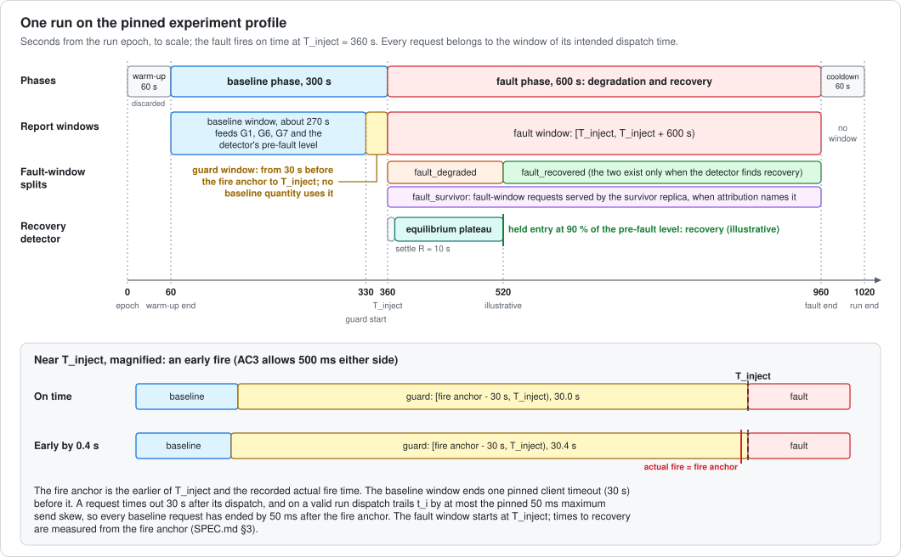
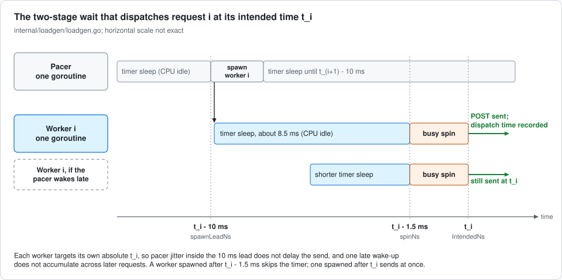
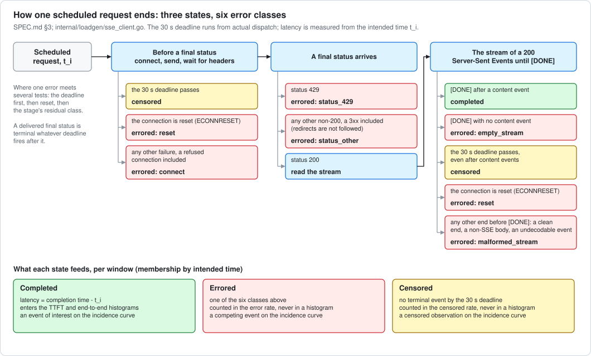
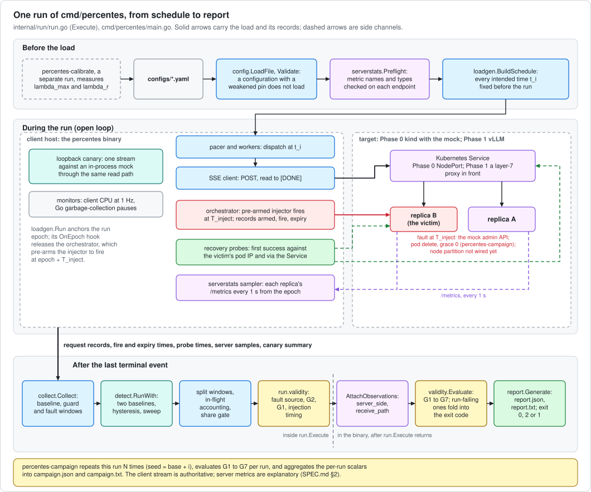
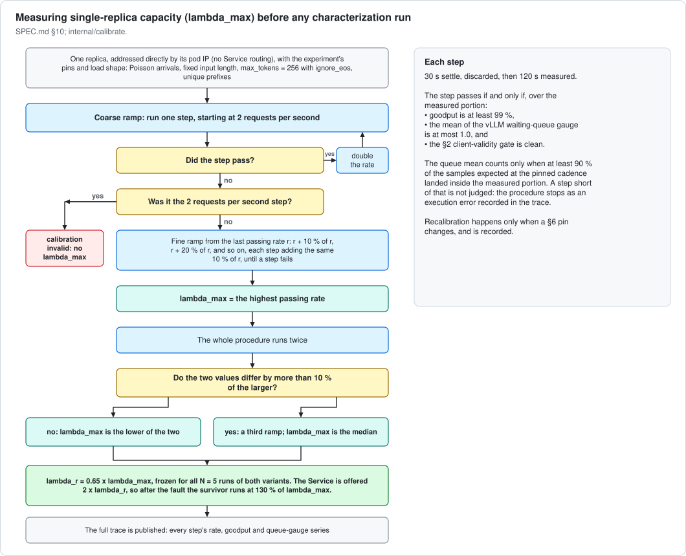
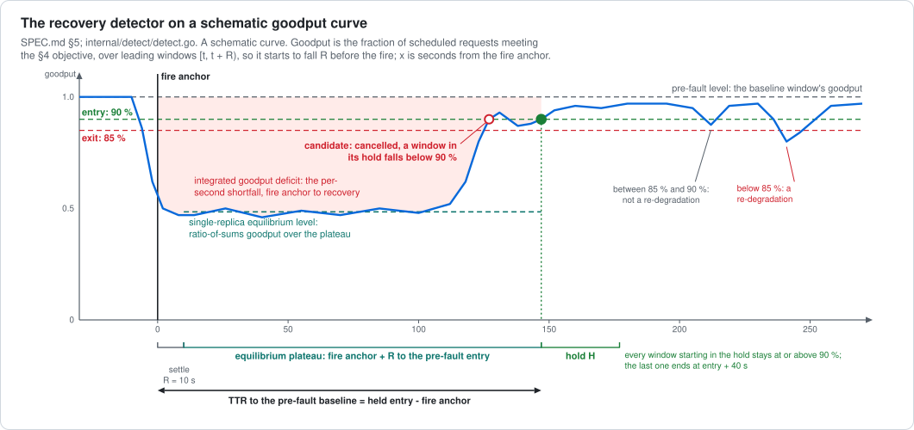
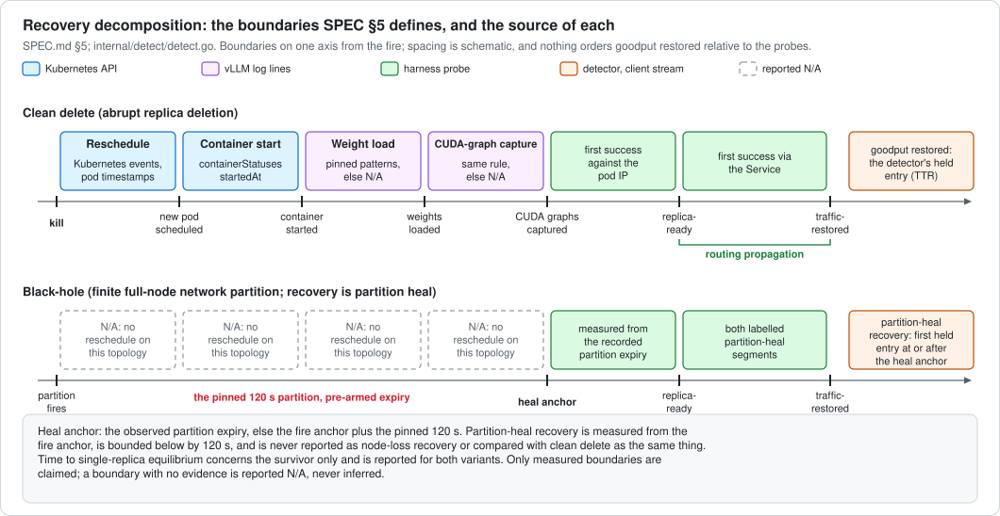
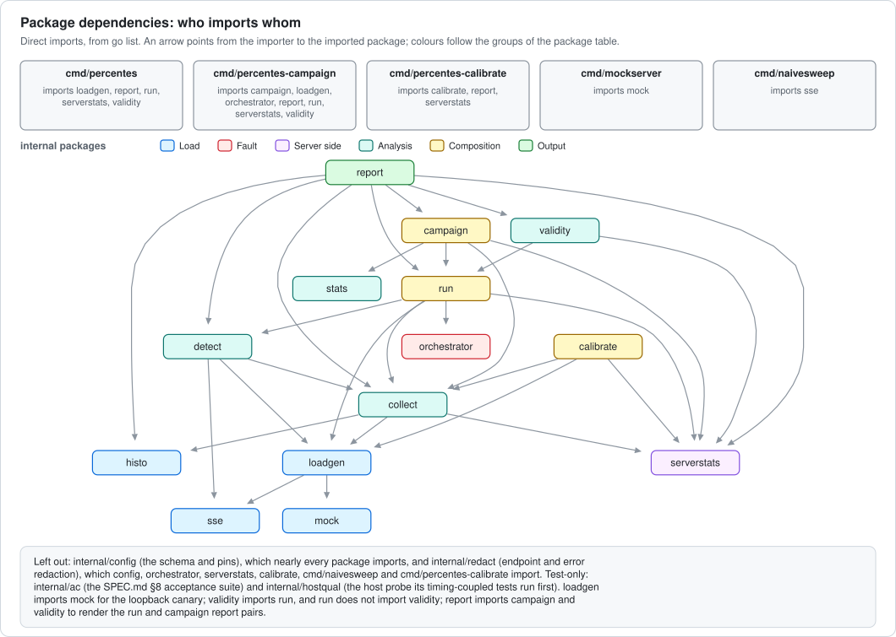

# Percentes architecture

Percentes is a measurement instrument. It drives open-loop load at a large
language model (LLM) inference service while one replica is
lost, and reports what the loss cost and how recovery unfolded. It also
drives managed provider endpoints under the hosted protocol,
[SPEC-HOSTED.md](../SPEC-HOSTED.md), and keeps the evidence those runs
publish. This page describes how the code implements
[SPEC.md](../SPEC.md), which is authoritative, and the hosted protocol
that is subordinate to it. A § number refers to a SPEC.md section unless
it is prefixed SPEC-HOSTED.

This page is written for an engineer who has not seen the code. Each
section opens with what it covers and when you need it. Two worked
examples follow one request from its schedule to its line in the report:
[one hosted run](#following-one-request-of-a-hosted-run) and
[one release request](#following-one-release-request).

- [Overview](#overview)
- [A run on the clock](#a-run-on-the-clock)
- [One request](#one-request)
- [Anatomy of a run](#anatomy-of-a-run)
- [Recovery detection](#recovery-detection)
- [Package map](#package-map)
- [Gates and where each bites](#gates-and-where-each-bites)
- [Server-side sampling and the receive path](#server-side-sampling-and-the-receive-path)
- [Fault modes](#fault-modes)
- [Hosted runs and the evidence files](#hosted-runs-and-the-evidence-files)
- [The release runner](#the-release-runner)
- [Tracing a published number](#tracing-a-published-number)
- [Changing things safely](#changing-things-safely)
- [Glossary](#glossary)

## Overview

This section says what the instrument measures, which rules the code
enforces in every run, and which binary does what. Read it first; every
later section assumes it.

### What is measured

§1 poses one question in three parts: when one replica of vLLM, the
open-source inference server the experiment targets, is lost under
sustained load, how many in-flight and queued requests fail or time out,
how the surviving replica degrades where there is one, and how long
recovery takes, split into measured segments.

Phase 0 builds the instrument and certifies it against a mock inference
server on a local kind (Kubernetes in Docker) cluster. Passing the
acceptance criteria (AC, §8) says nothing about behaviour on a real
graphics processing unit (GPU). Phase 1 runs the same harness against vLLM
on GPU nodes. One calibration has run against a standalone container.
The process-kill variant runs a new standalone container under the same
engine, model and GPU pins; its runs, and the two-replica Kubernetes
calibration and characterization runs, are pending.

§1 defines three fault variants. A clean delete removes the victim pod with
grace period 0. A black-hole fault partitions the victim's node for a
pinned 120 s and expires on its own; its recovery is partition heal, and a
run that passes the §1 runtime assertions carries the
node-loss-representative label. In Phase 0 the mock's fault modes stand in
for these two ([Fault modes](#fault-modes)). A process kill sends SIGKILL
(signal 9, which a process cannot catch) from the host to the vLLM
application programming interface (API) server process of one standalone
container, and the container runtime's restart policy starts the same
container again; with one replica there is no survivor and no Service.

The instrument also drives a managed provider endpoint (`target.hosted`).
A hosted run sits outside the §1 experiment: §6 lists what changes for it,
[Gates](#gates-and-where-each-bites) shows the two gates it carries, and
[Hosted runs](#hosted-runs-and-the-evidence-files) describes the pre-run
probe, the admission ledger, the evidence files every hosted run writes,
and the pilot of SPEC-HOSTED amendment HA2 that `cmd/percentes-pilot`
runs. [The release runner](#the-release-runner) describes the public
descriptive release of amendment HA3 that `cmd/percentes-release` runs:
one route per process and twelve cells per route, each a five-step
ladder of offered load, with the ceiling rule, the per-step tables and
the index.

### Design rules the code enforces

Four rules hold in every run. A reader who knows them can predict most
of the code's refusals.

- **Open loop.** Every request's intended dispatch time t_i is fixed before
  the run, and the generator never waits for a response before sending the
  next request. A generator that waited would send less while the service
  is slow and under-sample the slow period; that bias is called coordinated
  omission (§2). Latency is measured from t_i.
- **Three outcome states.** Every scheduled request ends completed,
  errored or censored (§3). Only completions enter the latency histograms,
  error and censored rates are reported per window, and the completion
  curve is the Aalen-Johansen cumulative incidence, the estimated share of
  scheduled requests completed by each time t after t_i. Errors are
  competing events on that curve, and only a request with no terminal
  event by the 30 s timeout is a censored observation.
- **Pinned numbers.** The configuration values SPEC pins are checked at
  load, and a configuration with a weakened value does not load
  (`internal/config`). The calibration rates lambda_max, the measured
  single-replica capacity, and lambda_r, the per-replica rate frozen at
  0.65 lambda_max, are recorded in the configuration's `calibration` block
  once §10 has run.
- **Missing measurements.** Of the §10 run-validity gates, G5 reports not
  applicable until its fingerprint capture is wired, and G7 when no metrics
  endpoints are configured. A recovery segment or an equilibrium estimate
  with no evidence is reported N/A (not applicable) with its reason.

### The binaries

The table lists each command, what it writes and how it exits. The
hosted and release commands have their own sections below.

| Binary | What it does | Output | Exit codes |
|---|---|---|---|
| `cmd/percentes` | one run; against a hosted target it also writes the evidence files, and `--replay DIR` and `--check-release DIR` act on a finished hosted run ([Hosted runs](#hosted-runs-and-the-evidence-files)) | `report.json`, `report.txt`; a hosted run adds `attempts.jsonl`, `clock.json`, `status-start.json`, `status-end.json` and `manifest.json`, and the frame store under `--frames` | 0 valid, or the replayed pair matches byte for byte, or the release check passed; 2 a gate invalidated the run; 1 error, a replayed pair that differs, or a refused release |
| `cmd/percentes-campaign` | N runs of one fault variant, gates per run, §7 aggregation; `--dry-kill` makes one process kill with no load | `run-N.json` and `run-N.txt` as each run ends; `campaign.json`, `campaign.txt`, partial after an error or a halt; under process kill `run-N-server.log`, `run-N-fingerprint-before.txt` and `run-N-fingerprint-after.txt`; `dry-kill.json` and `dry-kill-server.log` from `--dry-kill` | 0 every run valid, 2 at least one invalid run or a halted campaign, 1 error |
| `cmd/percentes-calibrate` | the §10 capacity calibration and the §5 single-replica reference; `--check` validates a configuration and lists its placeholders | `calibration.json`, `calibration.txt` | 0 valid, 2 calibration invalid, 1 error |
| `cmd/percentes-pilot` | the SPEC-HOSTED HA2 pilot: `ledger` (`create`, `price`, `hosting`, `show`), `probe`, `dev`, `session` and `check-cpu` | the ledger file; `probe-<UTC time>/<target>/probe.json`; `dev-1/` and `dev-2/` with `config.yaml`, `dev.json` and the targets' `attempts.jsonl` files; `<session>/session.json` and, per target, `<session>/<target>/` with the evidence files; the frame store under `--frames` | 0 done, every window client-valid, every probe unblocked and every endpoint through the development gate; 2 a window client-invalid or not started, a probe blocked, the second window late, or an endpoint failing the gate; 1 error or refusal |
| `cmd/percentes-release` | a release (SPEC-HOSTED HA3): before the window, `schedule`, `ledger create`, `ledger price` and `ceiling-check`; `run` for one route's cells over the committed window; after the window, `dispatch` and `pages`; `rehearse`, the acceptance run against six mock routes ([The rehearsal](#the-rehearsal)); `check-cpu` ([The release runner](#the-release-runner)) | the committed schedule file; the release ledger; `ceiling-<UTC time>/<route>-<ceiling>/probe.json` from `ceiling-check`; per cell attempt, `<route>/<cell>-a<attempt>/`: `cell.json`, `clock.json`, `status-start.json`, `balance-start.json`, `probe.json`, `attempts.jsonl`, `dispatch.json`, the ceiling probe copies, `status-end.json`, `balance-end.json`, `manifest.json`, `report.json` and `report.txt`; the frame store under `--frames`; `dispatch-aggregate.json` at the output root, from `dispatch`; `index.md`, `index.json`, `routes/<route>.txt` and `routes/<route>.json` under `--pages`, from `pages`; from `rehearse`, under its `--out`: `inputs/`, each mock route's cell directory as above, and `rehearsal.json` | `run`: 0 every cell counts; 2 a cell does not count; 3 the route stopped (a ledger refusal, a documented billing refusal, a clock offset above the bound, a probe 401 or 403 that the route's previous probed cell also saw, or an operator abort). `ceiling-check`: 0 the ceiling and input-bound checks passed; 2 the check failed or was blocked. `rehearse`: 0 the rehearsal is green; 2 it is not. Every command: 1 error or refusal |
| `cmd/mockserver` | the mock inference server in its Phase 0 form; the shaped hosted-provider form is built in Go only ([the mock's shaped form](#the-mocks-shaped-form)) | | |
| `cmd/naivesweep` | a reconnaissance sweep of an OpenAI-compatible endpoint, outside the instrument: closed loop, no client-validity gates | | |

## A run on the clock

This section covers the timeline of one self-hosted run and the report
windows cut from it. You need it to read any `windows.*` field of a run
report. A hosted run of `cmd/percentes` keeps these phases with no fault
injected; a release cell replaces them with the ladder's steps
([The ladder](#the-ladder)).

A run has four phases, whose ends `internal/loadgen/loadgen.go` sets from
the pinned durations: warm-up 60 s (discarded), baseline 300 s, the fault
phase, which is §1's degradation-and-recovery window with its 600 s
timeout, and cooldown 60 s. The load is identical throughout.

- **T_inject** is the configured fault instant, measured from the run
  epoch: the end of warm-up plus `fault.t_inject_offset_s`. The experiment
  profile sets the offset to 300 s, the end of the baseline phase, so
  T_inject is 360 s from the run epoch.
- **The fire anchor** is the earlier of T_inject and the recorded actual
  fire time (`collect.FireAnchorNs`). AC3 lets the fault fire up to 500 ms
  either side of T_inject. Times to recovery are measured from the fire
  anchor.

`run.Execute` builds the report windows. Every request belongs to the
window of its intended dispatch time, and each window is half-open,
[start, end).

| Window (report key) | Bounds | SPEC term |
|---|---|---|
| `baseline` | [warm-up end, fire anchor − 30 s) | baseline window (pre-fault) |
| `guard` | [fire anchor − 30 s, T_inject) | guard window |
| `fault` | [T_inject, end of the fault phase), which is T_inject + 600 s on the experiment profile | fault window |
| `fault_degraded` | [T_inject, recovery point), when the detector's recovery point falls inside the fault window | no separate term |
| `fault_recovered` | [recovery point, end of the fault phase), under the same condition | no separate term |
| `fault_survivor` | the fault window, restricted to requests served by the survivor replica, when baseline attribution names exactly one replica besides the victim | survivor cohort (§3) |

The recovery point is the pre-fault recovery, or partition-heal recovery
under the black-hole variant. No window covers the cooldown; the
detector's 1 s buckets still run to the end of the run. The guard window
exists because a request intended in the 30 s before the fire can still be
in flight when the fault fires, and counting it in the baseline would
charge a fault loss to the baseline.

The diagram's detector row is explained in [Recovery
detection](#recovery-detection).

## One request

This section follows one request through the client: how its send time
is fixed, how the send is kept on time, and how its ending is classed.
You need it to read any latency or outcome figure.

`loadgen.BuildSchedule` fixes every t_i before the run. The pacer spawns a
worker 10 ms before t_i, and the worker dispatches at t_i. The
server-sent events (SSE) client (`internal/loadgen/sse_client.go`, with the
framing in `internal/sse`) posts to the target's complete `endpoint_url`,
or to `base_url` plus `/v1/chat/completions` when no `endpoint_url` is
set, and reads the stream. The client timeout, the pinned 30 s or the
release profile's 90 s hard timeout, runs from the actual dispatch.

### Pacer timing

If one loop did the precise wait and the dispatch itself, a hiccup while
handling request i (a garbage-collection pause, a scheduler delay) would
delay request i and push every later request back with it. The generator
splits the work in two (`internal/loadgen/loadgen.go`):

1. **The pacer**, a loop in one goroutine (Go's lightweight thread), sleeps
   until t_i − 10 ms (`spawnLeadNs`), spawns the worker for request i, and
   moves straight on to request i + 1. It never does the precise wait.
2. **The worker** sleeps on its own timer (`waitTimer`) until
   t_i − 1.5 ms (`spinNs`), then spins on the clock until it reaches t_i and
   dispatches. The timer keeps the spin short; the spin covers timer
   wake-up latency.

Each worker aims at its own absolute t_i, so pacer jitter inside the 10 ms
lead does not delay the send, and one late wake-up does not accumulate
across later requests. A worker spawned after t_i − 1.5 ms skips the timer,
and one spawned after t_i dispatches at once, its lateness recorded as send
skew, which the §2 client-validity gate bounds.

### From dispatch to outcome

The client stamps four moments:

- **dispatch:** send skew is dispatch time minus t_i;
- **the first content event:** time to first token (TTFT) is its time
  minus t_i;
- **each later content event:** the gap from the previous one;
- **the terminal event:** end-to-end (e2e) latency is the completion time
  minus t_i.

A content event is an SSE event whose decoded delta carries non-empty
content at the key `target.response_shape.content` names (`content` by
default). Keys the shape lists as reasoning are recorded apart and never
count as content. A target whose `adapter` is `messages` is read by the
Messages adapter instead of the response shape: `text_delta` text is
content, `thinking_delta` text is reasoning, `message_start` carries the
model and the first usage object, `message_delta` the stop reason and the
cumulative usage, an `error` event the in-band error object, and
`message_stop` ends the stream. Gaps between content events are inter-chunk latencies. On a
self-hosted or mock target the report calls them inter-token latency (ITL)
where the §10 check passes. A hosted target's gaps stay inter-chunk, and a
mock run without usage is labelled one token per content event by
construction ([token counts](#token-counts-and-the-itl-label)). A chunk carrying a usage object
supplies the completion token count.

The client classifies how each request ends into one of the three §3
states and, for an error, one of six classes, by the stage at which the
failure occurs. A stream is also classed `malformed_stream` when an event
or a line exceeds the 1 MiB bound the client reads with.

`collect.Collect` then, per window:

- assigns each request to the window of its intended time;
- records completed TTFT and e2e latencies into the pinned HdrHistogram
  (high-dynamic-range histogram) configuration through `RecordValue` only;
- adds every scheduled request to the window's incidence curve;
- counts error classes, error and censored rates, throughput, and goodput,
  the fraction of scheduled requests that complete within the §4
  service-level objective (SLO);
- runs the §4 threshold sweep and computes the content-event and
  usage-count distributions and the §7 tail confidence intervals (CIs).

`detect.BuildSeries` buckets the same records at 1 s for the detector.
Every latency, rate and detector figure is computed from these records.

## Anatomy of a run

This section lists what `cmd/percentes` does from setup to report, in
code order, and how campaigns and calibration build on it. You need it
to find where a step of a run happens.

The diagram follows one run of `cmd/percentes` from its setup to its report;
the sections below expand each part.

`run.Execute`, in code order:

1. `loadgen.Run` anchors the run epoch on the monotonic clock and fires the
   `OnEpoch` hook before it starts the pacer.
2. The hook releases the orchestrator, which pre-arms the injector to fire
   at epoch + T_inject with automatic expiry and records the armed, fire and
   expiry times. §1 requires pre-arming because a black-hole partition
   makes the victim unreachable the moment it fires. Each §5 recovery probe
   runs when `cmd/percentes` is given its uniform resource locator (URL):
   `--probe-direct` for replica-ready, `--probe-service` for
   traffic-restored. A probe starts at the planned fire and polls every
   500 ms until its first counted success or the end of the fault phase; a
   success counts only after the fault was visible on that path.
   `percentes-campaign` takes `--probe-direct`, required under the
   process-kill variant, and passes it to every run; it passes no service
   probe URL, so traffic-restored and routing propagation are N/A in its
   runs.
3. The load runs open loop through warm-up, baseline, the fault phase and
   cooldown. Monitors sample client central processing unit (CPU) use at
   1 Hz and the Go garbage-collection (GC) pause histogram for the §2 gate.
4. After the last terminal event:
   1. the phase windows are collected (baseline, guard, fault);
   2. the detector runs (`detect.RunWith`): two baselines, hysteresis, the
      27-row sensitivity sweep, integrated deficits, per-component recovery;
   3. the split windows are collected: `fault_survivor`, and
      `fault_degraded` and `fault_recovered` at the recovery point;
   4. in-flight-at-fire requests are classified by outcome and replica
      (`collect.AccountInFlight`), the share gate is computed from
      per-request replica attribution (`run.shareGate`), and the §4
      threshold analysis runs;
   5. the probe times fill the decomposition, and for a mock fault the
      scheduled fires are read back from `/admin/faults`;
   6. `run.validity` decides validity from the fault source, the
      client-validity gate (G2), the share gate (G1) and the injection
      timing.
5. `run.Execute` returns. The binary attaches the server samples and the
   canary streams (`AttachObservations` fills the top-level `server_side`
   and `receive_path` maps, keyed by window), evaluates G1 to G7
   (`validity.Evaluate`), renders the report pair (`report.Generate`), and
   exits 0, 2 or 1.

**Campaigns.** `percentes-campaign` runs N repetitions of one variant with
seed base + i. For a clean delete it resolves each run's victim and arms a
fresh injector that deletes the pod through kubectl on a named context:
with `--victim` it waits for that pod to be Ready, and with
`--victim-selector` for every replica to be Ready before it picks one. It
evaluates G1 to G7 per run and aggregates the per-run scalars under §7
(`campaign.Run`, `stats.Summarize`): all values, median, mean and a
t-interval whose degrees of freedom follow the contributing runs, with
heavy-tailed scalars led by the median and range. Each endpoint reports
how many runs were dropped and why. The black-hole variant is refused until
the node-partition injector is wired. The process-kill runner is described
under [Fault modes](#fault-modes).

**Calibration.** `percentes-calibrate` runs the §10 procedure against one
replica addressed directly: coarse and fine ramps, the two-ramp agreement
rule, lambda_r frozen at 0.65 lambda_max, and the §5 reference run at
2 × lambda_r. Every step is a §3 collection over its measured window, with
the queue-gauge series, the kept families' reductions and the §2
receive-path report; the trace is rewritten after every step. The binary
writes `calibration.json` and `calibration.txt`, and the values are then
entered in the configuration's `calibration` block.

## Recovery detection

This section covers the detector that turns the goodput series into a
time to recovery. You need it to read the `detector` and `decomposition`
fields of a self-hosted report; hosted runs carry neither.

The detector (`internal/detect`) works on goodput over R = 10 s windows of
1 s buckets, keyed by intended dispatch time. The window at time t covers
[t, t + R), a leading window, so an entry time is the start of the good
service it describes, and the curve starts to fall R before the fire.

- **Entry and hold.** A candidate entry is a window at or above 90 % of the
  applicable baseline. It becomes recovery only if every window starting in
  the following H = 30 s also stays at or above 90 %; any window below 90 %
  cancels it (`canceled_entries`). The time to recovery (TTR) is the held
  entry's start minus the fire anchor.
- **Exit.** After recovery, a window below 85 % starts a re-degradation
  episode, which ends when a window is back at 90 % (`re_degradations`);
  the TTR stands.
- **Two baselines.** The pre-fault level is the baseline window's goodput
  from the collector. The single-replica equilibrium level is the
  ratio-of-sums goodput over the plateau, from fire anchor + R to the
  earlier of the pre-fault entry or the 600 s timeout, estimable only when
  that span is at least R and its goodput is above zero. Each baseline has
  its own TTR.
- **Unobserved.** A candidate whose hold runs past the end of the series is
  reported unobserved (`hold_unobserved`), which differs from not
  recovered, where no held entry starts before the timeout. A cut entry
  window counts as unobserved only when its missing seconds, each at the
  observed mean load and all of it good, could still lift it to 90 %.
- **Partition heal.** Under the black-hole variant the labelled recovery is
  the first held entry at or after the heal anchor: the observed partition
  expiry, else fire anchor + 120 s. The raw threshold crossing is reported
  beside it.
- **Sweep and deficit.** The sensitivity sweep runs entry 85, 90 and 95 %,
  R 5, 10 and 20 s, and H 15, 30 and 60 s, with exit fixed at 85 %: 27 rows.
  The integrated goodput deficit sums each second's shortfall below the
  baseline level, from the fire anchor to recovery, or to the timeout when
  there is none.
- **Components.** `ttft_slo`, `e2e_slo` and `error_rate` each get their own
  detection against their own pre-fault level. Backlog drain is reported
  unmeasured in every run; no code path measures it yet.

The decomposition (`detect.NewDecomposition`, filled in
`run.Execute`) reports each §5 boundary with its source. The probes supply
replica-ready and traffic-restored when they run, and the detector
supplies goodput restored. When `--victim` names the victim replica, the
traffic-restored probe counts only a success whose `X-Percentes-Replica`
header names that replica, a header only the mock sends; without
`--victim` it counts any success. Routing propagation is traffic-restored
minus replica-ready. No code path measures the Kubernetes API and log
boundaries yet (reschedule, container start, weight load, and the graph
capture of CUDA, NVIDIA's Compute Unified Device Architecture), so the
clean-delete and black-hole variants report them N/A. Under the
process-kill variant, container start comes from the container's
`StartedAt` in `docker inspect`, the vLLM startup boundaries and the
figures vLLM prints come from the server log (`internal/vllmlog`, patterns
pinned to vLLM 0.29.0), and reschedule, traffic-restored and routing
propagation are N/A. The code measures the probe segments from the fire in every variant; §5
measures the black-hole ones from the partition expiry, which lands with
the node-partition injector.

The figure shows the §5 boundaries of the two Kubernetes variants. Of
those, the code measures the probe and detector ones.

## Package map

This section maps each Go package to its role, the SPEC clauses it
serves and its entry points. You need it to find the code behind a
figure.

The diagram predates the hosted packages, which the table lists.

| Group | Package | Role | SPEC | Entry points | Tests |
|---|---|---|---|---|---|
| Configuration | `internal/config` | schema in YAML (YAML Ain't Markup Language), strict decode, the pins of each profile (`experiment`, `ac`, `pilot`, `release`) checked at load; the literal request body and its case slot; the release target's limits, unpublished-limit rulings, retained headers, not-applied parameters, naming record and documented statuses, errors and billing refusals | §1 to §6, §8, §10; SPEC-HOSTED HA2 and HA3 | `LoadFile`, `Parse`, `Config.Validate`, `CheckBaseURL`, `CheckLiteralBody`, `LiteralBody` | a mutation case per pin; refusal rows per profile |
| Load | `internal/loadgen` | schedule, pacer, SSE client with the HTTP/1.1 pin, outcome classification, per-request status, header, peer and protocol records, the credential header and literal body per target, the Messages stream adapter, retained header values kept apart from the record, the pilot and release tripwires, the release ladder with its drains and per-step verdicts, the dispatch and completion hooks, client gate, loopback canary | §2, §3; SPEC-HOSTED §3, §5, §9; HA3 points 2, 5, 15 and 16 | `BuildSchedule`, `BuildLadder`, `Run`, `NewTransport`, `StartCanary`, `SummarizeCanary`, `CPUMeasured` | request-body, stream-hardening, capture, ladder, hook and gate units; canary oracle; AC1 to AC2d |
| | `internal/sse` | SSE framing for the client, the recovery probes and naivesweep | §3 | `SplitLines`, `Events` | a unit per grammar case |
| | `internal/histo` | the pinned HdrHistogram wrapper; `RecordValue` only, and a test fails the suite if a correction API appears | §3 | `New`, `H.Record`, `H.Summarize` | the correction-API ban; AC1 oracles |
| | `internal/mock`, `cmd/mockserver` | OpenAI-compatible SSE mock: five scriptable fault modes and a slow-reload startup setting; the shaped hosted-provider form ([the mock's shaped form](#the-mocks-shaped-form)) | §2; SPEC-HOSTED §2, §5 | `New`, `NewShaped`, `Server.Start`, `/admin/faults` | a behaviour test per mode, including a raw Transmission Control Protocol (TCP) silent-hang test; a test per shape mode |
| Fault | `internal/orchestrator` | pre-armed fault execution with armed, fire and expiry records; mock-admin, clean-delete and process-kill injectors; container commands over SSH (Secure Shell) | §1, §2, AC3 | `Execute`, `NewMockInjector`, `NewCleanDeleteInjector`, `NewProcessKillInjector`, `SSHContainerOps` | AC3; fake-ops tests; a fake `ssh` on PATH |
| Server side | `internal/serverstats` | Prometheus sampler, per-window reductions, G7 baseline means | §2, §6, §10 | `ForRun`, `Sampler.Start`, `Sampler.Stop`, `Preflight`, `BaselineMeans`, `ReduceWindow` | test servers; window, reset and per-label-set oracles |
| Analysis | `internal/collect` | windows, incidence curves, in-flight accounting, threshold analysis, tail CIs, receive-path report | §3, §4, §7 | `Collect`, `EstimateIncidence`, `AccountInFlight`, `SplitAtFire`, `AnalyzeThresholds` | hand-computed incidence oracles; AC4, AC4b |
| | `internal/detect` | recovery detector, decomposition, recovery probes, /health calibration | §5 | `BuildSeries`, `RunWith`, `ProbeRecovery`, `CalibrateHealth`, `NewDecomposition` | synthetic-series units; AC5 |
| | `internal/vllmlog` | vLLM startup-log boundaries and printed figures, patterns pinned to vLLM 0.29.0, applied to the process-kill decomposition | §5 | `Parse`, `Apply`, `VLLM0290`, `Mock` | the 16 September 2026 vLLM start log as a byte-exact fixture |
| | `internal/validity` | the G1 to G7 run-validity gates | §10 | `Evaluate` | a unit per gate |
| | `internal/stats` | §7 statistics: values, median, mean, t-interval, coefficient of variation | §7 | `Summarize` | hand-computed oracles |
| Composition | `internal/run` | one run's artifacts; the profiles the single-run path refuses; a hosted run re-analysed from its records | §2; SPEC-HOSTED §9 | `Execute`, `CheckConfig`, `Replay` | the whole pipeline in process under the race detector |
| | `internal/campaign` | N runs, per-run scalars, endpoint summaries with drop counts, halt after an invalid run | §5, §7, §10 | `Run`, `RunWith` | fake-runner units |
| | `internal/calibrate` | the §10 ramps and the §5 reference | §10, §5 | `RunRamp`, `Calibrate`, `Reference`, `LoadRunner` | a capacity-model fake runner; one step against the mock |
| Output | `internal/report` | the report pairs for a run and a campaign; the hosted report without SLO fields; a hosted run's pair from its manifest and attempts file; the paired pilot report; the release cell report with G2 per step; the per-step tables with their intervals, finish-reason sub-lines, throughput, curves and quantile refusals, latency and token distributions, gap histograms and signals, the drift split of a frame, and the index table | §2 to §5, §7; SPEC-HOSTED §4, §7 to §9, HA2 §8, HA3 points 8, 12, 13 and 16 | `Generate`, `GenerateCampaign`, `FromRun`, `WriteHostedPair`, `GeneratePilot`, `NewStepTables`, `NewIndex`, `DocsOf` | renderer units; AC6 field assertions; byte-for-byte replay; hand-computed interval oracles; the forbidden-string test |
| | `internal/redact` | endpoint and error redaction for every published artifact and error string | §6 | `URL`, `ErrorText`, `Wrap` | leak tests across the packages that print |
| Hosted | `internal/probe` | the pre-run probe: DNS, TLS, one request, the response shape, the start gate; the release ceiling check | SPEC-HOSTED §2, §5; HA3 point 7 | `Run`, `RunRelease`, `ChooseCeiling`, `Gate`, `Write` | an httptest server per shape and failure |
| | `internal/admission` | the request and liability ledger, hash-chained; the release ceiling rule | SPEC-HOSTED HA2 §3; HA3 point 6 | `Create`, `Open`, `Ledger.Admit`, `Ledger.Settle`, `CeilingRule` | chain, cap and settlement units |
| | `internal/evidence` | per-attempt records, the frame store, the clock, status and balance records, the operator file, the manifest with the release cell record (the label, the aggregate dispatch series, the gap histograms, the per-step gates), the completeness check | SPEC-HOSTED §9; HA3 points 9, 13, 15 and 16 | `Records`, `WriteRun`, `WriteRunFrames`, `ReadClock`, `ReadStatus`, `ReadBalance`, `LoadOperator`, `NewManifest`, `StepGaps`, `ReleaseG6`, `CheckRelease` | round-trip, hash and refusal units |
| | `internal/pilot` | the synthetic ticket fixture, the pilot schedule, the Shape S tickets | SPEC-HOSTED HA2; HA3 point 7 | `Generate`, `NewSchedule`, `GenerateShapeS` | pinned hashes; determinism |
| | `internal/score` | the task scorer: the route contract and the ten outcome classes | SPEC-HOSTED HA2 §5 | `NewContract`, `NewScorer`, `Scorer.Score` | boundary, wrong-label and duplicate-key cases |
| | `internal/schedule` | a release's frame from one master seed: twelve cells per route, dates, attempt seeds, per-route offsets, the re-run bound, the committed file | SPEC-HOSTED §4; HA3 point 9 | `New`, `Load`, `Schedule.Runs`, `Schedule.Rerun` | a pinned derivation; window and refusal cases |
| Test support | `internal/hostqual` | the host qualification probe the timing-coupled tests run first | §2, §8 | `Measure`, `Observation.Qualify`, `Qualified`, `Allocation` | per-limit units |
| | `internal/ac` | the §8 acceptance suite; the mock runs as a separate process, so it never shares the generator's Go scheduler | §8 | | |

`detect.Run` wraps `RunWith` for a bare bucket series; the acceptance
suite calls it. `internal/stats` also implements the Holm step-down
correction for multiple comparisons, with tests; no campaign path calls it
yet.

| Path | Contents |
|---|---|
| `deploy/kind/` | the cluster configuration (one node, image pinned by digest, host port 18000 mapped to NodePort 30800); `smoke.sh`; `reproduce.sh`, the AC7 one-command run; `campaign-e2e.sh` |
| `deploy/mock/` | the two-replica mock Deployment and its NodePort Service; a readiness probe on `/health` and no liveness probe, so silent_hang can hold `/health` silent |
| `deploy/process-kill-e2e.sh` | the process-kill end-to-end: the mock in a Docker container under `--restart on-failure`, one dry kill and a two-run campaign that kill and restart it, and a check of the dry-kill record and the run files |
| `deploy/phase1/` | the vLLM topology manifest, which does not deploy until its PIN-AT-PHASE1 placeholders are filled; capture scripts for the host fingerprint, the GPU sample series and the server log |
| `configs/` | every runnable configuration; one file drives both the cluster ConfigMap and the host runner; `pilot.reference.yaml` and `release.reference.yaml` are the pilot and release profiles' reference files; `embed.go` builds `release.reference.yaml` into `percentes-release` for `rehearse` |

## Gates and where each bites

This section lists every check that can refuse a configuration, end a
run or label a cell, with its pinned number and the code that enforces
it. You need it when a run exits 2 or a cell does not count.

| Check | Pinned numbers | When | Consequence | Enforced in |
|---|---|---|---|---|
| Configuration pins | SPEC numbers from §1 to §5, §8 and §10 as equalities or bounds; §6 environment values as required fields | configuration load | the configuration does not load | `config.Validate` |
| Metric preflight | the queue gauge, every kept family and the TTFT histogram's type, read on each endpoint | before the load | the binary exits before any dispatch | `serverstats.Preflight` |
| G2: send skew | 99th percentile (p99) ≤ 5 ms and max ≤ 50 ms, compared in nanoseconds | judged after the run | run invalid | `loadgen.evaluateGates`, `run.validity` |
| G2: undispatched | zero scheduled requests never dispatched | judged after the run | run invalid | same |
| G2: client CPU | ≤ 70 % over any 5 s window | judged after the run | run invalid; unmeasured counts as failed | same |
| G2: GC pause | p99 < 1 ms, on the upper edge of the runtime histogram bucket that holds it | judged after the run | run invalid; a p99 in the runtime's open last bucket fails | same |
| Fault source | an armed injector, or the mock's scheduled fires read back | after the run | run invalid | `run.validity` |
| Injection timing (AC3) | fire within 500 ms of T_inject | after the run | run invalid | `run.validity` |
| G1: share (§1) | 45 to 55 % per replica over the baseline window | after the run | run invalid under a per-request (layer-7) dataplane, descriptive under per-connection routing; a replica count other than the declared one, or no attributed baseline request, fails in either regime; not applicable to a one-replica target | `run.shareGate`, `config.BalancesPerRequest` |
| G3, G4 (black-hole only) | zero errored victim in-flight requests; staleness window ≥ 20 s with victim-bound traffic | per-run evaluation | a failed or unobserved gate strips the node-loss-representative label, and the run stays valid | `validity.Evaluate` |
| G5 | GPU clock and power fingerprints equal across replicas and runs | per-run evaluation | not applicable until the capture output is wired | `validity.Evaluate` |
| G6 | baseline goodput ≥ 0.99 | per-run evaluation | run invalid | `validity.Evaluate` |
| G7 | per-replica waiting-queue mean ≤ 1.0 over the baseline window, with ≥ 90 % of the expected samples | per-run evaluation | run invalid; not applicable without `target.metrics_urls` | `validity.Evaluate` |

`percentes` and `percentes-campaign` fold run-invalidating gate failures
into exit code 2; `run.Execute` has already recorded G1 and G2. An
applicable gate that goes unobserved fails. `make bins`, `reproduce.sh` and
`campaign-e2e.sh` build with `CGO_ENABLED=0` (cgo, Go's C interoperability,
disabled), and on macOS that leaves the client CPU gate unmeasured, so such
a run exits 2; Linux measures CPU from `/proc`. The fault-source and
injection-timing checks sit outside SPEC's G1 to G7 list and invalidate a
run in the code.

**Hosted targets.** Only G2 and G6 are evaluated. Hosted G6 is completion
within the 30 s timeout, computed over the baseline, guard and fault
windows and reported without invalidating the run; §10 defines G6 over the
baseline window. Under the release profile, hosted G6 is completion
within the 30 s deadline over each ladder step's scheduled requests, and
the cell's manifest carries it per attempted step beside G2 per step,
and G2 over the whole ladder where no stop interrupted it
(`evidence.ReleaseG6`, `validity.ReleaseG6`).
The cell's text report prints a G2 line and the hosted G6 lines per
attempted step, and a G2 failure is also named by the cell's label. The
request body the client generates omits `ignore_eos`
and asks for no usage object; a target with a literal `body` sends that
body instead ([Hosted runs](#hosted-runs-and-the-evidence-files)). The key
is read at run start from the environment variable `target.api_key_env`
names and sent in the one header `target.auth_header` selects:
`Authorization: Bearer` (the default), `x-api-key` or `api-key`. It is
never recorded, and every recorded header, body and error string is
masked for it.

**Release cells.** A release route carries these checks beside G2 and
hosted-G6 ([The release runner](#the-release-runner)):

| Check | Pinned numbers | When | Consequence | Enforced in |
|---|---|---|---|---|
| Ceiling rule | each step's nominal demand at most half of every recorded rate, token, concurrency, daily and spend-window limit; the monthly cap and the route's ledger cap cover the twelve cells, re-runs and probes; the auto-reload threshold covers the costliest cell | route start | a step is excluded with its binding limit named; a route with no admitted step refuses to start | `admission.CeilingRule`, `newRoute` |
| Open-file limit | soft limit at least 65,536 | route start | refusal to start | `checkOpenFiles` |
| Balance command | one is given and parses | route start | refusal to start; a release manifest without its start balance record is refused | `ParseBalanceCommand`, `evidence.NewManifest` |
| Clock offset | at most 60 s | cell start | the route stops; the cell is retained and labelled | `runCell` |
| Ledger admission | the route and global liability caps of the configuration | cell start | the route stops | `Ledger.Admit` |
| Probe gate | a 400, 401, 403 or 404, or an operator-set limit status | cell start | the cell is blocked before its ladder | `probe.Gate` |
| Credential or account fault | a probe 401 or 403 that the route's previous cell to send a probe also saw, on its probe or inside its ladder | cell start | the route stops; the cell is retained and labelled | `authFault` |
| Documented billing refusal | the status and body string `target.billing_refusals` records | the probe, or any request | the route stops | `billingRefusal`, `Hooks.OnDone` |
| G2 per step | the §2 numbers over the step's measured window | each drain's end | the ladder ends; the cell is client-invalid | `loadgen.runLadder`, `stepEnd` |
| Tripwires | a send beyond the step's scheduled count; requests in flight above 2 × the step's rate × the 90 s hard timeout | each drain's end | the ladder ends; the cell is client-invalid | same |
| Backoff rule | a status_429 fraction above 0.5 of the step's scheduled requests | each drain's end | the ladder ends; the cell counts | same |
| EMFILE | any request failing for want of a file descriptor | during the ladder | the ladder ends; the cell is client-invalid | `isEMFILE` |

**Timing-coupled tests.** Before each timing-coupled acceptance test,
`internal/hostqual` probes the host against limits set in
`hostqual.Allocation` from the §2 budget: timer wake lateness p99 ≤ 1 ms,
plus 1 ms on Linux, where Go's poller waits in whole milliseconds, and
max ≤ 10 ms, and a GC pause p99 bucket edge of at most 1 ms. A test
skips only on a host that fails the probe, and re-probes after a failed
timing assertion before it fails. `make test-ac` fails on any skip unless
`PERCENTES_AC_ALLOW_SKIPS=1`.

## Server-side sampling and the receive path

This section covers what the client reads from the server's metrics
endpoints and the two checks on its own receive path. You need it for
the `server_side` and `receive_path` fields. A hosted target exposes no
metrics endpoint to the instrument, so only the loopback canary applies
to it.

### The sampler

`target.metrics_urls` names one Prometheus endpoint per replica (keyed r0,
r1 in order), each sampled every 1 s from the run epoch.
`target.queue_gauge` (`vllm:num_requests_waiting` on vLLM,
`percentes_mock_requests_waiting` on the mock) feeds G7: the per-replica
mean over the baseline window, with coverage of at least 90 % of the
expected samples. The kind campaign sets no `metrics_urls`, since each
pod's endpoint needs its own address behind the one NodePort Service.

`target.metrics_families` names the families kept on every sample. The
top-level `server_side` map reduces them per window and replica:

| Family type | Per-window value |
|---|---|
| gauge, untyped | the mean over the samples inside the window |
| counter | the increase, measured per label set from its last sample before the window (or its first inside) to its last inside, summed over label sets |
| histogram | the increase in count, sum and buckets by the same rule, the +Inf bucket left out |

A label set missing from a sample adds nothing there, and one first seen
inside the window adds its whole value. A label set that falls, or a
histogram whose bucket layout changes, is marked as a reset and
contributes its later value; after a layout change no buckets are
reported. A non-finite value, or a sum over label sets that overflows, is
an error counted in `family_errors`. The run report keeps the sample series
under `server_samples`.

### The receive-path checks

The two §2 checks are reported per window in the top-level `receive_path`
map, and neither fails a run:

- the client-side TTFT mean over completed requests, against the mean of
  the server's TTFT histogram (`target.ttft_histogram`) over the same
  window, pooled across replicas; the difference also holds the network
  round trip and any difference in where the server starts its clock;
- the loopback canary, one stream against an in-process mock with fixed
  timing through the same read path: its event lag p99 and max bound the
  host's read-loop lag, with the first-token and per-gap deviations beside
  them.

A window restricted to one replica carries no receive-path report.
`percentes-calibrate` takes the same settings as `--families` and
`--ttft-histogram`.

### Token counts and the ITL label

A self-hosted or mock request asks for the usage object
(`stream_options.include_usage`); the hosted body the client generates
does not, and a literal body carries whatever it says. The client
records the completion token count from any chunk that carries usage at a
path `target.response_shape.usage` names (`usage` by default), beside its
own content-event count. Each window reports both counts as
distributions (`content_events`, `completion_tokens`) and the §10 check
over the completed requests that carried usage (`token_check`: sampled and
matched).

| Case | Pooled ITL label in `report.txt` |
|---|---|
| hosted target | inter-chunk, with the counts when the stream carried usage |
| usage sampled, every request matched | inter-token, with the counts |
| usage sampled, a mismatch | inter-chunk, with the counts |
| mock, no usage in the stream | one token per content event by construction |
| any other target with no usage | inter-chunk |

## Fault modes

This section covers the faults the mock can inject and the process-kill
variant. You need it to read a Phase 0 run or a process-kill campaign.

The mock's modes stand in for the §1 variants in Phase 0: `stream_abort`
reproduces the resets of a clean delete, and `silent_hang` the silent drops
of a black-hole partition.

| SPEC §2 name | Configuration | Mock behaviour | What the instrument must show |
|---|---|---|---|
| stall | `stall` | server-wide emission freeze, staggered flush on expiry | completions delayed; the excess lands in p99.9 and max (AC2); lambda × D samples attributable to a stall of length D (AC2b) |
| error | `error` | 5xx on new requests; in-flight streams untouched | an error-rate step in the fault window; the goodput dip yields a detector TTR |
| throttle | `throttle` | 429 on new requests; in-flight streams untouched | `status_429` in the fault window's error classes, absent from the baseline |
| stream-abort | `stream_abort` | a TCP reset (RST) of in-flight streams at fire, sent by closing with `SO_LINGER=0`; admitted streams reset after N tokens | in-flight requests classified errored as `reset`, absent from the histograms (AC4) |
| silent-hang | `silent_hang` | no bytes, no clean close (FIN) and no RST, ever, on hijacked connections; captured requests stay hung past expiry | censored at exactly 30 s and entered on the incidence curve as censored observations (AC4b) |
| slow-reload-on-reschedule | `mock.slow_reload`, a startup setting | 503 for a set duration after process start | the replica-ready probe boundary in the decomposition |

The first five are scheduled in the configuration or armed through the
mock's `/admin/faults`; slow reload is set when the mock starts.

**Process kill.** The process-kill variant runs against a container on a
Docker host: vLLM in Phase 1, the mock in its end-to-end test. Before each
run `percentes-campaign` waits until the container is running, `/health`
returns 200 and one streamed inference succeeds, then reads the
container's process ID (PID), start time and restart count from
`docker inspect` and measures the host clock's offset from the client
clock. `orchestrator.ProcessKillInjector` sends SIGKILL to that PID at
T_inject after checking that the PID still belongs to the container; the
kill script stamps the host clock before and after the kill, and the
recorded fire is the midpoint of that bracket converted by the offset.
Docker's `on-failure` restart policy starts the same container again.
After the run the campaign reads the restart count, which must have
advanced by exactly one and must not have moved between runs, the
container's `die` and `start` events, the server log, from which
`internal/vllmlog` fills the decomposition's log rows, and the
fingerprints. A restart policy or container name other than the §6 pins
invalidates the run. `collect.SplitAtFire` separates the in-flight
requests ending just after the fire, which are indeterminate, from the
rest, and the requests scheduled from the fire to replica-ready are
collected as the `outage` window. The commands run over SSH on the host
`--ssh-target` names, or locally when it is empty. `deploy/process-kill-e2e.sh`
(`make process-kill-e2e`, in `make test` and in the `kind` job of
continuous integration) runs the mock in a Docker container under the
same restart policy, kills it once with `--dry-kill` and again in two
campaign runs, and checks the dry-kill record and the run files; on macOS it reaches the container's process through a privileged
helper container (`--kill-via docker-helper`).

## Hosted runs and the evidence files

A hosted target (`target.hosted`) is a managed provider endpoint the
project does not operate. SPEC-HOSTED.md is the pre-registered protocol
for measuring one; this section describes the code that runs it. You
need it to run or read a hosted run of `cmd/percentes` or the pilot, and
to know what each evidence file holds; a release adds to it in
[The release runner](#the-release-runner). Three
commands drive hosted targets: `cmd/percentes` runs one hosted run through the
experiment's phases with no fault injected, outside the SPEC-HOSTED §3
pins, `cmd/percentes-pilot` runs the descriptive pilot of
SPEC-HOSTED amendment HA2 (two endpoints, one task, six paired
sessions), and `cmd/percentes-release` runs one route of a release under
amendment HA3 ([The release runner](#the-release-runner)).
`run.CheckConfig` makes `cmd/percentes` and `cmd/percentes-campaign`
refuse a pilot configuration, and any target that carries a literal body,
before any setup.

### What a hosted run reads first

- **The operator file** (`--operator`, `internal/evidence`) names the
  provider, the account tier and the client host, the pilot roles where
  the run is a pilot, and one record of each required kind: limits,
  prices, quota, terms, status mapping, eligibility, dedicated account and
  affiliation. A record is a file beside the operator file, with the URL
  it was taken from and the retrieval date. `LoadOperator` reads and
  hashes every record before the run, and the manifest carries the
  hashes. A binary that carries no version-control revision refuses to
  run, and one built from a modified tree needs a `source_diff` record
  (`CheckSource`).
- **The admission ledger** (`--ledger`, `internal/admission`) is one
  append-only JSON Lines (JSONL, one JSON object per line) file holding
  every inference request sent to a route, the per-request prices and
  hosting costs the operator entered, and, on its first line, the caps it
  enforces. Each line carries its sequence number and the SHA-256
  (256-bit Secure Hash Algorithm) digest of every byte before it; a ledger whose chain does not check admits
  nothing. An admission reserves its requests before any is sent and is
  settled with the count actually sent, so a run cut short still holds
  its reservation. The pilot's caps are code constants (`PilotCaps`):
  1,024 requests per route, 2,048 in all, and a projected liability of
  US$40 at the highest per-request price recorded for each route.
- **The key.** `target.api_key_env` names an environment variable. The
  pilot command reads it from a file given with `--env` (`NAME=value`
  lines, readable by its owner only) and never from the inherited
  environment; `cmd/percentes` reads the variable itself. The key travels
  in the one header `target.auth_header` selects and is masked out of
  every recorded header, body and error string.

### One hosted run, in order

1. **Status and clock.** `--status-cmd` runs the operator's
   endpoint-status command and keeps its output verbatim
   (`status-start.json`). `--clock-sync` runs the host's clock-sync tool,
   `sntp` or `chronyc tracking`, and parses the offset it reports
   (`clock.json`). No reading, or an offset above 60 s, flags the run,
   and a flagged run does not count.
2. **The pre-run probe** (`internal/probe`, SPEC-HOSTED §5). From the
   client host: Domain Name System (DNS) resolution, the Transport Layer
   Security (TLS) handshake and one request at the run's settings, with
   the response shape recorded: which keys carried
   content or reasoning, the finish reasons, where usage objects and
   refusal fields appeared, and the reported model. A 400, 401, 403 or
   404, or a status the target lists in `probe.account_limit_statuses`,
   blocks the start. Any other outcome is recorded and the run starts. A
   pilot probe can add a wrong-model request and read a limits URL;
   neither gates the start.
3. **The load**, through `loadgen.Run`, with the loopback canary beside
   it. A configuration with a pilot body, or a target with a literal
   body, supplies one case text per scheduled request (`Hooks.Cases`);
   the client sends the body with the case text in its one slot,
   `"{{case}}"`, and every other byte unchanged. A pilot window carries
   two tripwires that record and never block a dispatch: a send beyond
   the schedule, and a fifth request in flight (the pinned limit is 4).
   Either firing makes the window client-invalid.
4. **After the last terminal event:** the end status; the frame store
   under `--frames`, a directory outside the source tree, with the
   operator file and its records copied beside it; `attempts.jsonl`; and
   `manifest.json`. `cmd/percentes` then renders the report pair from
   the manifest, the attempts file and the configuration alone
   (`report.WriteHostedPair`) and names both files in the manifest. A
   pilot window writes no report pair.

### The evidence files

| File | Contents | Written by |
|---|---|---|
| `attempts.jsonl` | one JSON object per scheduled request, in index order: the times from the run epoch (intended, dispatch, first content event, terminal event), the outcome and error class, the protocol and HTTP status, the response headers `target.response_headers` allows and the first `Retry-After` among them (a header `target.retained_headers` names carries the stand-in `[retained]` here and its values in the frame store), the redacted error text, the peer address and whether the connection was reused, the content-event count, the usage object and completion token count where the stream carried them, the finish reason, the reported model and any mismatch, the system fingerprint, the first in-band error object, the unknown-event count, whether reasoning arrived, whether a refusal field carried text and its length where the shape names one, the scorer's verdict where the request had a label, and the run's invalid reasons repeated on every record. Outside the release profile a hosted record also carries the visible answer. | `evidence.WriteRun` |
| `frames.jsonl` | per request, every read of a 200 body with its return time, up to 8 MiB per request, or the first 4,096 bytes of a non-200 body, read for at most 1 s after the status; the values of the retained headers; credentials masked | `evidence.WriteRunFrames`, into a directory named by the run epoch under `--frames` |
| `clock.json`, `status-start.json`, `status-end.json` | the command, its output verbatim, exit code and timing; for the clock, the parsed offset and its flag | `evidence.WriteClock`, `evidence.WriteStatus` |
| `balance-start.json`, `balance-end.json` | release cells only: the operator's account balance or quota command, run like the status command, with its output verbatim, exit code and timing at the cell's start and at its end | `evidence.ReadBalance`, `evidence.WriteStatus` |
| `probe.json` | the probe record: the exchange (DNS, connects, TLS, peer, protocol, status, allowed headers, a non-200 body), the response shape, the findings against the configured shape and the start decision | `probe.Write` |
| `manifest.json` | the build revision and whether the tree was modified; the capture limits; the configuration file by hash; the endpoint as configured and as observed (requested and reported models, mismatches, protocols, the parameters recorded as not applied); the client host; the clock and status records, and under the release profile the balance records; the operator file and its records by hash; the ledger's hash and line count; every artifact and the frame store by hash; validity and its reasons; the G2 and G6 gates, per ladder step under the release profile; the release cell record ([The cell's files and report](#the-cells-files-and-report)); and the replay record the report pair needs, absent for a release cell, whose pair reads its cell record | `evidence.NewManifest` |
| `operator.json`, `records/` | copies of the operator file and its records, beside the frame store | `Operator.WriteCopies` |

### The pilot

`cmd/percentes-pilot` runs the pilot profile: two hosted endpoints, one
literal body (`pilot.body`, a system text and the case slot) to which
each target's `model` and `params` are added, deterministic arrivals of
one request every 10 s, a 60 s warm-up and a 1,200 s measured window, a
4,096-token completion ceiling and the pinned 30 s timeout. Every number
is a pin the pilot profile checks at load (`internal/config/pilot.go`).

- **The cases** come from `internal/pilot`: synthetic support tickets
  from a deterministic generator, 120 measured (30 per label) and 24
  development (6 per label), each at most 600 bytes, labelled by the
  route a reader would send the ticket to: `billing`, `technical`,
  `account` or `escalation`. The generator's output is pinned by hash in
  its tests.
- **The scorer** (`internal/score`) applies the output contract, exactly
  one JSON object whose one key is `route` and whose value is one of the
  labels, and classes each attempt into one of ten task outcomes
  (success, late correct, wrong label, schema failure, refusal, length
  limit, partial answer, no answer, unknown termination,
  instrument-incompatible) against the 10 s scoring cutoff from intended
  dispatch. The verdict is written beside the transport outcome in the
  attempts record.
- **`probe`** probes each target and writes `probe.json`; **`dev`** sends
  the 24 development cases through each target at the session rate and
  applies the development gate (at least 22 correct, complete answers,
  and at least 5 of the 6 per label); the first attempt is `dev-1`, and
  one recorded revision, `dev-2`, may change only the body and the
  targets' `params` and `not_applied`.
- **`session`** runs one dated session from a schedule file that
  `pilot.NewSchedule` derives from a master seed: six sessions, three on
  weekdays and three on weekend days, one slot at 20:00 Coordinated
  Universal Time (UTC), a reserve
  date per day type, the endpoint order and a case permutation per
  session. The command re-derives the schedule from the file's input and
  refuses a file that differs; it refuses a session directory that
  exists, and a start more than 15 minutes after the slot. Both windows
  run in the session's order, the second starting as the first drains;
  `session.json` records the gap and whether it exceeded five minutes. A
  reserve replaces at most one session per output root, for a session
  that never ran or whose window was client-invalid or did not start.
- **Client-invalid** is a window with a failed G2 gate, a fired tripwire,
  an interrupted run, a response over a protocol other than HTTP/1.1, or
  a flagged clock. A 401 or 403 inside a window is counted and does not
  invalidate it.

### Replay and the completeness check

`percentes --replay DIR --config FILE --out OUT` renders a hosted run's
report pair again from `manifest.json`, `attempts.jsonl` and the
configuration file (`report.FromRun`): it checks the configuration and
attempts hashes against the manifest, re-analyses the records
(`run.Replay`), checks every count the manifest also states (undispatched
requests, reported models, protocols, validity and its reasons, the G2
and G6 gates), writes the pair to OUT and exits 1 unless both files match
the manifest's references byte for byte.

`percentes --check-release DIR --config FILE --frames ROOT` runs
`evidence.CheckRelease`: the commit record, the configuration, the
attempts file, the report pair, the manifest, the scorer output on every
measured attempt of a pilot run, and the frame store with one line per
attempt must all exist with the hashes and sizes the manifest records,
and the operator copies beside the frame store with them. For a release
cell it also checks the cell's label against its gates, the dispatches
its own part of the aggregate dispatch series counts against the
attempts file, its gap histograms against the completions, the balance
records, and that the attempts file carries no answer text. A labelled
cell passes as a record outside the frame, and the command prints its
label.

Both commands serve the runs of `cmd/percentes` and the cells of
`cmd/percentes-release`, whose report pair is the cell report. A pilot
window's manifest names no report pair, and its configuration file is
the two-endpoint pilot file, whose top-level target `run.Replay` does not
accept, so neither command applies to a pilot window as the tree stands.
The paired pilot report has a renderer, `report.GeneratePilot`, and no
command.

### The mock's shaped form

`mock.NewShaped` builds a mock that answers in a hosted provider's stream
form, for the tests of the hosted code; `cmd/mockserver` builds the Phase 0
form only, because a shape has no configuration file form. A `Shape`
sets: a reasoning key and the number of reasoning chunks sent before the
answer; the answer per request, chosen by the last message's content, in
four-rune content chunks; the finish reason, or no finish chunk; when the
usage chunk is sent (on request, always, never); an in-band error object
sent after a set number of content chunks in place of the finish and
usage chunks; an unknown key added to every chunk; a body cut before its
terminator; and a key that must arrive in the one credential header the
shape names and in no other, or the request is refused with 401. The
request's `max_completion_tokens` (or `max_tokens` when absent) caps
reasoning and content chunks together, and a capped stream ends with
finish reason `length`. A shape with `Messages` set serves the Anthropic
Messages stream instead, at `/v1/messages` and `/anthropic/v1/messages`:
`message_start`, a thinking block, a text block, `message_delta` and
`message_stop`; it refuses a request without `anthropic-version:
2023-06-01`, and answers every non-200 status in the Messages error form.

### Following one request of a hosted run

This is the first worked example: one request of a plain hosted run of
`cmd/percentes`. [Following one release request](#following-one-release-request)
is the second. A request goes through these steps, and each leaves a
field a reader can check.

1. **Schedule.** `loadgen.BuildSchedule` fixes the request's index i and
   its intended dispatch time t_i, as nanoseconds from the run epoch,
   from `load.rate_rps`, `load.arrival_process` and `run.seed`. The
   record's `index` and `intended_ns` are these two values.
2. **Body.** The client generates the chat-completions body: the model,
   one user message whose content is the unique prefix `cs-<seed>-<i>`
   followed by the pinned filler, `stream` true and `max_tokens` 256; a
   hosted body carries no `ignore_eos` and no usage request.
3. **Dispatch.** The worker sends at t_i and stamps `dispatch_ns`; the
   difference is the send skew the G2 gate bounds. The pinned 30 s
   timeout starts here.
4. **Response.** The status, the allowed headers, the peer address and
   the protocol are recorded as they arrive (`status`, `headers`,
   `peer_addr`, `protocol`). On a 200, each SSE event is decoded: the
   first non-empty content delta stamps `first_token_ns`; usage, finish
   reason, model and fingerprint fields are kept as they pass; every read
   of the body goes to the frame store with its time.
5. **Outcome.** The terminator `[DONE]` after at least one content event
   makes the request `completed` and stamps `done_ns`; a terminator with
   no content event is `empty_stream`; a stream cut before it, an
   undecodable event or an in-band error object is `malformed_stream`; a
   reset is `reset`; a failure before any status is `connect`; no
   terminal event by the timeout is `censored`. A non-200 status is
   `status_429` or `status_other`.
6. **Record.** The request is one line of `attempts.jsonl`, in index
   order, with every field above.
7. **Report.** `collect.Collect` assigns the record to the window of
   t_i, so it enters that window's `err_classes`, `censored_rate`,
   `completion_incidence` and, when completed, its TTFT and e2e
   histograms in `report.json`. `percentes --replay` reproduces the
   same figures from the record alone.

## The release runner

A release (SPEC-HOSTED amendment HA3) is a set of route characterizations
published together. A route is one provider, one model identifier, one
endpoint and one account tier. `cmd/percentes-release` runs one route as
its own process; the routes of a release run concurrently on one client
host, each at its own offset inside the slot, all writing under one
`--out` directory. You need this section to run a release or to read a
route page. It covers the profile's pins, the schedule, the commands
that run before the first cell, a cell from its start to its files, the
per-step tables and the index, the rehearsal, and ends with one request
followed from the schedule to its row in the index.

### The release profile

A release configuration holds one route. `internal/config/release.go`
pins the numbers and refuses a file outside them:

| Field | Pinned value |
|---|---|
| `release.ladder.steps_rps` | 0.25, 0.5, 1, 2 and 4, in that order |
| `release.ladder.warmup_s`, `step_s`, `drain_s` | 60, 480 and 90 |
| `release.shape` | name `S`, `input_bound_tokens` 1200, `ceiling_tokens` 512 or 1024, `deadline_s` 30 |
| `client.http_timeout_s` | 90, the hard timeout |
| `load` | `poisson` arrivals, `ignore_eos` false, `unique_prefixes` true, `connections` 32; no rate, input length or `max_tokens` |
| `release.caps` | `route_usd` and `global_usd`, positive decimals, the route's within the global |
| `target` | `hosted` true, `name`, `model_name`, `api_key_env`, the complete `endpoint_url`, `adapter` (`chat_completions` or `messages`), `auth_header`, the literal `body`, at least one `limits` entry and a `naming` record; optional `response_headers`, `retained_headers`, `response_shape` (chat completions only), `probe`, `unpublished_limits`, `not_applied`, `status_docs`, `error_docs` and `billing_refusals` |

The literal body is checked as a JSON object with `stream` true and the
case slot once; under the release profile it must also carry the
adapter's ceiling key (`max_completion_tokens` or `max_tokens` on a
chat-completions target, `max_tokens` on a Messages target) equal to
`release.shape.ceiling_tokens`, and none of `temperature`, `top_p`,
`top_k`, `min_p`, `frequency_penalty`, `presence_penalty`,
`repetition_penalty`, `ignore_eos` or `min_tokens`. Each `limits` entry
records a dimension (requests or tokens per minute, input or output
tokens per minute, requests per second, concurrent requests, requests or
tokens per day, spend per rolling window, spend per month, the auto-reload
threshold), its value, whether the operator set it, how the provider
counts tokens against it where it is a token limit, the page or
screenshot it came from, the retrieval date and the SHA-256 of the
retained copy. Three optional fields record what a route cannot measure
or publish. `unpublished_limits` is the operator's dated ruling on a
dimension the provider documents but neither publishes a value for nor
shows in the console: the documenting page's source, retrieval date and
hash, the ruling's date and where the ruling is kept; each entry caps
the route at 0.5 requests per second in the ceiling rule.
`retained_headers` names recorded response headers whose values the
provider's terms keep unpublished, in the form of `response_headers`; it
may not cover `Retry-After`, whose values the tables print. `not_applied`
lists the body parameters of SPEC-HOSTED HA3 point 3 that the target
rejects (`stream_options`, `reasoning_effort` or `reasoning_format` on a
chat-completions target; `thinking` or `output_config` on a Messages
target), which the body then omits and the manifest records.
`configs/release.reference.yaml` is one route with placeholders for the
system text, the limit snapshots and the caps. The transport's idle pool
is two times the top step's rate times the hard timeout plus
`load.connections`: 752 at the pins.

### The schedule

`internal/schedule` derives a release's frame from one master seed
(SPEC-HOSTED §4 as HA3 point 9 amends it): twelve cells per route, one
per UTC slot (00:00, 04:00, 08:00, 12:00, 16:00 and 20:00) on a weekday
and on a weekend day, over a committed window of at most 14 days. A
cell's attempt 1 date is drawn from its day type's dates in the window by
the SHA-256 of the seed and the cell label, reduced modulo their count;
its attempt 2 is the next date of that day type, absent when there is
none. Where the six weekend dates miss a Saturday or a Sunday, a counter
is appended to the seed and the whole schedule re-derived. Each route's
offset inside the slot is drawn from the seed as a permutation of 0, 10,
20 ... minutes over the routes in name order. A run starts at its slot
plus its offset, with a 15-minute tolerance, and a route takes at most
two re-runs in the window. One cell with all five steps admitted runs
48 minutes 30 seconds: the warm-up, then five steps of 480 s each followed
   by a 90 s drain. The committed file is the schedule's JSON, and `Load`
   refuses any byte that differs from what the file's own input derives.
   `percentes-release schedule --master-seed SEED --first DATE --last DATE
   --config FILE ... --schedule FILE` writes it for the routes whose
   configurations are given, prints the counter and each route's offset
   and first cell, and never replaces an existing file.

### Before the first cell

Three commands run before the window: `schedule` and `ledger create`
once, `ledger price` once per route, and `ceiling-check` once per route
at each ceiling checked. `percentes-release run` reads their outputs and
refuses to start on any of these.

| `run` refuses to start when | Checked by |
|---|---|
| the profile is not `release` | `newRoute` |
| the schedule does not name the route, or does not re-derive from its own input | `schedule.Load`, `Schedule.Runs` |
| the operator file fails to load, the build has no version-control revision, or the tree was modified and no `source_diff` record is given | `evidence.LoadOperator`, `evidence.CheckSource` |
| the open-file soft limit is below 65,536 | `checkOpenFiles` |
| the frame root is inside the source tree | `evidence.CheckFramesRoot` |
| the clock-sync, status or balance command is missing or does not parse | `evidence.ParseClockCommand`, `ParseStatusCommand`, `ParseBalanceCommand` |
| the ledger's caps differ from the configuration's, or the ledger holds no price line for the route | `State.CheckRelease`, `routePrice` |
| the ceiling rule admits no step | `newRoute`, after `admission.CeilingRule` |
| no `--ceiling-probe` record is given, or the records exclude the model, choose a ceiling other than the configuration's, or hold no record of this route | `readCeilingProbes`, `probe.ChooseCeiling` |
| `--byte-cap` is missing, or `--account-created` is not a date | `newRoute` |
| the env file does not set the key | `loadKey` |

- **The ledger.** `percentes-release ledger create --ledger FILE
  --config FILE ...` starts the release ledger the routes share, with
  `admission.ReleaseCaps`: each route's `release.caps.route_usd` under
  its name, and the `global_usd` that every route's file carries with
  the same value. A release ledger caps liability only. `ledger price
  --ledger FILE --config FILE --input USD --output USD --source URL
  --retrieved DATE` records a route's list prices at its shape's input
  bound and ceiling; the ledger then admits the route's requests at the
  highest per-request price it holds for the route.

- **The ceiling rule** (`admission.CeilingRule`, HA3 point 6) tests each
  step's nominal demand against every recorded limit, at the schedule's
  exact seeded counts: requests per minute and per second; tokens per
  minute under the limit's counting rule (input plus output, input only,
  or input plus output times a burndown factor) at the 1,200-token input
  bound plus the ceiling; concurrency as the step's rate times the 90 s
  hard timeout; daily requests and tokens for six cells, one per slot,
  at the largest cell's count;
  and spend per rolling window at the per-request price. Each must be at
  most half of its limit. The monthly spend cap and the route's ledger
  cap must cover the edition (twelve cells, two re-runs and 100 probe
  requests), and the auto-reload threshold the costliest cell. A step is
  admitted when every test passes; an excluded step names its binding
  limit. The verdict carries each demand as a fraction of its limit, and
  the per-step tables print it.
- **The ceiling check** (`probe.RunRelease` and `probe.ChooseCeiling`,
  HA3 point 7) sends ten requests at the configured ceiling, at least
  4 s apart, and passes when every one returned visible content with a
  finish reason other than the length value the instrument pins per
  adapter (`probe.LengthChatCompletions` "length",
  `probe.LengthMessages` "max_tokens"). It also checks that every
  reported prompt token count is at most the 1,200 input bound, records
  each TCP connect's duration as a round trip, reads the limits URL where
  the target names one, and checks each limit's retained copy against its
  recorded hash. `ChooseCeiling` runs a model at 512 when every record
  given passed at 512, else at 1,024 when every record passed there, and
  otherwise excludes it; the operator passes one record per host, and
  their model is not compared. `percentes-release ceiling-check --config
  FILE --env FILE --ledger FILE --out DIR --byte-cap N [--snapshots DIR]`
  runs the check for one route at its configured ceiling: ten Shape S
  texts, admitted in the ledger as a probe before the first is sent and
  settled with the count sent, written to
  `ceiling-<UTC time>/<route>-<ceiling>/probe.json` under `--out` also
  when the check fails or is blocked. It exits 0 when the ceiling and
  input-bound checks pass and 2 otherwise. The runner reads these records
  from `--ceiling-probe` and copies them into each cell's directory.
- **Shape S** (`pilot.GenerateShapeS`): 100 synthetic tickets from a fixed
  seed, each cut at the byte cap. The user text of request i is
  `cs-<seed>-<i>` with a six-digit index, a space, and the tickets in
  turn. The system text sent is the one in `target.body`, frozen by the
  configuration's hash; nothing checks it against the generator's.

### A cell, in order

`runCell` (`cmd/percentes-release/cell.go`) writes `cell.json` as running
and starts the cell's live dispatch series, then writes the clock record,
the start status and the start balance (`--balance-cmd`, run like the
status command with no shell); a clock offset above 60 s stops the route.
The ladder is cut at the top admitted step and the cell's seed set, and
one user text per scheduled request comes from Shape S. The ledger admits
one plus the scheduled count; a refusal stops the route. One probe
request is sent: a documented billing refusal stops the route, and a
start-gate status blocks the cell, unless it is a 401 or 403 that the
route's previous cell to send a probe also saw, on its probe or inside
its ladder, which stops the route as independent evidence of a credential
or account fault (`authFault`). After one lowest-step interval the ladder
runs with the loopback canary, and each request's terminal state is
checked for a documented billing refusal (the route stops) or an `EMFILE`
error (the cell is client-invalid); the ladder's 401 and 403 counts go
into the cell record. The outcome is then decided, and every finished
cell is retained.

| Outcome | Meaning | Files |
|---|---|---|
| `counted` | the ladder ran to the top admitted step's drain, or the backoff rule ended it; G2 passed at every attempted step, no tripwire fired, no `EMFILE`, the clock unflagged; the cell enters the route's frame | the full set, with a manifest whose cell record carries the label |
| `client_invalid` | `EMFILE`, a failed G2 at a step, a fired tripwire, a response over another protocol, a flagged clock, or a canary that did not start; re-run within the bound | the full set, labelled |
| `blocked` | the probe's status blocked the start | the files reached, an empty attempts file and frame store, and a labelled manifest and report pair |
| `stopped` | a route stop before or during the ladder; the process exits 3 | as blocked, with whatever the ladder sent |
| `interrupted` | the process ended or failed during the cell | `cell.json` and the files reached at the time; when the process next reads the route's records, `labelCell` writes the empty attempts file, reads any start record the cell did not write, and adds the labelled manifest and report pair |
| `missed` | the start was more than 15 minutes past when the process reached it | `cell.json`, then the labelled manifest and report pair from `labelCell`, with no end records and no concurrent runs |

A restarted process resumes from the cell records, marking one left
running as interrupted, and labels each missed or interrupted cell before
the next run. Each attempt 1 that did not count is re-run on its cell's
attempt 2 date, in attempt 1 order, while the route has fewer than two
re-runs and the window holds that date.

### The ladder

`loadgen.BuildLadder` places the warm-up at the first step's rate from the
epoch, then per step a measured window at its rate and a drain in which
nothing is scheduled; Poisson arrivals restart at each window from one
generator seeded by the cell's seed, and each request carries its step
and whether it was warm-up. At each drain's end, once every request of
the step is terminal, the step's verdict is taken: the status_429 count
over the step's scheduled requests, the G2 gate over the step's window
with its own garbage-collection snapshots, and whether a tripwire fired.
The ladder ends at the first failed G2 (`client_validity`), fired
tripwire (`tripwire`) or status_429 fraction above 0.5 (`backoff`); later
steps are recorded as not attempted and their requests are never sent.
The tripwires are per step: sends beyond the step's scheduled count, and
requests in flight above two times the step's rate times the hard
timeout. A completion whose whole answer arrived more than 30 s after
intended dispatch is late; the hard timeout of 90 s from actual dispatch
censors.

### The cell's files and report

Each cell attempt's directory holds `cell.json` (the run, the offset, the
outcome and reasons, the admitted steps, the open-file limit, the probe
status, the ladder's 401 and 403 counts, the ladder record with each
step's verdict, the tripwires, the canary summary per attempted step, the
concurrent runs and the requests sent), the clock, status and balance
records, `probe.json`, `attempts.jsonl` with the release fields (`shape`,
`ceiling_tokens`, `step`, `warmup`, `in_time`, `late` and
`reasoning_tokens`) and no answer text, `dispatch.json` (the cell's own
dispatches per UTC second, rewritten every second while the cell runs
and final when it ends), the ceiling probe copies, and `manifest.json`.
The manifest's `release` record carries the run, the offset, the
concurrent runs of other routes, the host's aggregate dispatch series
over the cell (`dispatch_aggregate`: the cell's own series, then each
concurrent run's, summed per UTC second, with the peak second and how
far each source was read), the inter-chunk gap histograms per step
(`inter_chunk_gaps`, 24 bins with lower edges from 1 microsecond to
50 s on a 1-2-5 series, the last open above 50 s), the ceiling rule's
   verdict, the ceiling in force and the probe's choice, the probe records
   by hash, the account's creation date, the requests the ledger settled
   before the window, and the label; its `gates` field carries G2 and
   hosted G6 per attempted step, and G2 over the whole ladder where no
   stop interrupted it. The report pair is the cell report
   (`report.CellReport`): the label, whether the cell enters the frame,
   and the cell's per-step tables with each step's G2 result from the
   manifest's `gates` (`report.stepG2`, which refuses results that miss
   an attempted step, name a step twice or name an excluded step),
   rendered from the manifest, the
   attempts file and the configuration, so `percentes --replay` reproduces
   it byte for byte and `percentes --check-release` accepts a labelled
   cell as a record outside the frame. `percentes-release dispatch --out
   DIR` sums every cell's `dispatch.json` into `dispatch-aggregate.json`,
   the host's dispatches per UTC second with the peak second, as a second
   record beside the per-cell aggregates.

### The per-step tables and the index

A route page is one set of per-step tables. `report.NewStepTables`
builds it from the ceiling rule's verdict and the route's cell records,
so a replay of the records reproduces every figure. Per cell and step,
every non-warm-up record falls on exactly one main line, and the table
below lists what each step carries.

| Part of a step | What it holds |
|---|---|
| Main lines | `completed_in_time`, `completed_late`, `status_429`, `status_other`, `connect`, `reset`, `empty_stream`, `malformed_stream`, `censored` and `unsent`; each a count over the step's scheduled requests with its 95 percent binomial (Wilson score) interval, labelled as treating the requests as independent |
| Sub-lines | one `status_other` line per status code; one `malformed_stream` line per in-band error type; two `completed` lines, for completions whose finish reason is the length value the instrument pins per adapter (`probe.LengthChatCompletions` "length", `probe.LengthMessages` "max_tokens"), printed as stopped at the ceiling, and for completions with no finish reason, printed as unknown termination; one `empty_stream` line per finish reason seen |
| Annotations | `target.status_docs` and `target.error_docs` give the provider's documented meaning beside a status or in-band line; under the `status_429` line, the step's highest demand-to-limit fraction over the limits held to half, and the `Retry-After` record |
| G2 | in a cell report only: the step's client-validity verdict from the manifest's `gates`, judged at the drain's end, printed as pass, FAIL, or not observed and so not passed, with the gate's detail |
| Hosted-G6 | the in-time count over scheduled, and beside it the same count over the requests that were not connect or reset errors |
| Throughput | completions per second: the completions, in time or late, of the step's scheduled requests over the configured step window (`release.ladder.step_s`, pinned at 480 s); the provider-reported completion tokens per second over the completions whose records carry the count, with how many those are; pooled over the cells' windows summed, with the range of the cells' completions per second |
| Completion-incidence curve | a point at each distinct completion time with its pointwise Wilson band, printed at 1, 2, 5, 10 and 20 s, at the deadline and at the last completion |
| Incidence quantiles | the median and the 90th, 95th and 99th percentiles of the curve, reported where the curve crosses them inside the 90 s hard timeout and refused in the §3 form otherwise |
| Failure timing | per error class with events, the median and 90th percentile of the time from intended dispatch to the failure signal |
| Latency | the TTFT and whole-answer distributions over completions: the median and 90th percentile, and the 95th and 99th percentiles with their §7 order-statistic intervals where the ranks fall inside the sample; the median and 90th percentile again, split by dialled and reused connections; the §3 caveat to read them with the curve where errors and censored requests exceed 5 percent of scheduled |
| Completion length | per completion, the content events, the provider-reported completion tokens and the reasoning tokens: minimum, median, 90th percentile and maximum, or not verifiable where no completion carried the count |
| Inter-chunk gaps | the histogram of gaps between successive content events over the step's completions |

A complete frame of twelve counted cells pools each step over the cells
that attempted it. A pooled line carries the count over the pooled
denominator, the range of the cell rates, the cells with events, and a
Wilson interval on the effective sample size N / DEFF, where DEFF is the
larger of 1 and the cluster-robust variance over the independent one
(HA3 point 13). The drift rule (SPEC-HOSTED §4) then applies. Each
counted cell's manifest records a documentation state: the account tier,
and the limits and eligibility records by URL and hash (`report.DocsOf`).
A change between consecutive cells in start order is named, with the
entries removed and added. The frame then pools each side apart, as a
`drift_parts` entry with its cells, dates and shared state, and carries
no whole-frame pooled figure.

`report.NewIndex` builds the index table of HA3 point 12 from each
route's tables. It has one row per route and step, alphabetical by
provider, then route, then step. A row carries the admission or the
binding limit, the highest step any cell attempted, the ceiling, the
cells that attempted the step out of the frame's twelve, the pooled
scheduled count, one column per main line and a link to the route's
page. Each main-line column holds the line's count summed over the cells
that attempted the step, printed as that count, a slash, and the pooled
scheduled count. Sub-lines, rates and intervals are left out; they are on
the route's page. An incomplete frame prints the number of cells recorded
in place of the counts. A frame the drift rule split prints the number of
parts and refers to the route page. `NewIndex` refuses a provider, route,
model or page string, and a rendered page, that carries `rank`, `winner`,
`best`, `worst`, `interval`, `sort key` or `p99`. The cell report builds
its one cell's table through the same code.

`percentes-release pages --out DIR --frames DIR --config FILE ...
--pages DIR` writes the pages after the window. It reads every route's
cell records under `--out` and runs the completeness check on every
manifest against the route's configuration file and the frame store.
Every manifest of a route must carry the same ceiling-rule verdict. One
counted attempt per scheduled cell enters the route's page; labelled,
missed and interrupted attempts are counted in the printed summary and
left out. It then writes `index.md` and `index.json`, and per route
`routes/<route>.txt` (the tables' text) and `routes/<route>.json`.
Nothing is written unless every route reads, and a route with cells
under `--out` and no `--config` is refused.

### What publishes and what stays retained

Per cell, the manifest names every published file by hash: the
configuration, `attempts.jsonl`, `probe.json`, `dispatch.json`, the
ceiling probe copies, the clock, status and balance records, and the
report pair; `manifest.json` itself publishes with them. `cell.json` is
the runner's working record and the manifest does not name it; its
outcome and reasons reach the published set through the manifest's
`release` record, and its per-step gate verdicts through the manifest's
`gates`. The frame store, with the operator file and its records copied
beside it, stays under `--frames`, named in the manifest by hash and
retained unpublished (SPEC-HOSTED §9); it also holds the values of the
headers `target.retained_headers` names, which the published record
replaces with `[retained]`. The answer text of a release request is in the
frame store and in no published file. `percentes --check-release` refuses
a cell whose named files are missing or differ from their recorded hashes.

### The end-to-end test

`TestReleaseLadderSixMockRoutes` (`cmd/percentes-release/e2e_test.go`)
runs six routes in one process against six in-process shaped mocks, two
of them Messages shapes, each holding its own key in one of the three
credential headers, over a ladder scaled to seconds with every step
admitted, and checks each cell's outcome, records, ledger settlement,
manifest, concurrent-run list and dispatch series, that each
manifest's aggregate dispatch series equals every route's sends per
second over the cell, and that each attempted step's G2 in the cell
report agrees with the ladder's verdict. The six request forms are the
list `rehearse` uses (`releaseForms`). When a cell does not count only
because the client-validity gate failed under test load, the test logs
the gates and skips.

### The rehearsal

`percentes-release rehearse` is the acceptance run: the client host
carries six routes' ladders at once, against mocks, before any provider
request is sent. You need this section to produce the acceptance run's
evidence file or to read one.

The command serves six shaped mocks on loopback in its own process, one
per request form of the release (`releaseForms`). Each mock accepts a
fresh random key in its form's credential header only; the key is set in
the process's environment for the run and unset after it.

| Route | Form | Key header | Reasoning in the stream |
|---|---|---|---|
| `anthropic` | Messages at `/v1/messages` | `x-api-key` | yes |
| `azure` | chat completions, `max_completion_tokens` | `api-key` | no |
| `baseten` | chat completions, `max_tokens` | `Authorization: Bearer` | yes, as `reasoning_content` |
| `bedrock` | Messages at `/anthropic/v1/messages` | `Authorization: Bearer` | no |
| `google` | chat completions, `max_tokens` | `Authorization: Bearer` | no |
| `groq` | chat completions, `max_completion_tokens` | `Authorization: Bearer` | yes, as `reasoning` |

At full length a mock's stream starts after 0.3 to 1.5 s and sends
events 10 to 40 ms apart: 200 reasoning tokens on a form that reasons,
then a 504-character answer in 4-character content events. Each route
runs through `newRoute`, with the same input checks as `run` and `true`
as its status and balance commands; the ceiling rule must admit the
whole ladder. Every route then runs the schedule's first cell through
`runCell`, all concurrently, each starting at its pinned offset after one
common start, so a cell carries its probe, canary, ladder, ledger
admission and settlement, and retained evidence as under `run`.

The command refuses to start, and writes nothing, on any of these:

| Input | Refused when |
|---|---|
| `--scale` | below 1, or so large that a step is shorter than the 5 s CPU window (above 96) |
| `--out`, `--frames`, `--clock-sync` | missing |
| `--byte-cap` | missing, or not above 0 |
| `--master-seed` | empty (the default is `percentes-rehearsal`) |
| `--frames` | inside the source tree |
| `--clock-sync` | not `sntp` with a server, and not `chronyc` ending in `tracking` without `-c` |
| open-file limit | below 65,536 |
| the binary | no version-control revision, or built from a modified tree without `--source-diff` |
| `--out` | an existing directory that is not empty |

| Path under `--out` | Contents |
|---|---|
| `inputs/` | the operator file, whose required records all name one note file; the source diff, when given; the schedule over the current UTC date and the nine days after it, from `--master-seed`; the ledger with the six routes' caps and a mock price; a passed ceiling record at 512 per route, since no ceiling check is sent |
| `<route>/<cell>-a1/` | the cell's files, as under `run` |
| `rehearsal.json` | the summary: whether the rehearsal is green, with the reasons where it is not; whether it ran at full length, the scale, and the ladder and mock settings as run; the master seed, the cell label, the build's revision and whether its tree was modified, the host's name, operating system, architecture, CPU count and open-file limit, the clock-sync command, and the start and end; per route, the form, the offset, the cell directory, the outcome, each step's rate, scheduled count and G2 report, the tripwires, the requests sent, the mock's answers by status, the completeness check's result and the manifest's SHA-256; and the host's aggregate dispatch series over every cell |

The rehearsal is green when, for every route, the cell counted, ran all
five steps with G2 passing at each and no ladder end or tripwire, and
passed the completeness check, and the route's mock answered every
request the cell sent with status 200. `rehearse` exits 0 when green, 2
when not, and 1 on an execution error or a refusal. An interrupt
(SIGINT, from Ctrl-C) or a termination signal (SIGTERM) stops the cells,
each retained and labelled, and the summary is still written.

`--scale k` divides the warm-up, step and drain lengths, the length of
an offset minute and the mocks' stream times by k, for a shortened run;
its summary carries `"full_length": false` and is not the evidence file. A
cell's report pair is rendered from its configuration file, which keeps
the pinned 480 s step window, so a shortened run's throughput figures
read k times below the rate that ran.

### Following one release request

This is the second worked example: one request of a release, from the
committed schedule to its row in the index. Where a step repeats [the
hosted example](#following-one-request-of-a-hosted-run), only the
difference is given.

1. **Schedule.** The committed schedule (`schedule.json` as
   `percentes-release schedule` wrote it) gives the route a cell, a date
   and a UTC slot, and the route's offset inside the slot. The cell's
   attempt seed becomes `run.seed`, and `loadgen.BuildLadder` fixes the
   request's step k and its intended time t_i from it; the record will
   carry `step` and `warmup`.
2. **Admission.** When the route's process started, the ceiling rule
   admitted step k at the schedule's exact counts, or the request would
   never be scheduled. At the cell's start, after the clock, status and
   balance records, the ledger reserves one probe request plus every
   scheduled request of the cell against the route's and the release's
   liability caps; a refusal stops the route and the cell is retained
   with that label.
3. **Body.** The user text is `cs-<seed>-<i>` with a six-digit index, a
   space, and a Shape S ticket; it replaces the case slot of the frozen
   body, whose hash the probe record carries, and the key goes in the
   one header `target.auth_header` names.
4. **Dispatch.** The worker sends at t_i and the live dispatch series
   counts the send in its UTC second; the hard timeout of 90 s runs from
   the send; the step's tripwires count the send and the request in
   flight.
5. **Stream.** The first content event stamps `first_token_ns`; a
   retained header's values go to the frame store and `[retained]` to
   the record; `message_stop` ends a Messages stream as `[DONE]` ends a
   chat-completions stream.
6. **Outcome.** A completion whose whole answer arrived within 30 s of
   t_i is `in_time`, and later than that `late`; no terminal event by 90 s
   from the send is `censored`; the error classes are the hosted
   example's. A completion with the adapter's length finish reason is
   also counted as stopped at the ceiling.
7. **Record.** The request is one line of `attempts.jsonl` with `step`,
   `in_time` or `late`, `reasoning_tokens` where the usage carried one,
   and no answer. Its gaps between content events enter the step's
   histogram in the manifest's `inter_chunk_gaps`, and its send enters
   the manifest's `dispatch_aggregate`.
8. **Cell report.** The request is one count on its step's
   `completed_in_time` or `completed_late` line, or on an error or
   censored line, of the cell's `report.json`, over the step's scheduled
   requests with its Wilson interval; if it completed, one rise of the
   step's completion-incidence curve at its completion time, one value
   in the step's TTFT and whole-answer distributions and one completion
   in the step's throughput; and one count toward the step's hosted-G6
   in the manifest's `gates`.
9. **Pages.** `percentes-release pages` reads the cell with the route's
   other counted cells, pools that line per step over the frame's cells
   that attempted the step with the DEFF-adjusted interval, and writes it
   to `routes/<route>.txt`. The index row for the route and step prints
   the line's pooled count over the pooled scheduled count in that line's
   column, in a table ordered by provider, route and step and never by a
   measured value.

## Tracing a published number

The tables below map each published field to the code that computes it,
in this order: a single run's `report.json`, a campaign's
`campaign.json`, a calibration's `calibration.json`, a hosted run's
evidence files, and last a release cell with its per-step tables, its
route page and the index.

`report.json`, the JavaScript Object Notation (JSON) report of one run:

| Field | Computed in | SPEC |
|---|---|---|
| `windows.*.ttft_conditional_on_completion`, `e2e_conditional_on_completion` | `collect.Collect`, `histo.H.Summarize` | §3 |
| `windows.*.error_rate`, `censored_rate`, `err_classes` | `collect.Collect` | §3 |
| `windows.*.completion_incidence` (points, censored count, final survival, horizon) | `collect.EstimateIncidence` | §3 |
| incidence quantiles and their refusals, in `report.txt` only | `report.incidenceText` through `IncidenceCurve.Quantile` and `Ceiling` | §3 |
| `windows.*.itl_pooled` | `collect.Collect` | §3 |
| `windows.*.content_events`, `completion_tokens`, `token_check` | `collect.Collect` | §6, §10 |
| `windows.*.goodput_frac`, `goodput_rps`, `goodput_sweep` | `collect.Collect` | §3, §4 |
| `windows.*.ttft_tail_ci`, `e2e_tail_ci` | `collect.tailCIs`: 95 % order-statistic intervals, ranks by the normal approximation to the binomial, refused where a rank falls outside the sample | §7 |
| `windows.fault_survivor` | `collect.Collect` over the replica `run.survivorOf` names | §3 |
| `windows.outage` (process kill) | `collect.Collect` from the fire to replica-ready, in `percentes-campaign` | §1 |
| `threshold_analysis` | `collect.AnalyzeThresholds` | §4 |
| `in_flight_at_fire`, with `on_victim_*` | `collect.AccountInFlight` against the recorded fire; under process kill, `determinate` and `indeterminate_at_fire` from `collect.SplitAtFire` | §1, §3 |
| `detector.to_pre_fault`, `to_equilibrium`, `sensitivity`, `components` | `detect.RunWith`, one `detect.detect` per detection | §5 |
| `detector.equilibrium_*`, `backlog_drain_*` | `detect.RunWith` | §5 |
| `detector.partition_heal_recovery`, `heal_anchor_ns`, `integrated_goodput_deficit_to_partition_heal` | `detect.RunWith`, black-hole variant only | §5 |
| `decomposition.segments` | `detect.NewDecomposition`, probe times in `run.Execute`; under process kill, container and log times from `percentes-campaign` through `vllmlog.Apply` | §5 |
| `container` (process kill) | `percentes-campaign`: container state before and after, clock offsets, the kill record, fire uncertainty, `die` and `start` events, log boundaries | §5, §6 |
| `loadgen.gates` | `loadgen.evaluateGates` | §2 |
| `share_gate` | `run.shareGate` | §1 |
| `victim_replica` | the `--victim` flag, through `run.Options.VictimReplica` | §1 |
| `orchestration`, `actual_fire_ns` | `orchestrator.Execute` and the injector's records; `run.Execute` | §2, AC3 |
| `schedule_fired` | the mock's `/admin/faults` read back (`run.scheduleFires`) | §2 |
| `run_valid`, `invalid_reasons` | `run.validity`; `cmd/percentes` adds `validity.Report.FailReasons` | §10 |
| `validity_gates` | `validity.Evaluate` | §10 |
| `receive_path`, `server_side`, `server_samples`, `family_errors` | `run.Artifacts.AttachObservations`, in the binary | §2 |
| `conditional_headline` | `report.headline` | Appendix |

`campaign.json`:

| Field | Computed in | SPEC |
|---|---|---|
| `campaign.per_run[*]`, each with its `receive_path`, `server_side` and `family_errors` | `campaign.extractScalars` | §5, §7 |
| `campaign.endpoints[*]` (summary, `contributing_n`, `dropped_runs`, `dropped_reason`) | `stats.Summarize`, `campaign.summarize` | §7 |
| `campaign.halted`, `failed`, `failed_run`, `failed_reason` | `campaign.RunWith` | §7 |
| `instrument_commit`, `config_sha256`, `overrides` | `report.GenerateCampaignWith` | §6 |
| `campaign.noise_floor_cov`, clean delete only | `campaign.Run`, from the coefficient of variation `stats.Summarize` gives for the primary endpoint | §7 |
| `validity_gates[*]` | `validity.Evaluate`, per run | §10 |

`calibration.json`:

| Field | Computed in | SPEC |
|---|---|---|
| `calibration.ramps[*].steps[*]` (rate, goodput, queue mean and coverage, gates, pass and reasons, `receive_path`, `server_window`) | `calibrate.RunRamp` | §10 |
| `calibration.lambda_max`, `lambda_r`, `load_rate_rps`, `decision`, `valid`, `reason` | `calibrate.Calibrate` | §10 |
| `calibration.reference` | `calibrate.Reference` | §5 |

The evidence files of a hosted run ([Hosted runs](#hosted-runs-and-the-evidence-files)):

| File or field | Computed in | SPEC |
|---|---|---|
| `attempts.jsonl`: the times, outcome, class, status, allowed headers, `retry_after`, `peer_addr`, `conn_reused`, `content_events`, `completion_tokens`, `usage`, `finish_reason`, `reported_model`, `model_mismatch`, `system_fingerprint`, `stream_error`, `unknown_events`, `reasoning`, `refusal` and `refusal_bytes` of each record | `loadgen.execute` and `recordChunk`, copied by `evidence.Records` | SPEC-HOSTED §9 |
| `attempts.jsonl`: `score` | `score.Scorer.Score`, through `evidence.Records` | SPEC-HOSTED HA2 §5 |
| `attempts.jsonl`: `run_failures` | the command's invalid reasons, repeated on every record | SPEC-HOSTED §7 |
| `frames.jsonl` | `evidence.FrameRecords`, from the timed reads `loadgen.execute` kept | SPEC-HOSTED §9 |
| `probe.json` | `probe.Run` | SPEC-HOSTED §2, §5 |
| `clock.json`, `status-start.json`, `status-end.json` | `evidence.ReadClock`, `evidence.ReadStatus` | SPEC-HOSTED §9 |
| `manifest.json` | `evidence.NewManifest` | SPEC-HOSTED §9 |

A release cell ([The release runner](#the-release-runner)):

| File or field | Computed in | SPEC |
|---|---|---|
| `cell.json` | `cmd/percentes-release` (`runCell`, `cellOutcome`, `labelCell`); `auth_statuses` by `countAuth` | SPEC-HOSTED HA3 point 16 |
| `manifest.json`: `release` | `evidence.Cell`, filled by `cellEvidence` and `retain`; `admission` by `admission.CeilingRule`; `ceiling_choice` by `probe.ChooseCeiling`; `dispatch_aggregate` by `hostDispatch`; `inter_chunk_gaps` by `evidence.StepGaps` | HA3 points 6, 7, 9 and 15 |
| `manifest.json`: `gates` (per step) | `evidence.releaseGates`: `validity.G2` per attempted step and over the ladder, `validity.ReleaseG6` per step | HA3 points 5 and 13 |
| `manifest.json`: `balance_start`, `balance_end` | `evidence.ReadBalance`, named by `evidence.NewManifest` | SPEC-HOSTED §9 |
| `report.json`: `tables.limits` | `admission.CeilingRule`, with the `unpublished:` cover tests | HA3 point 6 |
| `report.json`: `tables.cells[*].steps[*].lines`, `hosted_g6` | `report.stepTables`, `newRate` (Wilson); the finish-reason sub-lines by `finishLabel` | HA3 points 8 and 13 |
| `report.json`: `tables.cells[*].steps[*].g2` | `report.stepG2`, from the manifest's per-step `gates`; the text line by `g2Text` | HA3 point 5 |
| `report.json`: `tables.cells[*].steps[*].throughput`, `tables.step_s` | `report.throughput` over `release.ladder.step_s` | SPEC-HOSTED §8 |
| `report.json`: `tables.cells[*].steps[*].completion_incidence`, `incidence_quantiles` | `report.curve`, `report.incidence` through `collect.EstimateIncidence` | HA3 point 13; §3 |
| `report.json`: `tables.cells[*].steps[*].signals` (`failure_timing`, `ttft`, `whole_answer`, `latency_by_connection`, `content_events`, `completion_tokens`, `reasoning_tokens`, `inter_chunk_gaps`, `retry_after`) | `report.signals`, `distribution` with `collect.OrderStatRanks`, `counts`, `gapsOf` | HA3 point 8; SPEC-HOSTED §5, §8; §7 |
| `tables.pooled` (a complete frame) | `report.pool`, `newPooled`, `designEffect`; `throughput` by `pooledThroughput` | HA3 point 13; SPEC-HOSTED §8 |
| `tables.drift_changes`, `tables.drift_parts` | `report.DocsOf`, `tables.drift` | SPEC-HOSTED §4; HA3 point 9 |
| the index table, `index.md` and `index.json` | `report.NewIndex`, `Index.Markdown`, written by `pagesCmd` | HA3 point 12 |
| `routes/<route>.txt`, `routes/<route>.json` | `StepTables.Text` and the tables' JSON encoding, written by `pagesCmd` | HA3 point 13 |
| `dispatch.json`, `dispatch-aggregate.json` | `newDispatchSeries` and `liveSeries`, `aggregate` | HA3 point 9 |
| `rehearsal.json` | `rehearse`; each route's entry by `route.rehearsed`; `dispatch` by `aggregate` | SPEC-HOSTED §9 |

## Changing things safely

This section says where each kind of change lives and what must move
with it. You need it before editing a pin, a metric, a fault mode or a
diagram.

- **A configuration pin** lives in one constant in
  `internal/config/config.go` (the pilot and release pins among them, as
  `PinnedPilot*` and `PinnedRelease*`), which `Config.Validate` checks. Every
  configuration under `configs/` that sets the field carries the new value:
  the Go suite loads the four reference configurations, the kind stages load
  the kind configurations, and `configs/phase1.yaml` is checked with
  `percentes-calibrate --check`. The mutation case in
  `TestPinnedValueEnforcement` moves with the pin, and the SPEC text and a
  dated CHANGELOG.md entry change with it. A few fixed statistical
  constants (the 95 % t multipliers by degrees of freedom, the 95 % z value, the
  5 % conditional-caveat threshold) sit in `internal/stats` and
  `internal/collect` beside the code that uses them.
- **A metric** is computed in `collect` or `detect` from the request
  records, carried in `run.Artifacts` and rendered in `report`; AC6 asserts
  report completeness, so its field list grows with it.
- **A fault mode** needs the engine in `internal/mock/faults.go`, the mode
  in the configuration enum and its validation, the mode in the
  `/admin/faults` check in `internal/mock/server.go`, its handling in
  `internal/mock/sse.go`, and a behaviour test that asserts its
  transport-level signature, as the raw TCP silent-hang test does.
- **Real vLLM** reuses the request path in `loadgen` and the window and
  detector arithmetic in `collect` and `detect`, and the configuration
  carries the Phase 1 pins. Still to build:
  - replica attribution from the §1 layer-7 proxy's header and access log.
    `loadgen` records the serving replica only from the mock's header, so
    on any other target the survivor cohort, the on-victim outcome split
    and G3 have no attribution, and G1 fails every run;
  - the node-partition injector for the black-hole variant, which
    `percentes-campaign` refuses;
  - producers for the packet capture, endpoint staleness (G4) and GPU
    fingerprint (G5) observations: `validity.Observations` has fields for
    them, and both binaries fill only the queue samples;
  - a backlog-drain measurement in `detect`;
  - the Kubernetes API and log boundaries of the decomposition.
- **A diagram** is a draw.io file under `docs/diagrams/`: a Scalable
  Vector Graphics (SVG) image that carries its draw.io source, so draw.io
  opens it for editing.
- **Reproducing** anything: `make test` is the whole gate (`test-unit`,
  `test-ac`, `kind-smoke`, `reproduce`, `campaign-e2e`, `process-kill-e2e`),
  and each stage runs alone. `make hooks` installs the git hooks.

## Glossary

- **AC**: an acceptance criterion of §8; AC1 to AC7 certify the instrument
  against the mock.
- **Attempts file**: `attempts.jsonl`, one record per scheduled request of
  a hosted run (SPEC-HOSTED §9).
- **Balance record**: `balance-start.json` and `balance-end.json`, the
  output of the operator's account balance or quota command at a release
  cell's start and end.
- **Binding limit**: the recorded limit whose test a ladder step failed
  first, named where the step is excluded.
- **Black-hole**: the §1 variant that partitions the victim's node for a
  pinned 120 s with a pre-armed expiry.
- **Case slot**: the JSON string `"{{case}}"` that a literal body carries
  once; the client replaces it with the request's user text and changes
  nothing else.
- **Ceiling check**: the ten-request probe of a release route at a
  ceiling, and the choice of 512 or 1,024 tokens from the records of a
  model's hosts (SPEC-HOSTED HA3 point 7).
- **Ceiling rule**: the admission of each ladder step at half of every
  recorded rate, token, concurrency, daily and spend-window limit, with
  cover tests for the caps and the unpublished-limit records
  (SPEC-HOSTED HA3 point 6).
- **Cell**: one run of a route's ladder in one UTC slot on one day type;
  a route's frame holds twelve.
- **Censored**: no terminal event by the client timeout, the pinned 30 s
  or the release profile's 90 s hard timeout. The request is a censored
  observation on the incidence curve and stays out of the latency
  histograms; an error is a competing event instead (§3).
- **Clean delete**: the §1 variant that deletes the victim pod with grace
  period 0.
- **Completeness check**: `evidence.CheckRelease`, run by
  `percentes --check-release`: every file a hosted run's manifest names
  must exist with the hash and size it records.
- **Coordinated omission**: the under-sampling of slow periods by a load
  generator that waits for responses before sending more.
- **Deadline**: under the release profile, 30 s from intended dispatch; a
  completion after it is late and stays completed.
- **DEFF**: the design effect, the factor by which clustering across cells
  shrinks a pooled step's effective sample size (SPEC-HOSTED HA3 point
  13).
- **Drain**: the 90 s after a ladder step's measured window in which
  nothing is dispatched; the step's verdict is taken at its end.
- **Drift split**: the division of a route's frame into parts at a
  change of account tier, limits or model documentation between cells,
  each part pooled apart (SPEC-HOSTED §4).
- **e2e**: end-to-end latency, completion time minus t_i.
- **Fire anchor**: the earlier of T_inject and the recorded actual fire
  time; the baseline window ends 30 s before it, and times to recovery are
  measured from it (§3).
- **Frame**: a release route's twelve cells; an incomplete frame
  publishes its cells labelled, with no pooled figure (SPEC-HOSTED §4,
  HA3 point 9).
- **Frame store**: `frames.jsonl`, the timed raw reads of every response
  body of a hosted run, kept outside the source tree and retained
  unpublished (SPEC-HOSTED §9).
- **G1 to G7**: the §10 run-validity gates.
- **Gap histogram**: a release step's gaps between successive content
  events over its completions, in 24 bins with lower edges from 1
  microsecond to 50 s, the last open above 50 s;
  the per-request gaps are in no published file.
- **Goodput**: the fraction of a window's scheduled requests that complete
  within the §4 SLO: TTFT ≤ 1 s and e2e ≤ 14 s, without error.
- **Guard window**: from 30 s before the fire anchor to T_inject, longer
  than 30 s when the fault fires early; reported in full and left out of
  every baseline quantity (§3).
- **Hard timeout**: under the release profile, 90 s from actual dispatch,
  after which a request with no terminal event is censored.
- **HdrHistogram**: the high-dynamic-range histogram library every latency
  is recorded in, under one pinned configuration.
- **Heal anchor**: the observed partition expiry, else fire anchor + 120 s
  (§5).
- **Hosted target**: a managed provider endpoint the project does not
  operate (`target.hosted`, §6); a hosted run is measured under
  SPEC-HOSTED.md.
- **Index table**: a release's one table across routes, a row per route
  and step with counts only, alphabetical by provider (SPEC-HOSTED HA3
  point 12).
- **ITL**: inter-token latency, the name the report gives the gaps between
  content events where the §10 check shows one token per event; [Token
  counts and the ITL label](#token-counts-and-the-itl-label) gives the
  label each case gets.
- **kind**: Kubernetes in Docker, the local cluster of Phase 0.
- **Ladder**: a release cell's five steps of offered load at 0.25, 0.5,
  1, 2 and 4 requests per second, each a 480 s window followed by a drain,
  after a 60 s warm-up (SPEC-HOSTED HA3 point 5).
- **lambda, lambda_r, lambda_max**: the load generator's total offered
  arrival rate, the per-replica rate frozen at 0.65 lambda_max, and the
  measured single-replica capacity (§1, §10).
- **Leading window**: a detector window [t, t + R) whose value is assigned
  to its start t.
- **Ledger**: the admission ledger, the hash-chained JSONL file in which
  every inference request to a hosted route is reserved before it is sent
  and settled afterwards, under the caps on its first line.
- **Manifest**: `manifest.json`, the hashes and records of one hosted run
  (SPEC-HOSTED §9).
- **Node-loss-representative**: the label a black-hole run keeps when both
  §1 runtime assertions (G3, G4) pass.
- **Offset**: a route's pinned start inside every slot, a multiple of 10
  minutes drawn from the master seed, so no two routes of a release share
  one.
- **Operator file**: the file naming the provider, account tier and client
  host of a hosted run, and the documentation records read and hashed
  before it.
- **Outage**: under the process-kill variant, the kill to the first served
  inference (replica-ready); the variant's primary endpoint (§7).
- **p99**: the 99th percentile.
- **Pages**: the index page and the route pages `percentes-release pages`
  writes from the cells' records after the window.
- **Partition-heal recovery**: under the black-hole variant, the first held
  entry at or after the heal anchor, measured from the fire anchor; never
  reported as node-loss recovery (§5).
- **Pilot**: the descriptive comparison of two hosted endpoints on one
  task over six paired sessions that SPEC-HOSTED amendment HA2 defines and
  `cmd/percentes-pilot` runs.
- **Pre-armed**: the injector knows its fire and expiry times before it
  fires, so nothing depends on reaching the victim afterwards (§1).
- **Probe**: the pre-run request from the client host that records a
  hosted endpoint's response shape and gates the start (SPEC-HOSTED §5).
- **Process kill**: the §1 variant that sends SIGKILL from the host to the
  vLLM API server process of one container, which the runtime's restart
  policy starts again in place.
- **Rehearsal**: the acceptance run of a release, `percentes-release
  rehearse`: one cell of each of six mock routes on the client host,
  concurrently at their offsets up the whole ladder; it is separate from
  the §8 acceptance criteria.
- **Release**: a set of route characterizations under SPEC-HOSTED
  amendment HA3, published together on one dated page with the index
  table.
- **Replay**: rendering a hosted run's report pair again from its
  manifest, attempts file and configuration, and comparing it byte for
  byte with the pair the manifest names.
- **Report pair**: the JSON and text files a binary writes: `report.json`
  and `report.txt` from `run.Artifacts` or from a hosted run's records,
  `campaign.json` and `campaign.txt` from `campaign.Report`, and
  `calibration.json` and `calibration.txt` from `calibrate.Output`.
- **Retained header**: a recorded response header `target.retained_headers`
  names, whose values stay in the frame store while the published record
  carries `[retained]`.
- **Route**: one provider, one model identifier, one endpoint and one
  account tier; one release configuration file and one process.
- **Route stop**: a cause that ends a route's process with the cell
  retained and labelled: a ledger refusal, a documented billing refusal,
  a clock offset above 60 s, a probe 401 or 403 the route's previous
  probed cell also saw, or an operator abort (SPEC-HOSTED HA3 point 16).
- **Run-valid**: every applicable run-failing gate passed and was
  observed, and the fault-source and injection-timing checks passed.
- **Send skew**: actual dispatch time minus t_i (§2).
- **Shape S**: the release request shape: a frozen system text and a user
  text of the six-digit unique prefix, a space and a synthetic ticket,
  under a 1,200-token input bound and a 512- or 1,024-token ceiling
  (SPEC-HOSTED HA3 point 7).
- **Shaped mock**: the mock built with `mock.NewShaped`, which answers in
  a hosted provider's stream form for the tests of the hosted code.
- **SSE**: server-sent events, the streaming format of the
  OpenAI-compatible API.
- **Step**: one rung of the ladder; a request's step is recorded, and
  every release figure is per step.
- **Survivor cohort**: fault-window requests served by the one baseline
  replica besides the victim (§3).
- **t_i**: request i's intended dispatch time, fixed before the run.
- **T_inject**: the configured fault instant.
- **TTFT**: time to first token, first content event minus t_i.
- **TTR**: time to recovery, the held entry's start minus the fire anchor,
  per baseline (§5).
- **Two baselines**: the two-replica pre-fault level and the single-replica
  equilibrium level, each with its own TTR (§5).
- **Unpublished limit**: a dimension the provider documents without a
  published or shown value, recorded with the operator's dated ruling in
  `target.unpublished_limits`; each caps the route at 0.5 requests per
  second in the ceiling rule (SPEC-HOSTED HA3 point 6).
- **vLLM**: the open-source inference server the experiment targets.
